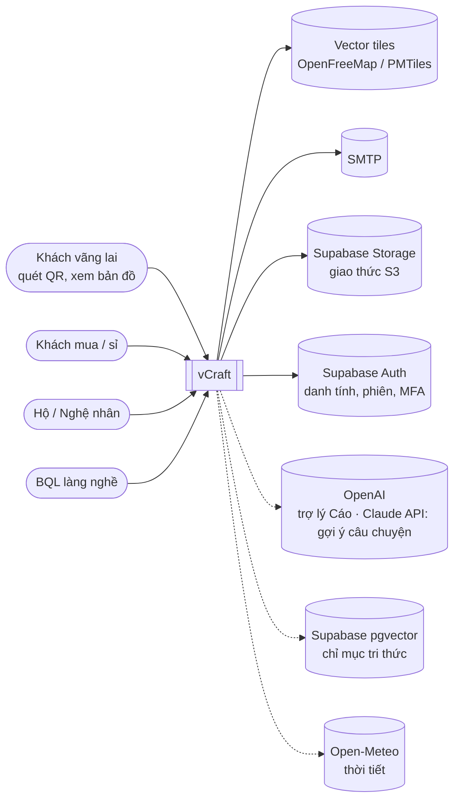
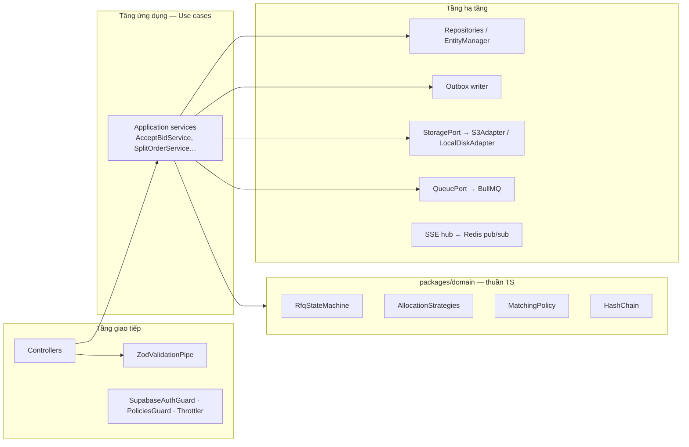
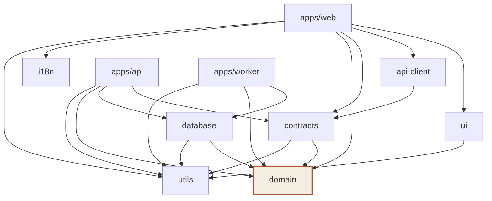
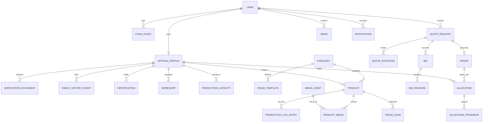
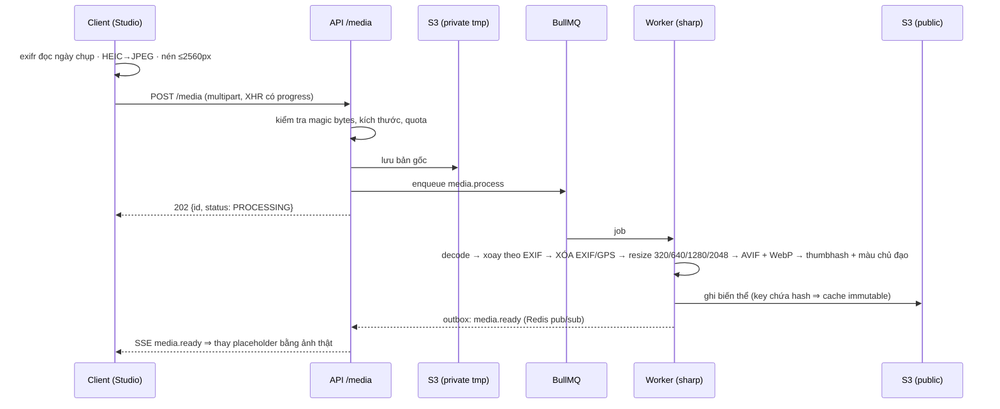
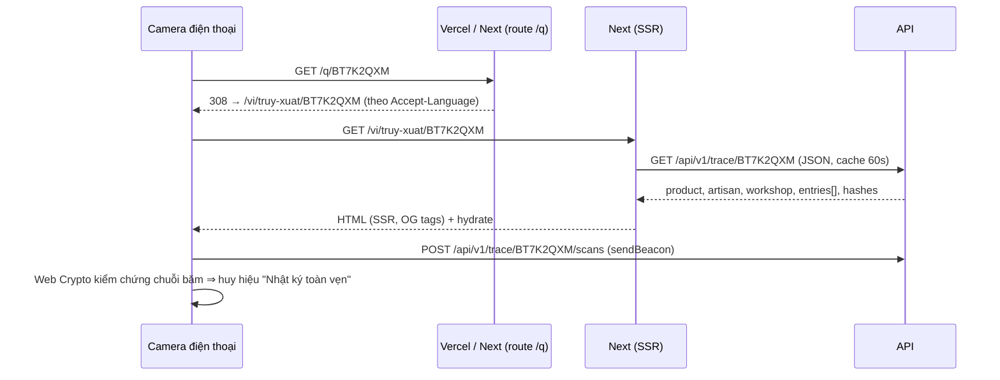
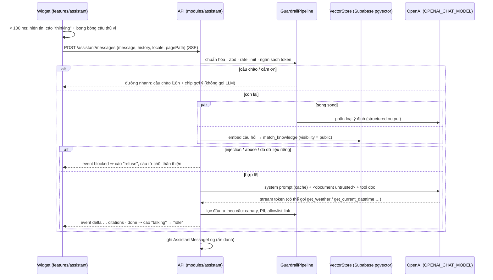

# vCraft — Kiến trúc hệ thống

> Phiên bản 1.0 · 27/10/2026 · Đi kèm [SRS.md](requirements/SRS.md), [PLAN.md](PLAN.md), [BRAND.md](design/BRAND.md)

---

## Mục lục

1. [Động lực kiến trúc](#1-động-lực-kiến-trúc)
2. [Tổng quan (C4)](#2-tổng-quan-c4)
3. [Monorepo](#3-monorepo)
4. [Backend](#4-backend)
5. [Design patterns](#5-design-patterns)
6. [Mô hình dữ liệu](#6-mô-hình-dữ-liệu)
7. [Luồng quan trọng](#7-luồng-quan-trọng)
8. [Bảo mật](#8-bảo-mật)
9. [Frontend](#9-frontend)
10. [Kiến trúc hoạt ảnh](#10-kiến-trúc-hoạt-ảnh)
11. [Hiệu năng & cache](#11-hiệu-năng--cache)
12. [Kiểm thử](#12-kiểm-thử)
13. [Triển khai & vận hành](#13-triển-khai--vận-hành)
14. [Quyết định kiến trúc (ADR)](#14-quyết-định-kiến-trúc-adr)

---

## 1. Động lực kiến trúc

Kiến trúc được chọn để mỗi tiêu chí chấm điểm có **bằng chứng nhìn thấy được** (demo) và **bằng chứng trong mã** (vấn đáp):

| Tiêu chí             | Quyết định kiến trúc tương ứng                                                                                                           |
| -------------------- | ---------------------------------------------------------------------------------------------------------------------------------------- |
| (1) Chức năng        | Modular monolith theo nghiệp vụ — mỗi nhóm FR là một module NestJS độc lập, làm song song được                                           |
| (3) Giao diện        | Lớp "experience" tách riêng trong frontend (3D, scroll story, transitions) + design system có token thương hiệu                          |
| (4) Hiệu năng / AJAX | Backend **chỉ là REST JSON API**; frontend lấy dữ liệu tương tác bằng `fetch` (TanStack Query), cập nhật DOM cục bộ; SSE đẩy thay đổi    |
| (5) Phong cách code  | Monorepo nhiều package có ranh giới cưỡng chế; domain thuần không phụ thuộc framework; pattern có tên                                    |
| (6) Nhập liệu        | Một bộ schema Zod dùng chung FE/BE                                                                                                       |
| (7) An ninh          | Danh tính ủy thác cho Supabase Auth (IdP), API tự kiểm chứng JWT qua JWKS; ủy quyền tập trung trong guards + policies; mã hóa nhiều tầng |
| (8) URL              | Định tuyến bản địa hóa ở Next, rewrite ở reverse proxy, redirect QR và slug cũ                                                           |
| (9) CSDL             | ORM Data Mapper (MikroORM): entity class, Unit of Work, đổi driver là đổi CSDL                                                           |

Thuộc tính chất lượng ưu tiên: **Tính đúng nghiệp vụ (khóa, trạng thái) > Trải nghiệm & thương hiệu > Hiệu năng > Khả năng mở rộng**.

---

## 2. Tổng quan (C4)

### 2.1 Mức 1 — Ngữ cảnh



### 2.2 Mức 2 — Container

```mermaid
flowchart TB
    browser["Trình duyệt<br/>(Next.js client: React 19, TanStack Query,<br/>GSAP, Motion, R3F, MapLibre)"]
    subgraph edge [Vercel — ADR-16; dev/dự phòng: Caddy]
      caddy{{"rewrite /api/* → api (Render)<br/>header bảo mật (next.config.ts)<br/>/* → web"}}
    end
    web["apps/web<br/>Next.js 16 (SSR shell, SEO, OG image,<br/>i18n routing, proxy.ts)"]
    api["apps/api<br/>NestJS 12 — REST JSON /api/v1 + SSE"]
    worker["apps/worker<br/>NestJS standalone + BullMQ<br/>(sharp, QR/PDF, mail, outbox, cron)"]
    db[("Supabase Postgres 17 — CSDL nghiệp vụ<br/>(kiểm chứng MySQL 8.4)")]
    redis[("Redis<br/>cache · queue · pub/sub")]
    s3[("Supabase Storage (S3)<br/>vcraft-media + vcraft-private")]
    supa[["Supabase Auth<br/>đăng nhập · refresh · MFA · OAuth"]]
    vec[("Supabase Postgres + pgvector<br/>knowledge_chunks (dẫn xuất)")]
    ai[["OpenAI (trợ lý) · Claude API (gợi ý)"]]

    browser -->|HTTPS| caddy
    browser -->|supabase-js: sign in/up, refresh| supa
    api -->|JWKS + admin API (secret key)| supa
    caddy --> web
    caddy --> api
    caddy --> s3
    web -->|fetch JSON khi SSR| api
    api --> db
    api --> redis
    api --> s3
    worker --> db
    worker --> redis
    worker --> s3
    redis -. pub/sub sự kiện .-> api
    api -->|RPC match_knowledge (secret key)| vec
    worker -->|upsert chunk + embedding| vec
    api -->|trả lời, phân loại| ai
    worker -->|embedding| ai
```

Điểm then chốt: **trình duyệt chỉ thấy một origin** (domain của web trên Vercel); `/api/*` được Next rewrite sang API trên Render ⇒ không cần CORS, không cookie xuyên origin, QR luôn trỏ về một domain ([ADR-16](adr/0016-deploy-vercel-render.md)). Trong dev và bản dự phòng tự host, Caddy làm đúng vai trò đó. Trình duyệt nói chuyện trực tiếp với Supabase **chỉ** cho việc xác thực; mọi dữ liệu nghiệp vụ đi qua `apps/api`.

### 2.3 Mức 3 — Thành phần trong `apps/api`



---

## 3. Monorepo

### 3.1 Cấu trúc thư mục

```
vCRAFT/
├── apps/
│   ├── web/                      # Next.js 16 — giao diện cho cả 4 lớp người dùng
│   │   ├── public/               # brand/, models/, map/style.json, fonts tự host
│   │   └── src/
│   │       ├── app/
│   │       │   ├── [locale]/
│   │       │   │   ├── (marketing)/        # trang chủ, giới thiệu làng
│   │       │   │   ├── (discover)/         # san-pham, nghe-nhan, ban-do, tin-tuc
│   │       │   │   ├── truy-xuat/[code]/   # landing truy xuất QR
│   │       │   │   ├── (auth)/             # đăng nhập, đăng ký, đăng ký hộ
│   │       │   │   ├── (buyer)/            # yêu cầu báo giá của tôi
│   │       │   │   ├── studio/             # khu vực Hộ (mobile-first)
│   │       │   │   └── admin/              # bảng điều khiển BQL
│   │       │   └── q/[code]/               # redirect QR ngắn
│   │       ├── features/         # "feature slices": components + hooks + view-models theo nghiệp vụ
│   │       │   ├── catalog/  artisan-profile/  products/  production-log/  traceability/
│   │       │   ├── village-map/  rfq/  orders/  news/  notifications/  auth/  admin/  assistant/
│   │       ├── experience/       # lớp trải nghiệm thương hiệu: hero-vase (R3F), scroll-story (GSAP), transitions
│   │       ├── providers/        # QueryClient, Theme, Motion, Lenis, Auth, SSE
│   │       ├── lib/              # cấu hình app (env, metadata, fonts)
│   │       └── styles/           # globals.css nhập token từ @vcraft/ui
│   ├── api/                      # NestJS 12 — REST JSON API + SSE
│   │   ├── src/
│   │   │   ├── modules/          # auth, users, artisans, workshops, products, production-logs,
│   │   │   │                     # traceability, catalog, village-map, rfq, bids, orders,
│   │   │   │                     # news, notifications, media, admin, assistant, health
│   │   │   ├── common/           # guards, interceptors, filters, pipes, decorators, policies
│   │   │   ├── infrastructure/   # storage, mail, cache, queue, realtime, crypto, vector, llm, weather (adapters)
│   │   │   └── config/           # cấu hình có kiểm tra bằng Zod
│   │   └── test/                 # integration/, concurrency/
│   └── worker/                   # tiến trình nền BullMQ
│       └── src/processors/       # media, qr-labels, mail, notifications, outbox, scheduler, assistant-ingest
├── packages/
│   ├── domain/        # lõi nghiệp vụ THUẦN: rfq/, allocation/, matching/, traceability/, shared/
│   ├── contracts/     # Zod schemas + kiểu DTO + mã lỗi — hợp đồng API giữa FE và BE
│   ├── database/      # MikroORM: entities/, repositories/, migrations/{postgresql,mysql}/, seeders/
│   ├── api-client/    # http/ (fetch có kiểu, refresh token, idempotency), queries/ (query keys + hooks), realtime/ (SSE)
│   ├── ui/            # design system: tokens/, components/, motion/, ornaments/, mascot/, hooks/, assets/
│   ├── i18n/          # messages/vi.json, en.json + pathnames
│   └── utils/         # vn/ (slug, đọc số, SĐT, địa giới), format/, validation/
├── tooling/
│   └── typescript/    # tsconfig dùng chung: base, library, nextjs, nestjs
├── tests/
│   ├── e2e/           # Playwright: specs/{public,buyer,artisan,admin}, fixtures/
│   └── load/          # k6: tranh chấp chốt giá, tải danh mục
├── infra/
│   ├── compose/       # compose.dev.yml (mysql*, redis, mailpit, caddy); CSDL + file trên Supabase
│   ├── docker/        # Dockerfile đa tầng cho web, api, worker
│   └── caddy/         # Caddyfile.dev (HTTP :8080), Caddyfile.prod (HTTPS tự động + HSTS), routes.caddy dùng chung; production chính là Vercel + Render (ADR-16), Caddy còn dùng cho dev và dự phòng
├── render.yaml        # Render Blueprint: api, worker, Key Value (ADR-16); web: apps/web/vercel.json; runbook: docs/operations/deploy.md
├── supabase/          # migrations/: vector store (ADR-13), bucket Storage (ADR-14), chặn Data API cho bảng nghiệp vụ (ADR-15)
├── docs/              # ARCHITECTURE, PLAN, README (index); requirements/ (SRS), design/ (BRAND), api/, operations/ (deploy), adr/, assistant-kb/ (FAQ vi/en)
├── scripts/           # script tiện ích phát triển (ci/, demo/, map/, brand/, mascot/)
├── .github/           # workflows/ci.yml, pull_request_template.md
├── package.json · pnpm-workspace.yaml · turbo.json · biome.json
├── .dependency-cruiser.cjs · lefthook.yml · .editorconfig · .nvmrc · .env.example
└── README.md
```

### 3.2 Đồ thị phụ thuộc & luật ranh giới



Luật (cưỡng chế bằng `.dependency-cruiser.cjs`, chạy trong CI):
1. `domain` không import framework, ORM hay workspace nào khác ⇒ test được 100% bằng unit test nhanh.
2. `web` **không** import `database` hay `apps/api` ⇒ frontend chỉ giao tiếp qua REST JSON.
3. `ui` không biết nghiệp vụ (không import `domain`, `contracts`, `api-client`).
4. `packages/*` không import `apps/*`.

Hai kiểu package nội bộ:
- **Compiled** (`domain`, `contracts`, `utils`, `database`): backend Node dùng nên build bằng **tsdown** ra `dist/index.mjs` (ESM, giữ decorator metadata cho MikroORM). Backend CommonJS nạp được nhờ `require(esm)` của Node ≥ 22. Trường `types` vẫn trỏ `src/` nên IDE/typecheck không phải chờ build; `turbo dev` chạy `tsdown --watch`.
- **Just-in-time** (`ui`, `i18n`, `api-client`): chỉ frontend dùng, export thẳng `src/index.ts`, Next tự biên dịch (`transpilePackages`).

### 3.3 Công cụ monorepo

- **pnpm workspaces** — cài đặt nhanh, `workspace:*`, chặn phụ thuộc ma.
- **Turborepo** — chạy tác vụ theo đồ thị, cache kết quả `build/test/typecheck` (local + remote).
- **Biome** — lint + format một công cụ; **Lefthook** — pre-commit + kiểm tra Conventional Commits.
- **TypeScript 6.0** (strict) cho typecheck; backend build bằng **SWC** (giữ decorator metadata cho NestJS). TypeScript 7 (native) chưa có API JavaScript mà Next, Nest CLI, MikroORM CLI cần ⇒ nâng cấp sau.

---

## 4. Backend

### 4.1 Phong cách: Modular Monolith + Clean Architecture nhẹ

Mỗi module trong `apps/api/src/modules/<tên>/`:

```
rfq/
├── rfq.module.ts
├── rfq.controller.ts            # HTTP: route, DTO in/out, không chứa logic nghiệp vụ
├── application/
│   ├── submit-rfq.service.ts    # 1 use case = 1 service, điều phối domain + repo + outbox
│   ├── accept-bid.service.ts
│   └── rfq.queries.ts           # truy vấn đọc (danh sách, chi tiết, so sánh)
├── rfq.policy.ts                # luật ủy quyền CASL cho tài nguyên RFQ
├── rfq.mapper.ts                # Entity → DTO (contracts)
└── rfq.events.ts                # tên/kiểu domain events
```

Quy tắc: Controller **mỏng** → Application service **điều phối** → Domain **quyết định** → Repository **lưu**. Không gọi ORM trong controller; không gọi HTTP/framework trong domain.

### 4.2 Hợp đồng API

- Tiền tố `/api/v1`, danh từ số nhiều, hành động trạng thái là **sub-resource động từ** rõ nghĩa:
  `POST /rfqs/{id}/submit`, `POST /rfqs/{id}/bids`, `POST /rfqs/{id}/bids/{bidId}/accept`, `POST /orders/{id}/allocations:split`, `POST /allocations/{id}/confirm`.
- Phân trang **con trỏ**: `?cursor=…&limit=24` → `{ data: [...], nextCursor }`.
- Lỗi **RFC 9457**: `{ type, title, status, code: "STALE_VERSION", detail, errors?: [{ path, message }] }`.
- Header: `ETag`/`If-None-Match` cho GET công khai; `If-Match: <version>` cho cập nhật; `Idempotency-Key` cho POST thay đổi trạng thái.
- Schema: `packages/contracts` (Zod 4) ⇒ `ZodValidationPipe` kiểm tra đầu vào; `z.toJSONSchema()` sinh OpenAPI 3.1; trang tài liệu tương tác `/api/docs` (Scalar).

### 4.3 Danh sách module

| Module            | Trách nhiệm                                                                                                                                                        | FR                  |
| ----------------- | ------------------------------------------------------------------------------------------------------------------------------------------------------------------ | ------------------- |
| `auth`            | `SupabaseAuthGuard` (kiểm chứng JWT/JWKS), cấp hồ sơ người dùng lần đầu, lời mời & khóa tài khoản qua Supabase admin API, lịch sử đăng nhập, kiểm `aal2` cho Admin | FR-AUTH             |
| `users`           | Hồ sơ người dùng, tùy chọn thông báo, xuất/xóa dữ liệu                                                                                                             | FR-AUTH, NFR-SEC-07 |
| `artisans`        | Hồ sơ hộ, lịch sử gia đình, chứng nhận, năng lực, kiểm duyệt                                                                                                       | FR-ART, FR-ADM      |
| `workshops`       | Xưởng, giờ mở cửa, trạng thái mở                                                                                                                                   | FR-ART-05           |
| `products`        | CRUD sản phẩm, media sản phẩm                                                                                                                                      | FR-PRD              |
| `production-logs` | Mốc nhật ký, mẫu công đoạn, chuỗi băm                                                                                                                              | FR-PRD-03…05        |
| `traceability`    | Mã truy xuất, QR, landing data, lượt quét                                                                                                                          | FR-TRC              |
| `catalog`         | Truy vấn danh mục/tìm kiếm/gợi ý                                                                                                                                   | FR-CAT              |
| `village-map`     | Ghim theo bbox, trạng thái mở cửa                                                                                                                                  | FR-MAP              |
| `rfq` / `bids`    | Máy trạng thái RFQ, ghép hộ, chào giá kín                                                                                                                          | FR-RFQ              |
| `orders`          | Đơn hàng, phân bổ, chia đơn, tiến độ                                                                                                                               | FR-ORD              |
| `news`            | Tin tức, giá vật liệu, lịch cúp điện                                                                                                                               | FR-NEWS             |
| `notifications`   | Thông báo in-app, SSE hub, email                                                                                                                                   | FR-NOTI             |
| `media`           | Upload, kiểm tra, đẩy job xử lý, URL ký                                                                                                                            | FR-MEDIA            |
| `admin`           | Dashboard, audit log                                                                                                                                               | FR-ADM              |
| `assistant`       | Trợ lý Cáo: định tuyến ý định, guardrail pipeline, truy hồi qua `VectorStore`, tool đọc, stream SSE, log ẩn danh                                                   | FR-AST              |
| `health`          | Kiểm tra sức khỏe                                                                                                                                                  | NFR-REL             |

### 4.4 Tầng dữ liệu — MikroORM (OOP & độc lập CSDL)

- **Entity là class TypeScript** có hành vi (vd. `Product.publish()`, `QuoteRequest.apply(event)` ủy quyền cho domain). Repository tùy biến cho truy vấn phức tạp (`ProductRepository.findCatalog(spec)`).
- **Unit of Work + Identity Map**: một request = một `EntityManager` fork; mọi thay đổi `flush()` một lần trong một giao dịch.
- **Khóa**: `@Property({ version: true }) version` (lạc quan); `em.findOne(QuoteRequest, id, { lockMode: LockMode.PESSIMISTIC_WRITE })` (bi quan) — API ORM, không SQL tay.
- **Độc lập CSDL** — `packages/database/src/mikro-orm.config.ts` chọn driver theo `DB_DRIVER`:
  - Chỉ dùng kiểu di động: `uuid` (v7 sinh ở app), `bigint` cho tiền, `decimal(9,6)` cho lat/lng, `json` cho cấu trúc nhỏ (giờ mở cửa), `datetime` UTC.
  - Không PostGIS: lọc bbox bằng `lat BETWEEN … AND lng BETWEEN …` + chỉ mục ghép; khoảng cách Haversine tính ở app.
  - Tìm kiếm không dấu: cột `search_text` (chữ thường, bỏ dấu, đ→d) sinh trong hook `@BeforeCreate/@BeforeUpdate` ⇒ `LIKE` hoạt động y hệt trên mọi CSDL. Cổng `SearchPort` cho phép thay bằng Meilisearch (tùy chọn).
  - Migrations sinh **riêng cho từng driver** (`migrations/postgresql`, `migrations/mysql`); seeder dùng chung (viết bằng entity).
  - CI chạy integration test trên **cả hai** CSDL.
- **SQL tay** (theo [AGENTS.md §3](../AGENTS.md#3-luật-bắt-buộc-khi-viết-code)): chỉ khi ORM không diễn đạt được hoặc quá chậm; chỉ nằm trong repository/migration; luôn tham số hóa; SQL chuẩn chạy được cả hai CSDL hoặc tách cài đặt theo driver sau cùng interface repository.
- **Vector store** của trợ lý không thuộc tầng này: nằm ở Supabase (pgvector), truy cập qua port `VectorStore` trong `apps/api/src/infrastructure/vector` (ADR-13).

### 4.5 Sự kiện, hàng đợi, realtime

- **Domain events** phát trong application service → ghi **Outbox** cùng giao dịch (BR-L8) → worker đọc outbox → (a) đẩy Redis pub/sub cho SSE, (b) tạo `Notification`, (c) gửi email.
- **BullMQ queues**: `media.process`, `qr.labels`, `mail.send`, `outbox.dispatch`, `rfq.expire` (job hẹn giờ theo `biddingClosesAt`), `rfq.coordination-check`, `assistant.ingest` (nghe outbox `product/workshop/news.*` để cập nhật chỉ mục tri thức).
- **SSE**: `GET /api/v1/events/stream` (fetch-based EventSource kèm `Authorization`), mỗi người dùng một kênh `user:{id}` + kênh chủ đề `rfq:{id}` khi đang mở trang RFQ. Nhiều instance API đồng bộ qua Redis pub/sub.

---

## 5. Design patterns

| Pattern                                             | Ở đâu                                                                              | Vì sao                                                   |
| --------------------------------------------------- | ---------------------------------------------------------------------------------- | -------------------------------------------------------- |
| **State** (bảng chuyển trạng thái + guard)          | `packages/domain/src/rfq/rfq-state-machine.ts`                                     | Luồng báo giá phức tạp; dùng chung FE/BE; test đầy đủ    |
| **Strategy**                                        | `domain/allocation/strategies/{capacity,cheapest,balanced}.ts`, `domain/matching/` | Thay thuật toán chia đơn/ghép hộ không sửa client        |
| **Repository + Unit of Work + Data Mapper**         | `packages/database` (MikroORM)                                                     | Thao tác CSDL hướng đối tượng, độc lập CSDL              |
| **Specification**                                   | `catalog/specs/*.ts` (lọc giá, danh mục, mở cửa)                                   | Kết hợp điều kiện lọc có thể tái dùng                    |
| **Observer / Domain Events + Transactional Outbox** | `*.events.ts`, `OutboxEvent`, worker                                               | Tách tác dụng phụ (thông báo, mail) khỏi giao dịch chính |
| **Adapter / Port**                                  | `infrastructure/storage` (S3/Local), `mail` (SMTP/Console), `search`, `vector` (Supabase/InMemory), `llm` (OpenAI/Fake) | Hoán đổi hạ tầng, test bằng fake                         |
| **Factory**                                         | `MediaVariantFactory`, `TraceCodeFactory`, `QrFactory`                             | Đóng gói quy tắc tạo đối tượng                           |
| **Value Object**                                    | `Money`, `GeoPoint`, `OpeningHours`, `TraceCode`                                   | Bất biến, tự kiểm tra hợp lệ                             |
| **Policy (ABAC)**                                   | `*.policy.ts` + CASL                                                               | Ủy quyền theo vai trò + sở hữu ở một chỗ                 |
| **Decorator**                                       | `@Roles()`, `@CurrentUser()`, `@Idempotent()`, `@Audit()`                          | Cắt ngang (cross-cutting) khai báo                       |
| **Facade**                                          | `packages/api-client`                                                              | Che giấu refresh token, retry, idempotency khỏi UI       |
| **Container / Presentational + custom hooks**       | `apps/web/src/features/*`                                                          | Tách mã tạo giao diện khỏi mã nghiệp vụ (tiêu chí 5)     |
| **Chain of Responsibility**                         | Pipeline xử lý ảnh: validate → decode → strip → resize → encode → hash; `GuardrailPipeline` của trợ lý | Mỗi bước độc lập, dễ test                                |

Ví dụ lõi State pattern (minh họa thiết kế):

```ts
// packages/domain/src/rfq/rfq-state-machine.ts
export const RFQ_TRANSITIONS = {
  DRAFT: { SUBMIT: 'SENT', CANCEL: 'CANCELLED' },
  SENT: { RECEIVE_BID: 'BIDDING', CANCEL: 'CANCELLED', EXPIRE: 'EXPIRED' },
  BIDDING: { ACCEPT_BID: 'ACCEPTED', CANCEL: 'CANCELLED', EXPIRE: 'EXPIRED' },
  ACCEPTED: { START_PRODUCTION: 'IN_PRODUCTION', ADMIN_CANCEL: 'CANCELLED' },
  IN_PRODUCTION: { CONFIRM_DELIVERY: 'DELIVERED' },
  DELIVERED: {},
  CANCELLED: {},
  EXPIRED: {},
} as const satisfies Record<RfqStatus, Partial<Record<RfqEvent, RfqStatus>>>;

/** Trả về trạng thái kế tiếp hoặc ném DomainError('INVALID_TRANSITION' | <guard code>). (SRS §4.1) */
export function transition(rfq: RfqSnapshot, event: RfqEvent, ctx: TransitionContext): RfqStatus;

/** Các sự kiện mà `actor` được phép kích hoạt lúc này — frontend dùng để render nút. */
export function availableEvents(rfq: RfqSnapshot, actor: Actor, now: Date): RfqEvent[];
```

---

## 6. Mô hình dữ liệu



Thuộc tính chính (rút gọn):

| Entity                 | Thuộc tính đáng chú ý                                                                                                                                                                                      | Ràng buộc / chỉ mục                                                 |
| ---------------------- | ---------------------------------------------------------------------------------------------------------------------------------------------------------------------------------------------------------- | ------------------------------------------------------------------- |
| `User`                 | `id uuid` (= `sub` của Supabase, **không** FK sang schema `auth`), `email`, `fullName`, `phone`, `role {ADMIN,ARTISAN,BUYER}`, `status {ACTIVE,SUSPENDED}`, `locale`, `version`                            | UNIQUE(email)                                                       |
| `LoginEvent`           | `userId`, `occurredAt`, `userAgent`, `ipHash`, `country`, `method {PASSWORD,OAUTH,MFA}`                                                                                                                    | IDX(userId, occurredAt) · append-only                               |
| `ArtisanProfile`       | `householdName`, `slug`, `story`, `foundedYear`, `generations`, `status {DRAFT,PENDING_REVIEW,NEEDS_INFO,APPROVED,REJECTED,SUSPENDED}`, `ratingAvg`, `responseRate`, `onTimeRate`, `searchText`, `version` | UNIQUE(slug), IDX(status)                                           |
| `VerificationDocument` | `kind {CCCD,RESIDENCE,WORKSHOP_PHOTO}`, `numberEnc` (AES-GCM), `mediaId` (private)                                                                                                                         | —                                                                   |
| `Workshop`             | `address`, `communeCode`, `lat decimal(9,6)`, `lng decimal(9,6)`, `openingHours json`, `acceptsVisitors`, `experience json?`, `temporarilyClosed`, `closedReason`                                          | IDX(lat, lng)                                                       |
| `Product`              | `artisanId`, `categoryId`, `name`, `slug`, `traceCode`, `priceVnd bigint`, `isUnique`, `stock`, `status`, `coverMediaId`, `searchText`, `publishedAt`, `deletedAt`, `version`                              | UNIQUE(traceCode), UNIQUE(slug), IDX(categoryId,status,publishedAt) |
| `ProductionLogEntry`   | `productId`, `seq`, `stageCode`, `occurredAt`, `note`, `mediaIds json`, `correctsEntryId?`, `prevHash`, `hash`                                                                                             | UNIQUE(productId, seq) · append-only                                |
| `MediaAsset`           | `ownerId`, `visibility`, `status {PROCESSING,READY,FAILED}`, `originalKey`, `width`, `height`, `checksum`, `thumbhash`, `dominantColor`, `variants json`                                                   | IDX(ownerId, checksum)                                              |
| `QuoteRequest`         | `code`, `buyerId`, `categoryId`, `quantity`, `unit`, `budgetMinVnd?`, `budgetMaxVnd?`, `requiredBy`, `biddingClosesAt`, `status`, `needsCoordination`, `coordinatorId?`, `acceptedBidId?`, `version`       | UNIQUE(code), IDX(status, biddingClosesAt)                          |
| `Bid`                  | `rfqId`, `artisanId?`, `type {INDIVIDUAL,COOPERATIVE}`, `unitPriceVnd`, `quantityOffered`, `leadTimeDays`, `deliveryDate`, `allocationPlan json?`, `status`, `revision`, `version`                         | **UNIQUE(rfqId, artisanId)**                                        |
| `Order`                | `rfqId`, `buyerId`, `quantity`, `totalVnd`, `dueDate`, `version`                                                                                                                                           | UNIQUE(rfqId)                                                       |
| `Allocation`           | `orderId`, `artisanId`, `quantity`, `unitPriceVnd`, `dueDate`, `status`, `completedQty`, `version`                                                                                                         | IDX(orderId), IDX(artisanId, status)                                |
| `News`                 | `slug`, `category`, `audience {PUBLIC,ARTISANS}`, `contentJson`, `contentHtml` (đã làm sạch), `pinned`, `status`, `publishAt`                                                                              | UNIQUE(slug)                                                        |
| `OutboxEvent`          | `type`, `payload json`, `status`, `attempts`, `availableAt`                                                                                                                                                | IDX(status, availableAt)                                            |
| `IdempotencyKey`       | `key`, `userId`, `requestHash`, `responseStatus`, `responseBody json`, `expiresAt`                                                                                                                         | UNIQUE(userId, key)                                                 |
| `AuditLog`             | `actorId`, `action`, `entity`, `entityId`, `before json`, `after json`, `ipHash`                                                                                                                           | IDX(entity, entityId) · append-only                                 |
| `SlugRedirect`         | `entity`, `oldSlug`, `entityId`                                                                                                                                                                            | UNIQUE(entity, oldSlug) — phục vụ 301                               |
| `AssistantMessageLog`  | `conversationId`, `ipHash`, `locale`, `pagePath`, `intent`, `blocked bool`, `blockReason`, `latencyFirstTokenMs`, `tokensIn/Out`, `feedback {UP,DOWN,null}`, `createdAt` (không lưu nguyên văn tin bị chặn chứa PII) | IDX(createdAt) · xóa sau 30 ngày bằng job                           |

Ngoài CSDL nghiệp vụ (Supabase, ADR-13): `knowledge_chunks(id, source_type, source_id, locale, url, visibility, content, embedding vector, source_updated_at)` + index HNSW; dựng lại toàn bộ bằng `pnpm assistant:reindex`.

---

## 7. Luồng quan trọng

### 7.1 Upload & tối ưu ảnh



Frontend hiển thị bằng `<picture>` (AVIF → WebP) với `srcset` + `sizes`, `loading="lazy"`, `decoding="async"`, nền thumbhash ⇒ không giật layout, "hiện dần" mượt. Next `<Image>` dùng **custom loader** trỏ thẳng biến thể đã sinh (không tối ưu lần hai).

### 7.2 Quét QR → trang truy xuất



### 7.3 Chốt chào giá có khóa (chống tranh chấp)

```mermaid
sequenceDiagram
    participant B1 as Buyer tab 1
    participant B2 as Buyer tab 2
    participant A as AcceptBidService
    participant D as DB
    B1->>A: POST /rfqs/42/bids/7/accept (If-Match: v5, Idempotency-Key)
    B2->>A: POST /rfqs/42/bids/9/accept (If-Match: v5, Idempotency-Key)
    A->>D: BEGIN; SELECT rfq 42 FOR UPDATE   (B1 giữ khóa)
    Note over A,D: B2 chờ khóa
    A->>A: domain.transition(BIDDING, ACCEPT_BID, ctx{actor, now, bid, …}) ✓
    A->>D: UPDATE rfq v6, bids, INSERT order, allocations, outbox; COMMIT
    A-->>B1: 200 ACCEPTED
    A->>D: (B2) lấy khóa, đọc rfq v6 status=ACCEPTED
    A->>A: domain.transition(ACCEPTED, ACCEPT_BID, ctx) ✗ INVALID_TRANSITION
    A-->>B2: 409 Problem Details
    Note over B1,B2: SSE rfq:42 → cả hai tab cập nhật stepper + bảng bid
```

### 7.4 Điều phối & chia nhỏ đơn

1. Job `rfq.coordination-check` đánh dấu `needsCoordination` (FR-ORD-01) → thông báo Admin.
2. Admin `POST /rfqs/{id}/coordination:claim` (khóa lạc quan trên `coordinatorId`).
3. `GET /rfqs/{id}/allocation-proposals?strategy=capacity|cheapest|balanced` → domain trả 3 phương án (số lượng, chi phí, ngày xong dự kiến).
4. Admin chỉnh trên **bảng kéo-thả** → `POST /rfqs/{id}/bids` với `type=COOPERATIVE, allocationPlan[]` (domain kiểm BR-L6).
5. Buyer chốt như thường (§7.3) ⇒ Order + Allocations `PROPOSED` ⇒ hộ xác nhận ⇒ `START_PRODUCTION`.

### 7.5 Xác thực với Supabase Auth

```mermaid
sequenceDiagram
    participant C as Client (Next + @supabase/ssr)
    participant S as Supabase Auth
    participant A as API (SupabaseAuthGuard)
    participant D as DB vCraft
    C->>S: signInWithPassword / OAuth Google (+ Turnstile token)
    S-->>C: session {access JWT 15′, refresh token} → cookie do @supabase/ssr quản lý
    opt Admin
      C->>S: mfa.challengeAndVerify (TOTP) ⇒ JWT aal2
    end
    C->>A: GET /api/v1/me (Authorization: Bearer <access JWT>)
    A->>A: verifyAuth(): kiểm chữ ký qua JWKS (cache), iss, aud, exp
    A->>D: tìm User theo sub (cache Redis 60s); chưa có ⇒ tạo hồ sơ (role BUYER); ghi LoginEvent
    A->>A: status = SUSPENDED ⇒ 403 · route Admin cần aal2
    A-->>C: 200 {user, role, permissions}
    Note over C,S: access token hết hạn ⇒ supabase-js tự refresh (xoay vòng, phát hiện dùng lại)
    Note over A,S: Admin duyệt/khóa hộ ⇒ API cập nhật DB vCraft + gọi auth.admin (ban, invite) bằng secret key
```

Nguyên tắc:
- **Supabase = danh tính** (ai đó là ai), **vCraft = quyền** (người đó được làm gì). Vai trò, trạng thái, quyền sở hữu nằm trong CSDL vCraft, vì vậy CSDL nghiệp vụ vẫn độc lập và chuyển sang MySQL được.
- Hồ sơ `User` được tạo **lười** ở request đầu tiên (không dùng trigger trong schema `auth`, vì trigger không di động được).
- `SupabaseAuthGuard` là guard NestJS tự viết, bọc `verifyAuth()` của `@supabase/server`. Không dùng adapter NestJS có sẵn vì adapter chỉ hỗ trợ Nest 10/11 và sẽ bị gỡ vào 01/12/2026.
- Secret key Supabase chỉ có trong `apps/api`/`apps/worker`; frontend chỉ dùng publishable key.
- Email xác thực gửi qua **SMTP riêng** cấu hình trong Supabase (SMTP mặc định giới hạn vài email/giờ), mẫu email tiếng Việt theo [BRAND](design/BRAND.md).

### 7.6 Trợ lý Cáo (RAG + guardrail)

Model and embeddings: OpenAI, set by `OPENAI_CHAT_MODEL` and `OPENAI_EMBEDDING_MODEL` at 1024 dimensions ([ADR-19](adr/0019-assistant-on-openai.md)); the vector store stays on Supabase pgvector (ADR-13).



Nguyên tắc:
- Trợ lý **chỉ đọc**: tool trong allowlist (BR-AST-02) gọi API với quyền Guest, không mượn token người dùng.
- Mọi văn bản đi vào prompt từ nguồn ngoài (tài liệu truy hồi, mô tả do hộ tự viết, kết quả tool) được bọc là **dữ liệu không tin cậy**.
- Chỉ mục tri thức là dữ liệu dẫn xuất: worker cập nhật từ outbox; xóa/dựng lại được bất cứ lúc nào (ADR-13).
- `VectorStore` và `LlmClient` là port; test và CI dùng `InMemoryVectorStore` + `FakeLlmClient` nên không cần mạng.

---

## 8. Bảo mật

### 8.1 Phòng thủ theo lớp

| Lớp            | Biện pháp                                                                                                                                                                                 |
| -------------- | ----------------------------------------------------------------------------------------------------------------------------------------------------------------------------------------- |
| Truyền tải     | HTTPS bắt buộc (Vercel tự cấp chứng chỉ; Caddy + Let's Encrypt khi tự host), HSTS đặt ở `next.config.ts` (ADR-16), HTTP/2–3 |
| Trình duyệt    | CSP có nonce (`script-src 'self' 'nonce-…'`, `connect-src 'self' https://<ref>.supabase.co`), `frame-ancestors 'none'`, `X-Content-Type-Options`, `Referrer-Policy`, `Permissions-Policy` |
| Xác thực       | Supabase Auth (bcrypt, chặn mật khẩu đã lộ); JWT ký bất đối xứng, API kiểm qua JWKS; refresh xoay vòng + phát hiện dùng lại; MFA TOTP bắt buộc với Admin (`aal2`); CAPTCHA Turnstile      |
| Phiên          | Access token 15′; đăng xuất thiết bị khác / toàn bộ; lịch sử đăng nhập (`LoginEvent`); khóa tài khoản ⇒ chặn ngay ở API (trạng thái trong DB) + ban trên Supabase                         |
| Ủy quyền       | `SupabaseAuthGuard` → `PoliciesGuard` (CASL) ở **mọi** route; kiểm sở hữu ở tầng truy vấn (`where: { artisan: user.artisanId }`) chống IDOR                                               |
| Đầu vào        | Zod ở biên API; ORM tham số hóa; HTML tin tức làm sạch bằng sanitize-html theo whitelist                                                                                                  |
| CSRF           | API nghiệp vụ chỉ nhận `Authorization: Bearer` (trình duyệt không tự gửi) ⇒ miễn nhiễm CSRF; cookie phiên của `@supabase/ssr` là `SameSite=Lax`                                           |
| Upload         | Magic bytes, cấm SVG, giới hạn kích thước/pixel, mã hóa lại bằng sharp, bucket riêng tư cho giấy tờ                                                                                       |
| Trợ lý AI      | `GuardrailPipeline` 7 lớp (§7.6, NFR-SEC-09): chuẩn hóa + giới hạn, phân loại trước, prompt có ranh giới dữ liệu, chỉ mục chỉ có dữ liệu công khai, chỉ tool đọc, lọc đầu ra (canary, PII, allowlist link, không HTML/ảnh ngoài), giám sát + red-team |
| Dữ liệu nghỉ   | AES-256-GCM mức trường (số CCCD, [ADR-18](adr/0018-field-level-encryption.md)), khóa có phiên bản `v1:` để xoay (`pnpm db:rotate-field-keys`); giấy tờ ở bucket riêng tư, URL ký 5 phút; IP băm có salt                                                                                                |
| Lạm dụng       | `@nestjs/throttler` (Redis): 100 req/phút/IP cho API; endpoint xác thực có rate limit + CAPTCHA của Supabase                                                                              |
| Kiểm toán      | `@Audit()` ghi `AuditLog` cho hành động Admin và từ chối truy cập                                                                                                                         |
| Chuỗi cung ứng | `pnpm audit`, Renovate, lockfile cố định, không commit `.env`                                                                                                                             |
| Dữ liệu cá nhân | NFR-SEC-07 ([ADR-17](adr/0017-personal-data-export-and-deletion.md)): recorded consent per purpose and policy version (`consent_record`, enforced by the API), `GET /me/data-export`, `DELETE /me` (anonymizes and keeps orders and the hash-chained journal valid) |

### 8.2 Bảng OWASP Top 10 (2021) → biện pháp

Evidence per item (code and tests), with the known gaps: [`docs/security/owasp-top10.md`](security/owasp-top10.md). The route walker that checks every API route's auth policy is `apps/api/src/common/auth/route-policy.test.ts` plus `apps/api/test/integration/route-policy.integration.test.ts`.

A01 Broken Access Control → CASL + kiểm sở hữu + test 403 · A02 Cryptographic Failures → JWT bất đối xứng + JWKS, AES-GCM, TLS · A03 Injection → ORM + Zod + sanitize · A04 Insecure Design → máy trạng thái + khóa + idempotency · A05 Misconfiguration → header bảo mật, config kiểm bằng Zod · A06 Vulnerable Components → audit/Renovate · A07 Auth Failures → Supabase Auth (MFA, CAPTCHA, rate limit, rotation) · A08 Integrity Failures → chuỗi băm nhật ký, lockfile · A09 Logging Failures → pino + audit, không log bí mật · A10 SSRF → không fetch URL do người dùng nhập (geocode qua danh sách endpoint cố định).

**OWASP LLM Top 10 (trợ lý Cáo):** LLM01 Prompt Injection → phân loại trước + tài liệu đánh dấu không tin cậy + canary · LLM02 Sensitive Info Disclosure → chỉ mục chỉ có dữ liệu công khai + che PII đầu ra · LLM05 Improper Output Handling → markdown đã sanitize, allowlist link, không ảnh ngoài · LLM06 Excessive Agency → chỉ tool đọc, quyền Guest · LLM07 System Prompt Leakage → không để bí mật trong prompt + canary · LLM08 Vector Weaknesses → RLS chặn `anon`/`authenticated`, lọc `visibility` · LLM10 Unbounded Consumption → rate limit, `max_tokens`, trần token/ngày.

### 8.3 Ma trận phân quyền (RBAC + ABAC)

| Tài nguyên / Hành động                             | Guest | Buyer                          | Artisan                  | Admin             |
| -------------------------------------------------- | ----- | ------------------------------ | ------------------------ | ----------------- |
| Xem sản phẩm, hộ, bản đồ, truy xuất, tin công khai | ✓     | ✓                              | ✓                        | ✓                 |
| Xem tin "chỉ hộ"                                   | —     | —                              | ✓                        | ✓                 |
| Tạo/sửa sản phẩm, mốc nhật ký                      | —     | —                              | ✓_(của mình)_            | ✓ (khóa/ẩn)       |
| Tạo RFQ, chốt bid, xác nhận nhận hàng              | —     | ✓_(RFQ của mình)_              | —                        | ✓_(thay mặt)_     |
| Xem RFQ                                            | —     | ✓_(của mình)_                  | ✓_(được mời)_            | ✓                 |
| Chào giá / sửa / rút                               | —     | —                              | ✓_(được mời, trước hạn)_ | ✓_(bid liên kết)_ |
| Xem bid                                            | —     | ✓_(mọi bid trên RFQ của mình)_ | ✓**_chỉ bid của mình_**  | ✓                 |
| Xác nhận phân bổ, cập nhật tiến độ                 | —     | —                              | ✓_(phân bổ của mình)_    | ✓                 |
| Duyệt hộ, chia đơn, quản lý tin, xem audit         | —     | —                              | —                        | ✓                 |
| Hỏi trợ lý Cáo (chỉ thấy dữ liệu công khai)        | ✓     | ✓                              | ✓                        | ✓ (+ thống kê)    |

---

## 9. Frontend

### 9.1 Chiến lược render

| Khu vực                                         | Render                                                                             | Lý do                              |
| ----------------------------------------------- | ---------------------------------------------------------------------------------- | ---------------------------------- |
| Trang chủ, hồ sơ hộ, chi tiết sản phẩm, tin tức | SSR + revalidate (ISR 60s) cho **khung & SEO**; phần tương tác là client component | SEO, OG image, LCP tốt             |
| Truy xuất QR                                    | SSR (dữ liệu nhỏ, mobile, cần nhanh)                                               | Người quét chờ ít nhất             |
| Danh mục, bản đồ, tìm kiếm                      | Shell SSR + **dữ liệu client (fetch JSON)** đồng bộ URL                            | Lọc/cuộn không tải lại             |
| Studio, Admin, RFQ của tôi                      | **CSR hoàn toàn** sau đăng nhập (`'use client'` + TanStack Query)                  | Dữ liệu cá nhân, tương tác dày đặc |

Nguyên tắc cho tiêu chí (4): **mọi dữ liệu tương tác đi qua `@vcraft/api-client` → `fetch` → REST JSON → TanStack Query cache → React cập nhật DOM**. Không dùng Server Actions cho nghiệp vụ (để mọi thao tác đều là API JSON quan sát được trong tab Network).

### 9.2 Lớp dữ liệu

- `api-client/http`: wrapper `fetch` có kiểu (sinh từ OpenAPI bằng openapi-typescript + openapi-fetch), lấy access token từ phiên Supabase (`supabase.auth.getSession()`), gặp 401 thì làm mới phiên rồi thử lại một lần, tự sinh `Idempotency-Key`, chuyển Problem Details thành `ApiError`.
- `api-client/queries`: **query key factory** (`rfqKeys.detail(id)`), hooks `useRfq`, `useAcceptBid`… với **cập nhật lạc quan** + rollback.
- `api-client/realtime`: SSE → `queryClient.invalidateQueries` / `setQueryData` theo loại sự kiện.
- **URL state** (bộ lọc, tab, trang) bằng `nuqs` ⇒ chia sẻ được, back/forward đúng.
- **UI state** cục bộ: `useState`/Zustand (chỉ cho trạng thái UI toàn cục nhỏ: command palette, drawer).
- **Form**: React Hook Form + `zodResolver(schema từ @vcraft/contracts)`.

### 9.3 Tổ chức component (tách giao diện ↔ nghiệp vụ)

```
features/rfq/
├── api.ts                 # tái xuất hooks từ @vcraft/api-client cho feature này
├── hooks/use-rfq-actions.ts   # view-model: availableEvents() từ domain + mutation
├── components/            # presentational, chỉ nhận props
│   ├── rfq-stepper.tsx
│   ├── bid-comparison-table.tsx
│   └── bid-form.tsx
└── containers/rfq-detail.tsx  # nối hooks ↔ components
```

### 9.4 Định tuyến & URL (tiêu chí 8)

- `next-intl` với **pathnames bản địa hóa**: `/vi/san-pham` ↔ `/en/products`, `/vi/truy-xuat/[code]` ↔ `/en/trace/[code]`.
- `proxy.ts` (Next 16): phát hiện locale, redirect `/q/:code` (308), làm mới cookie phiên Supabase (`@supabase/ssr`) và chặn route `studio/*` & `admin/*` khi chưa đăng nhập (phân quyền thật vẫn ở API), 301 slug cũ (tra `SlugRedirect`).
- Slug sản phẩm = `slugify(tên)` + `-` + `traceCode` viết thường ⇒ đổi tên không gãy link.
- `sitemap.ts`, `robots.ts`, `generateMetadata` + `opengraph-image.tsx` động.
- `/api/*` cùng origin: rewrite trong `next.config.ts` (production, ADR-16) hoặc Caddy `/api/*`, `/media/*` (dev, dự phòng tự host).

---

## 10. Kiến trúc hoạt ảnh

| Lớp                              | Công cụ                                                                                        | Dùng cho                                     |
| -------------------------------- | ---------------------------------------------------------------------------------------------- | -------------------------------------------- |
| Cuộn                             | **Lenis** (cuộn mượt) đồng bộ với GSAP ticker                                                  | Toàn trang công khai (tắt ở Studio/Admin)    |
| Kể chuyện theo cuộn              | **GSAP 3 + ScrollTrigger + SplitText + DrawSVG** (`@gsap/react` `useGSAP`)                     | Hero, timeline nhật ký, lịch sử gia đình     |
| Hoạt ảnh component/layout/cử chỉ | **Motion** (`motion/react`): `layout`, `AnimatePresence`, spring, drag                         | Thẻ, modal, danh sách, bảng chia đơn         |
| Chuyển trang                     | **View Transitions API** (phần tử chia sẻ: ảnh thẻ → ảnh chi tiết), fallback Motion `layoutId` | Danh mục ↔ chi tiết                          |
| 3D                               | **React Three Fiber + drei** — bình gốm `LatheGeometry` thủ tục + shader men                   | Hero trang chủ, landing truy xuất (tùy chọn) |
| Vi tương tác                     | CSS (`@starting-style`, transitions) + SVG filter                                              | Nút, ấn triện, ghim bản đồ                   |

Quy tắc:
- Token thời lượng/easing tập trung ở `packages/ui/src/motion/tokens.ts` (xem [BRAND §6](design/BRAND.md#6-ngôn-ngữ-chuyển-động)).
- Mọi hook hoạt ảnh đọc `useReducedMotion()`; 3D chỉ tải khi `IntersectionObserver` thấy + thiết bị đủ mạnh (`navigator.hardwareConcurrency ≥ 4`, có WebGL2), ngược lại dùng ảnh poster/video ngắn.
- Chỉ animate `transform`/`opacity`/`filter`; `will-change` bật/tắt quanh hoạt ảnh; 3D dừng render khi ra khỏi màn hình (`frameloop="demand"`).

---

## 11. Hiệu năng & cache

| Tầng         | Kỹ thuật                                                                                                                                                                                                                                                            |
| ------------ | ------------------------------------------------------------------------------------------------------------------------------------------------------------------------------------------------------------------------------------------------------------------- |
| Trình duyệt  | TanStack Query (staleTime theo loại dữ liệu), prefetch khi hover link, ảnh `srcset` + lazy + thumbhash, font tự host `font-display: swap` + subset vietnamese, tách bundle theo route, `dynamic()` cho MapLibre/R3F/Tiptap, ảo hóa danh sách dài (TanStack Virtual) |
| Edge / proxy | zstd/gzip, `Cache-Control: immutable` cho media & static, HTTP/2                                                                                                                                                                                                    |
| Next         | ISR 60s trang công khai, OG image cache                                                                                                                                                                                                                             |
| API          | ETag/304 cho GET công khai; Redis cache-aside (danh mục cây, ghim bản đồ, landing truy xuất — TTL 60s, xóa khi có thay đổi qua event)                                                                                                                               |
| CSDL         | Chỉ mục theo truy vấn (§6), phân trang con trỏ (không OFFSET), `populate` có chọn lọc, tránh N+1 bằng dataloader của ORM                                                                                                                                            |
| Nền          | Xử lý ảnh, email, PDF chạy ở worker, API phản hồi ngay                                                                                                                                                                                                              |

---

## 12. Kiểm thử

| Loại        | Công cụ                                                       | Phạm vi                                                                                                                                          | Mục tiêu           |
| ----------- | ------------------------------------------------------------- | ------------------------------------------------------------------------------------------------------------------------------------------------ | ------------------ |
| Unit        | Vitest                                                        | `packages/domain` (máy trạng thái — mọi cặp trạng thái×sự kiện, chiến lược chia đơn — property-based với fast-check: Σ = Q, ≤ năng lực), `utils` | ≥ 95%              |
| Component   | Vitest + Testing Library                                      | Form, bảng so sánh, stepper                                                                                                                      | Luồng chính        |
| Integration | Vitest + Testcontainers (PostgreSQL **và** MySQL) + Supertest | Module API, phân quyền (403), khóa                                                                                                               | ≥ 70% API          |
| Concurrency | Integration + k6                                              | 50 request chốt đồng thời ⇒ đúng 1 thành công                                                                                                    | Xanh               |
| E2E         | Playwright                                                    | 3 hành trình vai trò + quét QR (mở URL) + responsive 360/1440                                                                                    | Xanh trên CI       |
| A11y        | `@axe-core/playwright`                                        | Trang chính                                                                                                                                      | 0 lỗi nghiêm trọng |
| Red-team AI | Vitest (`tests/assistant-redteam/`), mock mỗi PR + API thật nightly | ≥ 60 câu tấn công + ≥ 80 câu hợp lệ (chào, ngày giờ, thời tiết, xã giao, nghiệp vụ)                                                             | ≥ 95% chặn đúng · 0 rò canary/PII · chặn nhầm ≤ 3% |
| Hiệu năng   | Lighthouse CI                                                 | Trang chủ, danh mục, truy xuất                                                                                                                   | Ngưỡng NFR-PERF-02 |

---

## 13. Triển khai & vận hành

### 13.1 Môi trường

| Môi trường    | Cách chạy                                                                                                                                                          |
| ------------- | ------------------------------------------------------------------------------------------------------------------------------------------------------------------ |
| Dev           | `pnpm infra:up` (Redis, Mailpit, Caddy) + `pnpm dev`; CSDL + file trên Supabase (ADR-14, ADR-15)                                                                   |
| Demo/Prod     | **Web trên Vercel; API, worker và Redis (Render Key Value) trên Render; CSDL, Auth, file trên Supabase** (ADR-16, [deploy.md](operations/deploy.md)). Tên miền thật ⇒ Vercel tự cấp HTTPS (QR quét được từ điện thoại giám khảo). ~~1 VPS + Docker Compose + Caddy~~: bị thay thế bởi ADR-16 |
| Dự phòng demo | Toàn bộ chạy local + Cloudflare Tunnel để có URL HTTPS công khai (chuyển DNS của domain thi từ Vercel sang tunnel, ADR-16); bản đồ dùng PMTiles tự host; `STORAGE_DRIVER=local` cho ảnh |

### 13.2 CI/CD

GitHub Actions ([.github/workflows/ci.yml](../.github/workflows/ci.yml)): lint → kiểm ranh giới gói → typecheck → unit test → build → integration test **ma trận PostgreSQL × MySQL** → E2E. Triển khai dùng tích hợp repo của nền tảng, không cần token trong CI (ADR-16): merge `main` ⇒ Vercel build web; Render đợi CI xanh (`checksPass`) ⇒ build ⇒ `preDeployCommand` chạy migration ⇒ khởi động API và worker, health check `/api/v1/health`. Pull request có preview web trên Vercel. ~~Build image ⇒ deploy qua SSH + `docker compose`~~ (kế hoạch VPS cũ) đã bị thay thế.

### 13.3 Quan sát

Log JSON (pino) có `requestId` xuyên suốt web → api → worker; `/api/v1/health` (terminus); bảng Bull Board cho Admin xem hàng đợi; Sentry (tùy chọn).

---

## 14. Quyết định kiến trúc (ADR)

| #      | Quyết định                                                              | Phương án đã cân nhắc                                            | Lý do chọn                                                                                                                                              |
| ------ | ----------------------------------------------------------------------- | ---------------------------------------------------------------- | ------------------------------------------------------------------------------------------------------------------------------------------------------- |
| ADR-01 | Monorepo pnpm + Turborepo                                               | Nx; polyrepo                                                     | Nhẹ, đủ dùng cho 3 người, cache tốt, cấu hình ít                                                                                                        |
| ADR-02 | Frontend Next.js 16 tách khỏi backend                                   | Vite SPA; Next full-stack (Server Actions)                       | Cần SSR/OG cho QR & chia sẻ; backend riêng để API JSON rõ ràng cho tiêu chí 4 & 5                                                                       |
| ADR-03 | Backend NestJS (adapter Fastify)                                        | Express thuần; Hono                                              | DI, module, guard, interceptor ⇒ thể hiện design pattern; hệ sinh thái lớn                                                                              |
| ADR-04 | ORM **MikroORM**                                                        | Prisma; Drizzle; TypeORM                                         | Entity class + Unit of Work + Identity Map (OOP thật), khóa lạc quan/bi quan qua API, đổi driver ⇒ đáp ứng trực tiếp tiêu chí 9 và yêu cầu khóa bản ghi |
| ADR-05 | PostgreSQL chính, MySQL kiểm chứng                                      | Chỉ Postgres + PostGIS                                           | PostGIS phá vỡ độc lập CSDL; dữ liệu bản đồ ít ⇒ bbox thường là đủ                                                                                      |
| ADR-06 | Máy trạng thái tự viết trong `domain`                                   | XState                                                           | Ít phụ thuộc, dễ giải thích khi vấn đáp, dùng chung FE/BE                                                                                               |
| ADR-07 | SSE thay WebSocket                                                      | Socket.IO                                                        | Chỉ cần server → client; đơn giản qua proxy; tự kết nối lại                                                                                             |
| ADR-08 | MapLibre GL + OpenFreeMap/PMTiles                                       | Google Maps; Leaflet                                             | Vector tiles, xoay/nghiêng 3D, style theo màu thương hiệu, miễn phí, chạy offline được                                                                  |
| ADR-09 | Xử lý ảnh bất đồng bộ (BullMQ + sharp)                                  | Xử lý trong request                                              | API phản hồi nhanh; không nghẽn khi upload hàng loạt                                                                                                    |
| ADR-10 | Chuỗi băm nhật ký                                                       | Blockchain                                                       | Đủ chứng minh toàn vẹn, không cần hạ tầng phi tập trung                                                                                                 |
| ADR-11 | **Supabase Auth** làm IdP; vCraft giữ vai trò/trạng thái trong DB riêng | Tự cài JWT + refresh rotation + Argon2id; session cookie (Redis) | Có sẵn xác minh email, OAuth, MFA, rotation, CAPTCHA ⇒ tiết kiệm ~1 sprint; tách danh tính khỏi phân quyền giữ CSDL nghiệp vụ độc lập                   |
| ADR-12 | Zod là nguồn sự thật cho DTO + OpenAPI                                  | class-validator                                                  | Một schema cho cả FE và BE ⇒ kiểm tra nhất quán (tiêu chí 6)                                                                                            |
| ADR-13 | [Vector store trợ lý trên **Supabase pgvector**, tách CSDL nghiệp vụ](adr/0013-assistant-vector-store-supabase.md) | pgvector trong CSDL chính; Pinecone/Qdrant; tìm kiếm từ khóa thuần | Đã có project Supabase (Auth); chỉ mục là dữ liệu dẫn xuất nên CSDL nghiệp vụ vẫn chạy MySQL; port `VectorStore` cho phép thay adapter |
| ADR-14 | [Object storage trên **Supabase Storage** qua giao thức S3](adr/0014-object-storage-supabase.md) | MinIO + Cloudflare R2; SDK `supabase-js`; BLOB trong CSDL | Gom dịch vụ ngoài về một project Supabase; giữ `StoragePort → S3Adapter` trung lập nên đổi nhà cung cấp chỉ cần đổi env; `LocalDiskAdapter` cho test/offline |
| ADR-15 | [CSDL nghiệp vụ trên **Supabase Postgres**](adr/0015-business-db-on-supabase.md) | Postgres trong container mỗi máy; schema riêng ngoài Data API | Cả nhóm dùng chung và theo dõi trên Dashboard; event trigger tự bật RLS chặn Data API; MySQL vẫn kiểm chứng trong CI |
| ADR-16 | [Web trên **Vercel**, API + worker trên **Render**, giữ Supabase](adr/0016-deploy-vercel-render.md) | 1 VPS + Docker Compose + Caddy; web và API cùng Render; gọi chéo origin có CORS | Không phải tự vận hành máy chủ; HTTPS, preview theo PR, rollback có sẵn; rewrite `/api/*` giữ một origin nên không cần CORS. Thay thế kế hoạch VPS ở §13 và ý "Redis cục bộ" của ADR-15 |
| ADR-17 | [Recorded consent, personal data export and self-service deletion](adr/0017-personal-data-export-and-deletion.md) | Request-and-approve through the Management Board; hard delete; consent only in the browser | Consent is evidence and is enforced; people export and delete without waiting; orders and the hash-chained journal stay valid |
| ADR-18 | [Field-level AES-256-GCM encryption of the citizen ID number](adr/0018-field-level-encryption.md) | MikroORM type that decrypts on load; pgcrypto / AES_ENCRYPT in SQL; plaintext last four digits | Plaintext never on an entity or in a public path; same code on PostgreSQL and MySQL; rotation by key id; audited admin reveal |
| ADR-19 | [The Fox assistant runs on OpenAI and is back in scope](adr/0019-assistant-on-openai.md) | Keep Claude Haiku + Voyage AI; mixed providers; self-hosted model | One provider and key for chat and 1024-dimension embeddings; vector store unchanged (ADR-13); reverses the 9hg.1/9hg.7 deferral |

Rủi ro kỹ thuật cần kiểm chứng ở Sprint 0: (0) project Supabase gói Free tự tạm dừng sau 7 ngày không hoạt động ⇒ giữ hoạt động trước buổi thi và cấu hình SMTP riêng cho email xác thực; (1) adapter NestJS của `@supabase/server` chỉ hỗ trợ Nest 10/11 ⇒ tự viết guard bọc `verifyAuth()`. (Đã xử lý 27/10: package dùng ở backend được build bằng tsdown — xem §3.2.)
