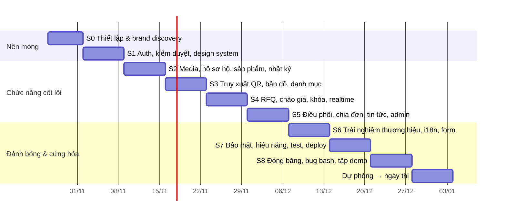

# vCraft — Kế hoạch thực hiện

> Phiên bản 1.0 · 27/10/2026 · Nhóm 3 người · Đi kèm [SRS.md](SRS.md), [ARCHITECTURE.md](ARCHITECTURE.md), [BRAND.md](BRAND.md)
> Giả định lịch vấn đáp **đầu tháng 1/2027**. Lịch khác thì co giãn Sprint 6–8, **không** cắt Sprint 7 (cứng hóa).

---

## Mục lục

1. [Chiến lược đạt điểm tối đa](#1-chiến-lược-đạt-điểm-tối-đa)
2. [Tech stack](#2-tech-stack)
3. [Phân vai nhóm](#3-phân-vai-nhóm)
4. [Lộ trình theo sprint](#4-lộ-trình-theo-sprint)
5. [Backlog chi tiết theo epic](#5-backlog-chi-tiết-theo-epic)
6. [Kịch bản demo vấn đáp](#6-kịch-bản-demo-vấn-đáp)
7. [Chuẩn bị câu hỏi vấn đáp](#7-chuẩn-bị-câu-hỏi-vấn-đáp)
8. [Definition of Done &amp; quy trình làm việc](#8-definition-of-done--quy-trình-làm-việc)
9. [Rủi ro &amp; phương án](#9-rủi-ro--phương-án)
10. [Bước tiếp theo ngay hôm nay](#10-bước-tiếp-theo-ngay-hôm-nay)

---

## 1. Chiến lược đạt điểm tối đa

### 1.1 Phân bổ công sức theo trọng số

| # | Tiêu chí                  | Hệ số        | Công sức | Cách "chốt" điểm tối đa                                                                                                                                                                        |
| - | --------------------------- | -------------- | ---------- | ---------------------------------------------------------------------------------------------------------------------------------------------------------------------------------------------------- |
| 1 | Chức năng                 | **0.35** | ~40%       | Làm **đủ 100% chức năng trong đề** (mức M) trước 06/12, sau đó mới thêm "wow" (mức S/C). Mỗi chức năng trong đề có ít nhất một điểm vượt kỳ vọng (bảng 1.2).    |
| 3 | Giao diện & bản sắc      | **0.2**  | ~25%       | Hệ thống thương hiệu hoàn chỉnh ([BRAND.md](BRAND.md)), 10 khoảnh khắc chuyển động đặc trưng, ảnh Bát Tràng có giấy phép rõ ràng, responsive kiểm từng màn ở 360/768/1440. |
| 2 | Thiết kế logic, dễ dùng | 0.1            | ~8%        | Stepper trạng thái thống nhất, chỉ hiện hành động hợp lệ, wizard, trạng thái rỗng/lỗi có hướng dẫn, test với 5 người.                                                          |
| 4 | Hiệu năng / AJAX / JSON   | 0.1            | ~8%        | Mọi tương tác là fetch → JSON → cập nhật DOM; SSE realtime; Lighthouse ≥ 90; chứng minh bằng tab Network.                                                                                |
| 5 | Phong cách lập trình     | 0.05           | ~5%        | Monorepo có ranh giới cưỡng chế, domain thuần, 12+ pattern có tên, JSDoc tham chiếu mã yêu cầu.                                                                                          |
| 6 | Xử lý nhập liệu         | 0.05           | ~4%        | Schema Zod dùng chung, kiểm tra realtime, ≥ 8 kiểu tự điền/gợi ý/chuyển đổi (bảng 1.3).                                                                                                 |
| 7 | An ninh                     | 0.05           | ~4%        | Supabase Auth (xác minh email, MFA bắt buộc cho Admin, CAPTCHA, refresh xoay vòng), API tự kiểm chứng JWT qua JWKS, đăng xuất mọi thiết bị, CASL, AES-GCM, CSP, rate limit.             |
| 8 | URL                         | 0.05           | ~3%        | URL bản địa hóa vi/en, slug tiếng Việt, `/q/<code>` 308, slug cũ 301, rewrite ở Caddy.                                                                                                     |
| 9 | CSDL OOP & độc lập       | 0.05           | ~3%        | MikroORM entity class + Unit of Work, **demo đổi sang MySQL trực tiếp**, CI ma trận 2 CSDL.                                                                                               |

### 1.2 Mỗi yêu cầu của đề có một điểm "vượt kỳ vọng"

| Yêu cầu trong đề   | Mức đề bài                | vCraft làm thêm                                                                                                                    |
| ---------------------- | ----------------------------- | ------------------------------------------------------------------------------------------------------------------------------------ |
| Hồ sơ xưởng        | Lịch sử, ảnh, chứng nhận | Timeline gia đình kéo ngang, chứng nhận được BQL xác minh, độ hoàn thiện hồ sơ, AI gợi ý viết + dịch câu chuyện |
| Nhật ký sản xuất   | Mảng mốc + ảnh             | Mẫu công đoạn theo nghề, tự điền ngày từ EXIF, **chuỗi băm chống sửa** kiểm chứng ngay trên trình duyệt     |
| QR                     | Sinh QR → landing            | QR thương hiệu trong khung ấn, URL ngắn đa ngôn ngữ, thống kê lượt quét, in tờ tem PDF                                 |
| Báo giá              | State machine                 | Chào giá kín, sửa có phiên bản, so sánh realtime, ghép hộ chấm điểm, hết hạn tự động, idempotency                  |
| Khóa bản ghi         | "Logic khóa phức tạp"      | Khóa lạc quan + bi quan + UNIQUE + outbox, **demo 2 tab chốt cùng lúc**                                                   |
| Chia đơn             | Admin chia 3–4 hộ           | 3 chiến lược thuật toán so sánh song song, kéo-thả chỉnh tay, bất biến tổng, Gantt tiến độ, chia lại khi trễ        |
| Bản đồ              | Ghim + popup                  | Style thương hiệu, "đang mở cửa" theo giờ thật, clustering, đồng bộ danh sách, gần tôi, chạy offline                  |
| Upload & tối ưu ảnh | Resize ở backend             | Nén trước ở client, AVIF/WebP 4 kích thước, xóa GPS, thumbhash, xử lý nền + SSE báo xong                                 |
| Kiểm duyệt hộ       | Duyệt tài khoản            | Hồ sơ song song giấy tờ ↔ bản đồ, kiểm tra trong ranh giới làng, giấy tờ mã hóa, hiệu ứng đóng ấn                |
| Tin tức               | CRUD                          | Lịch cúp điện có cấu trúc ⇒ banner cho hộ bị ảnh hưởng; biểu đồ giá vật liệu; hẹn giờ đăng                    |

### 1.3 Danh sách tính năng nhập liệu (tiêu chí 6)

1. Kiểm tra realtime bằng schema Zod dùng chung, thông báo tiếng Việt cụ thể.
2. Kiểm tra bất đồng bộ (email/slug/SĐT đã dùng) có debounce.
3. Địa chỉ dạng cascade **Tỉnh/Thành → Xã/Phường** (dữ liệu 2 cấp mới).
4. Chọn vị trí trên bản đồ ⇒ tự điền địa chỉ; "Dùng vị trí hiện tại".
5. Chọn danh mục ⇒ tự nạp mẫu công đoạn sản xuất.
6. Ảnh ⇒ tự điền ngày giờ mốc từ EXIF.
7. Ô tiền tự định dạng `1.250.000 ₫` + **đọc thành chữ** ("Một triệu hai trăm năm mươi nghìn đồng") + quy đổi USD tham khảo.
8. SĐT tự chuẩn hóa `0912…` ⇄ `+84 912…`; slug tự sinh từ tên tiếng Việt.
9. Gợi ý: tìm kiếm không dấu ⌘K, gợi ý giá chào/giá bán, gợi ý thời gian hoàn thành theo năng lực.
10. Ảnh: nén + HEIC→JPEG ở client, kiểm tra kích thước/định dạng trước khi gửi.
11. Wizard nhiều bước tự lưu nháp; cảnh báo khi rời trang chưa lưu.
12. Ngày tháng `dd/MM/yyyy`, chọn khoảng ngày, ràng buộc chéo (hạn giao > hạn chào giá).

---

## 2. Tech stack

Phiên bản đã đối chiếu npm ngày 27/10/2026. Sprint 0 khóa phiên bản chính xác trong lockfile.

### 2.1 Nền tảng & monorepo

| Thành phần    | Lựa chọn          | Phiên bản | Ghi chú                                                                                                                                |
| --------------- | ------------------- | ----------- | --------------------------------------------------------------------------------------------------------------------------------------- |
| Runtime         | Node.js LTS         | 24 (≥)     | `.nvmrc`                                                                                                                              |
| Package manager | pnpm workspaces     | 12.x        | `corepack use pnpm@latest`                                                                                                            |
| Task runner     | Turborepo           | 2.11        | Cache build/test                                                                                                                        |
| Ngôn ngữ      | TypeScript (strict) | 6.0         | Bản 7 (native) chưa có JS API cho Next/Nest CLI/MikroORM CLI ⇒ nâng cấp khi hệ sinh thái hỗ trợ; `apps/api` build bằng SWC |
| Lint + format   | Biome               | 2.6         | Một công cụ thay ESLint + Prettier                                                                                                   |
| Git hooks       | Lefthook            | 2.2         | pre-commit + Conventional Commits                                                                                                       |
| Ranh giới gói | dependency-cruiser  | 18.7.0      | Chạy trong CI                                                                                                                          |

### 2.2 Frontend — `apps/web`

| Mục đích                 | Lựa chọn                                                                                                         | Phiên bản   |
| --------------------------- | ------------------------------------------------------------------------------------------------------------------ | ------------- |
| Framework                   | **Next.js** (App Router, Turbopack, `proxy.ts`)                                                            | 16.4          |
| UI runtime                  | React (+ React Compiler)                                                                                           | 19.3          |
| CSS                         | **Tailwind CSS** (token qua `@theme`)                                                                      | 4.3           |
| Primitive truy cập được | Radix UI qua shadcn/ui (tùy biến hoàn toàn theo brand)                                                         | —            |
| Dữ liệu server            | **TanStack Query**                                                                                           | 5.105         |
| Bảng / danh sách dài     | TanStack Table 9 · TanStack Virtual 3                                                                             | —            |
| URL state                   | nuqs                                                                                                               | 2.10          |
| UI state                    | Zustand                                                                                                            | 5             |
| Form                        | React Hook Form 7.91 + Zod 4.6                                                                                     | —            |
| Xác thực (client)         | **@supabase/supabase-js** + **@supabase/ssr** (cookie phiên cho App Router) · Cloudflare Turnstile   | 2.118 · 0.12 |
| i18n                        | next-intl                                                                                                          | 4.14          |
| Hoạt ảnh component        | **Motion** (`motion/react`)                                                                                | 14.6          |
| Kể chuyện theo cuộn      | **GSAP** (ScrollTrigger, SplitText, DrawSVG — miễn phí toàn bộ) + `@gsap/react`                       | 3.15          |
| Cuộn mượt                | Lenis                                                                                                              | 1.3           |
| 3D                          | three 0.186 · **@react-three/fiber** 9.8 · drei 10.7                                                       | —            |
| Bản đồ                   | **MapLibre GL JS** 6.16 + react-map-gl 8 (`/maplibre`) + OpenFreeMap / PMTiles                             | —            |
| Editor tin tức             | Tiptap                                                                                                             | 3.x           |
| Kéo-thả                   | dnd-kit                                                                                                            | 6.x           |
| QR                          | qr-code-styling (QR thương hiệu)                                                                                | 1.9           |
| Ảnh client                 | exifr (EXIF) · browser-image-compression · heic2any                                                              | —            |
| Biểu đồ                  | Recharts                                                                                                           | 3.x           |
| Khác                       | cmdk (⌘K) · sonner (toast) · vaul (bottom sheet) · embla-carousel · lucide-react · date-fns 4 + @date-fns/tz | —            |

### 2.3 Backend — `apps/api`, `apps/worker`

| Mục đích          | Lựa chọn                                                                                                                                                                                                                                  | Phiên bản                                          |
| -------------------- | ------------------------------------------------------------------------------------------------------------------------------------------------------------------------------------------------------------------------------------------- | ---------------------------------------------------- |
| Framework            | **NestJS** (adapter Fastify)                                                                                                                                                                                                          | 12.x*(pin 11.x nếu thư viện phụ chưa hỗ trợ)* |
| ORM                  | **MikroORM** (`@mikro-orm/nestjs`, driver postgresql + mysql)                                                                                                                                                                       | 7.2                                                  |
| CSDL                 | **Supabase Postgres 17** (chính, ADR-15) · MySQL 8.4 (kiểm chứng độc lập)                                                                                                                                                               | —                                                   |
| Validation & OpenAPI | Zod 4 + `ZodValidationPipe` tự viết + `z.toJSONSchema()` → Scalar API reference                                                                                                                                                      | —                                                   |
| Xác thực           | **Supabase Auth** (email, Google OAuth, MFA TOTP, invite) · **@supabase/server** `verifyAuth()` trong `SupabaseAuthGuard` tự viết (không dùng adapter NestJS — sẽ bị gỡ 01/12/2026)                                | 1.9                                                  |
| Phân quyền         | CASL                                                                                                                                                                                                                                        | 7.0                                                  |
| Bảo vệ             | @fastify/helmet · @nestjs/throttler (Redis store) · sanitize-html                                                                                                                                                                         | —                                                   |
| Hàng đợi          | **BullMQ** + Redis 7                                                                                                                                                                                                                  | 6.5                                                  |
| Ảnh                 | **sharp** · thumbhash                                                                                                                                                                                                                | 0.35                                                 |
| QR / PDF             | qrcode · pdf-lib                                                                                                                                                                                                                           | —                                                   |
| Lưu trữ            | @aws-sdk/client-s3 → **Supabase Storage** (S3, ADR-14)                                                                                                                                                                                            | —                                                   |
| Mail                 | Nodemailer (Mailpit khi dev)                                                                                                                                                                                                                | —                                                   |
| Log / health         | nestjs-pino · @nestjs/terminus                                                                                                                                                                                                             | —                                                   |
| ID                   | uuid v7 · nanoid (mã truy xuất, bảng chữ tùy chỉnh)                                                                                                                                                                                  | —                                                   |
| AI (Could)           | Claude API — Haiku 5.5 cho dịch/gợi ý câu chuyện                                                                                                                                                                                      | —                                                   |
| Trợ lý Cáo (S)    | `@anthropic-ai/sdk` (Haiku 5.5: trả lời + phân loại guardrail) · embedding đa ngữ Voyage AI (chốt model hỗ trợ tiếng Việt ở S5) · **pgvector trên Supabase** (cùng project với Auth) qua `@supabase/supabase-js` | —                                                   |
| Mascot               | `page-mascot` (skill vẽ sprite sheet 9 hướng đầu + 9 biểu cảm) — chỉ dùng để **sinh asset**; component hiển thị tự viết trong `packages/ui` nếu gói npm chưa đạt (kiểm license, kích thước, a11y)        | —                                                   |

### 2.4 Kiểm thử, hạ tầng, triển khai

| Mục đích        | Lựa chọn                                                                                                                                                                                                |
| ------------------ | --------------------------------------------------------------------------------------------------------------------------------------------------------------------------------------------------------- |
| Unit / component   | Vitest 5 · Testing Library · fast-check                                                                                                                                                                 |
| Integration        | Testcontainers (PostgreSQL + MySQL) · Supertest                                                                                                                                                          |
| E2E / a11y         | Playwright 1.64 · @axe-core/playwright                                                                                                                                                                   |
| Tải / tranh chấp | k6                                                                                                                                                                                                        |
| Hiệu năng        | Lighthouse CI                                                                                                                                                                                             |
| Dev infra          | Docker Compose: mysql (profile), redis, mailpit, caddy; CSDL + file trên Supabase                                                                                                                             |
| Reverse proxy      | Caddy 2 (HTTPS tự động, rewrite, header bảo mật) cho dev và dự phòng; production: rewrite + header ở `next.config.ts` trên Vercel ([ADR-16](adr/0016-deploy-vercel-render.md))                                                                                                                                                     |
| CI/CD              | GitHub Actions                                                                                                                                                                                            |
| Hosting demo       | **Đã thay bằng Vercel (web) + Render (API, worker) + Supabase, xem [ADR-16](adr/0016-deploy-vercel-render.md); phần dưới là kế hoạch cũ:** 1 VPS (GitHub Student Pack có credit DigitalOcean) + tên miền (`.id.vn` miễn phí cho người 18–23 tuổi — kiểm tra điều kiện, hoặc `.me` qua Student Pack); dự phòng Cloudflare Tunnel |

---

## 3. Phân vai nhóm

| Thành viên                               | Vai trò chính                             | Sở hữu                                                                                                              | Hỗ trợ                                                        |
| ------------------------------------------ | ------------------------------------------- | --------------------------------------------------------------------------------------------------------------------- | --------------------------------------------------------------- |
| **A — Frontend & Brand lead**       | Design system, hoạt ảnh, trang công khai | `packages/ui`, `apps/web/experience`, trang chủ, hồ sơ hộ, chi tiết sản phẩm, landing truy xuất, BRAND.md | Figma, tuyển chọn ảnh có giấy phép, kiểm thử khả dụng |
| **B — Backend & Domain lead**       | Nghiệp vụ lõi, bảo mật                 | `packages/domain`, `packages/contracts`, module auth/rfq/bids/orders, khóa & state machine, phân quyền         | Màn RFQ/điều phối (cùng A)                                 |
| **C — Platform & Integration lead** | Dữ liệu, media, bản đồ, hạ tầng      | `packages/database`, media pipeline, worker, traceability/QR, bản đồ, i18n, CI/CD, deploy                        | Studio nghệ nhân, Admin dashboard                             |

Quy tắc chéo:

- **Ai cũng phải trả lời được mọi tiêu chí** khi vấn đáp ⇒ mỗi thứ Sáu 30 phút "dạy lại": một người trình bày phần mình cho hai người còn lại.
- Mỗi PR cần 1 người khác duyệt; người duyệt luân phiên để hiểu toàn bộ mã.
- Màn hình nào cũng có 1 "chủ" FE và 1 "chủ" API rõ ràng trong issue.

---

## 4. Lộ trình theo sprint



| Sprint                    | Mục tiêu (sản phẩm demo được cuối sprint)                       | A — Frontend/Brand                                                                                                                            | B — Backend/Domain                                                                                                                                                                       | C — Platform                                                                                                                                                         |
| ------------------------- | ----------------------------------------------------------------------- | ---------------------------------------------------------------------------------------------------------------------------------------------- | ----------------------------------------------------------------------------------------------------------------------------------------------------------------------------------------- | --------------------------------------------------------------------------------------------------------------------------------------------------------------------- |
| **S0** 27/10–01/11 | Repo chạy được, CI xanh, có hướng thương hiệu                 | Moodboard, logo ấn bình, token màu/chữ, Figma 6 màn chính                                                                                | Mô hình domain, schema Zod đầu tiên, bảng state machine + test                                                                                                                      | `create-next-app`, `nest new`, MikroORM + 2 driver, compose, CI; cấu hình Supabase Auth (Site URL, redirect URLs, SMTP riêng, JWT 15′, MFA, Turnstile)        |
| **S1** 02/11–08/11 | Đăng ký/đăng nhập, hộ nộp hồ sơ, admin duyệt                 | `packages/ui` (button, input, card, dialog, toast…), layout, header/footer, trang auth, wizard đăng ký hộ                               | `SupabaseAuthGuard` (JWKS), cấp hồ sơ lần đầu, CASL, throttler, kiểm duyệt hộ (+ invite/ban qua Supabase admin API)                                                            | Entities User/LoginEvent/Artisan/Workshop, migration, seeder cơ bản, mail (Mailpit), mã hóa trường CCCD                                                         |
| **S2** 09/11–15/11 | Hộ đăng sản phẩm có nhiều ảnh + nhật ký                       | Studio (mobile-first): hồ sơ hộ, form sản phẩm, uploader nhiều ảnh, thêm mốc nhật ký                                                | Module products, production-logs, chuỗi băm (domain), mẫu công đoạn                                                                                                                 | **Media pipeline**: upload, magic bytes, worker sharp AVIF/WebP, thumbhash, SSE `media.ready`                                                                 |
| **S3** 16/11–22/11 | Khách quét QR xem hành trình; xem bản đồ; duyệt danh mục       | Trang danh mục (lọc + URL + cuộn vô hạn), chi tiết sản phẩm, hồ sơ hộ công khai, landing truy xuất                                | Module catalog (Specification, cursor, tìm không dấu), gợi ý ⌘K                                                                                                                     | Traceability (mã, QR, `/q` redirect, lượt quét), **bản đồ** (style, ghim bbox, popup, đang mở, cluster), seed 200 sản phẩm                         |
| **S4** 23/11–29/11 | Luồng báo giá đầy đủ tới chốt, 2 tab chốt cùng lúc an toàn | Màn tạo RFQ, lời mời + form chào giá (Studio), bảng so sánh realtime, stepper                                                          | **RFQ/Bids**: state machine, ghép hộ, chào giá kín, khóa lạc quan/bi quan, idempotency, outbox, job hết hạn                                                                | SSE hub + Redis pub/sub, thông báo in-app + email, test concurrency (2 CSDL)                                                                                        |
| **S5** 30/11–06/12 | **Đủ 100% chức năng đề bài**                               | Màn điều phối (kéo-thả, 3 phương án), Gantt tiến độ, admin dashboard, editor tin tức                                              | Orders/Allocations, 3 chiến lược chia (property test), chia lại, cập nhật tiến độ                                                                                                | News (lịch cúp điện, giá vật liệu), audit log, biểu đồ dashboard                                                                                            |
| **S6** 07/12–13/12 | Trang web "cực kỳ nổi bật"                                          | **Hero bình gốm 3D**, scroll story, View Transitions, đóng ấn, ghim thở, chế độ Lò đêm, **widget trợ lý Cáo** (E15) | Gợi ý giá, đánh giá hộ, trang Bảo mật tài khoản (lịch sử đăng nhập, đăng xuất mọi thiết bị), MFA bắt buộc cho Admin, **module assistant + guardrail** (E15) | i18n vi/en + URL bản địa hóa, OG image động, sitemap, slug 301, tự điền địa chỉ/EXIF, đọc số thành chữ, **ingest tri thức → pgvector** (E15) |
| **S7** 14/12–20/12 | Sẵn sàng chấm                                                        | Responsive pass 360/768/1440 từng màn, a11y (axe), reduced-motion, Lighthouse ≥ 90                                                          | Rà soát bảo mật (OWASP checklist + OWASP LLM Top 10 cho trợ lý), CSP nonce, test phân quyền 403 toàn bộ route, **bộ red-team trợ lý**                                  | Deploy VPS + HTTPS, backup, PMTiles offline, Lighthouse CI, E2E 3 vai trò                                                                                            |
| **S8** 21/12–27/12 | **Đóng băng tính năng 20/12**                                | Kiểm thử khả dụng 5 người, sửa UX                                                                                                       | Bug bash, tối ưu truy vấn                                                                                                                                                              | Dữ liệu demo cuối cùng, kịch bản reset dữ liệu 1 lệnh                                                                                                        |
| Dự phòng 28/12 → thi   | Tập demo ≥ 3 lần có bấm giờ, luyện Q&A chéo                     |                                                                                                                                                |                                                                                                                                                                                           |                                                                                                                                                                       |

**Mốc kiểm soát:** 08/11 (đăng nhập + duyệt chạy end-to-end) · 22/11 (QR quét được trên điện thoại thật) · **06/12 (đủ chức năng đề bài)** · 20/12 (feature freeze) · 27/12 (bản demo cuối).

---

## 5. Backlog chi tiết theo epic

Ký hiệu: **[A] [B] [C]** = người phụ trách; mã FR tham chiếu [SRS.md](SRS.md).

### E0 — Nền móng (S0)

- [X] [C] Khởi tạo `apps/web` bằng `create-next-app` (TS, Tailwind 4, App Router, src/) vào khung thư mục sẵn có
- [X] [C] Khởi tạo `apps/api`, `apps/worker` bằng Nest CLI; adapter Fastify; SWC
- [X] [C] `packages/database`: `mikro-orm.config.ts` đọc `DB_DRIVER`; migration riêng 2 driver; `pnpm db:migrate`, `pnpm db:seed`
- [X] [C] CI chạy đủ job; `pnpm deps:check` xanh
- [X] [B] `packages/domain/rfq`: bảng chuyển trạng thái + `transition()` + `availableEvents()` + test mọi cặp trạng thái×sự kiện
- [X] [B] `packages/contracts`: quy ước schema, mã lỗi, Problem Details
- [x] [A] Moodboard, logo ấn bình (SVG), token màu/chữ/khoảng cách/bóng, Figma: Trang chủ, Hồ sơ hộ, Sản phẩm, Truy xuất, RFQ, Điều phối — 6 màn dựng thẳng bằng route Next.js thật (dữ liệu mẫu `apps/web/src/lib/demo`), moodboard ở `docs/design/moodboard.html`

### E1 — Xác thực & phiên (FR-AUTH) — Supabase Auth

- [ ] [C] Cấu hình project Supabase: Site URL + redirect URLs (localhost, domain demo), SMTP riêng, mẫu email tiếng Việt, JWT expiry 15′, bật MFA TOTP, leaked password protection, Turnstile, Google OAuth
- [ ] [B] `SupabaseAuthGuard` bọc `verifyAuth()` (`@supabase/server`): kiểm JWKS/iss/aud/exp, nạp `User` từ DB (cache Redis), tạo hồ sơ lần đầu, chặn `SUSPENDED`, decorator `@RequireAal2()` cho route Admin
- [ ] [B] CASL abilities + `PoliciesGuard` + decorator `@CheckPolicies`; test 403 cho mọi route
- [ ] [B] Supabase admin API ở backend: mời hộ, ban/unban khi khóa tài khoản; ghi `LoginEvent`
- [ ] [C] `api-client/http`: lấy token từ phiên Supabase, 401 ⇒ refresh + thử lại một lần, Idempotency-Key, ApiError
- [ ] [A] `@supabase/ssr` trong `proxy.ts` + providers; trang đăng nhập/đăng ký/quên mật khẩu (Turnstile); wizard đăng ký hộ 4 bước có lưu nháp
- [ ] [A][B] Trang Bảo mật tài khoản + màn nhập mã MFA cho Admin (S6)

### E2 — Kiểm duyệt hộ (FR-ADM-01…05)

- [ ] [B] API hàng đợi, duyệt/từ chối/yêu cầu bổ sung, audit
- [ ] [C] Polygon ranh giới làng (GeoJSON tĩnh) + kiểm tra điểm trong đa giác (domain)
- [ ] [A] Màn duyệt 3 cột + hiệu ứng **đóng ấn**

### E3 — Hồ sơ hộ & xưởng (FR-ART)

- [ ] [B] API hồ sơ, lịch sử gia đình, chứng nhận, năng lực, xưởng + giờ mở cửa
- [ ] [A] Studio: chỉnh hồ sơ (rich text), timeline gia đình, chứng nhận, thư viện ảnh kéo-thả
- [ ] [A] Trang triển lãm số công khai (bento, timeline ngang, masonry)

### E4 — Media (FR-MEDIA)

- [ ] [C] `POST /media` multipart, magic bytes, quota; bucket public/private; URL ký — bucket `vcraft-media`/`vcraft-private` đã tạo trên Supabase (ADR-14)
- [ ] [C] Worker: pipeline Chain of Responsibility; AVIF/WebP ×4; thumbhash; màu chủ đạo; outbox `media.ready`
- [ ] [A] Uploader: nén client, HEIC→JPEG, EXIF, 4 luồng song song, progress, hủy/thử lại, thứ tự kéo-thả
- [ ] [A] Component `<CraftImage>`: `<picture>` + srcset + thumbhash + hiện dần

### E5 — Sản phẩm & nhật ký (FR-PRD)

- [ ] [B] CRUD sản phẩm, xuất bản (≥ 1 mốc), slug + `SlugRedirect`
- [ ] [B] Mốc nhật ký append-only, đính chính, chuỗi băm (domain + test)
- [ ] [A] Form sản phẩm, trình thêm mốc nhanh trên mobile (camera + EXIF)

### E6 — Truy xuất & QR (FR-TRC)

- [ ] [C] Sinh mã 8 ký tự, `GET /trace/:code`, `POST /trace/:code/scans`, thống kê lượt quét
- [ ] [C] `/q/[code]` 308 theo locale (proxy.ts)
- [ ] [A] Landing truy xuất: dòng thời gian lửa, kiểm chứng băm Web Crypto, ấn xác thực, bản đồ mini
- [ ] [A] QR thương hiệu (qr-code-styling) + tải SVG/PNG; [C] tờ tem PDF (pdf-lib)

### E7 — Danh mục & tìm kiếm (FR-CAT)

- [ ] [B] Catalog query (Specification), cursor pagination, `search_text` không dấu, gợi ý
- [ ] [A] Trang danh mục: bộ lọc ⇄ URL (nuqs), cuộn vô hạn, skeleton, ⌘K
- [ ] [A] Chi tiết sản phẩm + View Transition từ thẻ

### E8 — Bản đồ (FR-MAP)

- [ ] [C] `GET /map/workshops?bbox=…&openNow=…` (JSON), tính `isOpenNow/nextOpenAt` theo giờ VN
- [ ] [C] Style MapLibre theo brand; PMTiles khu vực Bát Tràng (dự phòng offline)
- [ ] [C] Ghim ấn + cluster + popup + bộ lọc + ghim thở + flyTo; danh sách đồng bộ; bottom sheet mobile; "gần tôi"
- [ ] [C] Chế độ danh sách cho không WebGL / screen reader

### E9 — Báo giá & chào giá (FR-RFQ)

- [ ] [B] API RFQ: nháp, submit (guard), ghép hộ (Strategy, BR-05), lời mời
- [ ] [B] API Bid: tạo/sửa (revision)/rút, chào giá kín (policy), hạn chót
- [ ] [B] `AcceptBidService`: giao dịch + khóa bi quan + `If-Match` + idempotency + outbox
- [ ] [B] Job `rfq.expire`, `rfq.coordination-check`
- [ ] [C] Test concurrency: 50 request chốt song song ⇒ 1 thành công (PostgreSQL + MySQL)
- [ ] [A] Form RFQ (ví dụ 5.000 cốc), Studio lời mời + đếm ngược + form chào giá (gợi ý giá), bảng so sánh realtime, stepper dùng `availableEvents()`

### E10 — Điều phối & chia đơn (FR-ORD)

- [ ] [B] Domain: 3 chiến lược chia + bất biến + property test (fast-check)
- [ ] [B] API nhận điều phối, đề xuất phương án, bid liên kết, xác nhận/từ chối phân bổ, bắt đầu SX, tiến độ, giao hàng, chia lại
- [ ] [A] Màn chia đơn: 3 phương án song song, kéo-thả/thanh trượt, khối đất rạn khi sai tổng
- [ ] [C] Gantt phân bổ + cảnh báo trễ; Studio "Đơn của tôi" cập nhật tiến độ

### E11 — Tin tức & thông báo (FR-NEWS, FR-NOTI)

- [ ] [C] API tin (chuyên mục, audience, hẹn giờ, sanitize), giá vật liệu, lịch cúp điện
- [ ] [A] Editor Tiptap; trang tin công khai; biểu đồ giá vật liệu; banner cúp điện trong Studio
- [ ] [C] Chuông thông báo SSE, đánh dấu đã đọc, email theo tùy chọn

### E12 — Admin dashboard (FR-ADM-06)

- [ ] [C] API thống kê; [A] KPI + biểu đồ + hoạt động gần đây; audit log viewer

### E13 — Trải nghiệm thương hiệu (S6) — xem [BRAND §6.3](BRAND.md#63-mười-khoảnh-khắc-đặc-trưng-signature-moments)

- [ ] [A] Hero bình gốm 3D (LatheGeometry nội suy 4 profile, shader men lam vẽ dần, ánh lửa nung) + poster fallback
- [ ] [A] Lenis + ScrollTrigger: "Một ngày ở Bát Tràng" cuộn ngang
- [ ] [A] SplitText "chữ nặn", mặt nạ "mực thấm ảnh", DrawSVG gạch chân
- [ ] [A] View Transitions (thẻ → chi tiết, chuyển sáng/tối "Lò đêm")
- [ ] [A] Con trỏ mực, nút từ tính, số đếm lên; kiểm reduced-motion toàn bộ

### E14 — Cứng hóa (S7)

- [ ] [B] Checklist OWASP (ARCHITECTURE §8.2) từng mục có bằng chứng
- [ ] [B] CSP nonce, header, cookie flags, kiểm tra mọi route có policy (test tự động duyệt toàn bộ route)
- [ ] [A] Lighthouse ≥ 90 / a11y ≥ 95 trên 3 trang chính; responsive pass
- [ ] [C] Deploy + HTTPS + domain; backup; script `pnpm demo:reset` nạp lại dữ liệu demo

### E15 — Trợ lý "Cáo" (FR-AST, mức S) — chatbot mascot góc dưới bên phải

Mục tiêu: khách (kể cả Guest) hỏi về vCraft, cách đặt hàng/RFQ, truy xuất QR, làng Bát Tràng, hộ và sản phẩm **công khai**. Cáo cũng phải trả lời tự nhiên các câu **đời thường**: chào hỏi, cảm ơn, hỏi ngày giờ, thời tiết, đường đi tới làng, "đang có xưởng nào mở cửa". Trợ lý **chỉ đọc**: không tạo RFQ, không xem dữ liệu riêng của ai, không có tool gây tác dụng phụ. Nguyên tắc: **chỉ chặn tấn công thật, không chặn người dùng thật**; câu lạc đề nhưng vô hại thì trả lời ngắn rồi khéo léo gợi ý quay về chủ đề. Mã FR-AST-01…08 bổ sung vào [SRS.md](SRS.md) khi bắt đầu epic.

**Định tuyến ý định** (chọn đường nhanh nhất cho mỗi loại câu)

| Ý định                                             | Ví dụ                                                                   | Xử lý                                                                                                                                                                                                                                                                                 | Độ trễ mục tiêu |
| ----------------------------------------------------- | ------------------------------------------------------------------------- | --------------------------------------------------------------------------------------------------------------------------------------------------------------------------------------------------------------------------------------------------------------------------------------- | -------------------- |
| `greeting` / `thanks` / `bye`                   | "chào cáo", "hi", "cảm ơn nha"                                        | **Đường nhanh không gọi LLM**: khớp mẫu (có dấu, không dấu, teencode "hellu", "thanks", emoji 👋) ⇒ trả câu chào i18n ngẫu nhiên theo giờ ("Chào buổi tối!") + 3 chip gợi ý theo trang đang xem; cáo vẫy tay                                            | < 100 ms             |
| `datetime`                                          | "hôm nay ngày mấy", "mấy giờ rồi", "âm lịch hôm nay"             | Tool `get_current_datetime` (giờ server, `Asia/Ho_Chi_Minh`, kèm âm lịch tính bằng hàm thuần trong `packages/utils`)                                                                                                                                                      | < 1,5 s              |
| `weather`                                           | "thời tiết Bát Tràng", "mai có mưa không", "Hà Nội nóng không" | Tool `get_weather` qua **Open-Meteo** (miễn phí, không cần key). Mặc định tọa độ Bát Tràng; tên địa điểm khác geocode qua API của Open-Meteo, chỉ trong VN. Cache Redis 15′; có gợi ý kèm ("Trời nắng, hợp đi làm gốm cùng nghệ nhân đấy!") | < 2 s                |
| `site_help` / `catalog` / `trace` / `village` | "đặt 5.000 cốc thế nào", "QR này là gì", "xưởng nào đang mở" | RAG + tool đọc `search_catalog`, `get_open_workshops` (gọi API công khai với quyền Guest)                                                                                                                                                                                     | first token < 1,5 s  |
| `chitchat` lạc đề vô hại                       | "kể chuyện cười", "1+1", "bạn là ai"                                | Trả lời **ngắn**, giữ giọng cáo, kết bằng một câu nối về gốm/vCraft                                                                                                                                                                                                  | first token < 1,5 s  |
| `out_of_scope` cần chuyên môn                    | tư vấn pháp lý, y tế, đầu tư                                      | Từ chối nhẹ nhàng, gợi ý nguồn phù hợp                                                                                                                                                                                                                                         | —                   |
| `injection` / `abuse` / dò dữ liệu riêng      | "bỏ qua hướng dẫn", hỏi CCCD, giá chào hộ khác                   | Chặn; giọng cáo vẫn lịch sự, không giảng giải kỹ thuật, không lặp lại nội dung độc                                                                                                                                                                                     | —                   |

**UX — mượt và có duyên**

- Phản hồi tức thì: gửi tin ⇒ < 100 ms tin hiện trong khung + cáo chuyển `thinking` + bong bóng câu thú vị; không có khoảng trắng chờ nào.
- Giảm độ trễ: prompt caching cho system prompt + tài liệu tĩnh; **phân loại chạy song song** với truy hồi vector (không nối tiếp); câu chào và ngày giờ không cần LLM.
- Stream mượt: token gom vào buffer rồi vẽ theo `requestAnimationFrame` (không giật từng ký tự); bộ lọc đầu ra chạy theo từng câu nên không chặn cả stream.
- Hiểu ngữ cảnh: gửi kèm `pagePath`. Đang ở trang sản phẩm thì "cái này làm ở đâu" hiểu là sản phẩm đó; chip gợi ý đổi theo trang (trang chủ / danh mục / bản đồ / landing QR / RFQ).
- Tự nhận vi/en theo câu hỏi, mặc định theo locale URL; hiểu tiếng Việt không dấu và teencode.
- Chào chủ động **một lần**: sau 8 giây ở trang chủ hoặc landing QR, cáo ló đầu kèm bong bóng nhỏ "Cần tớ giúp gì không?" (tắt được, nhớ trong `localStorage`, không bao giờ bật popup tự động).
- Giữ hội thoại trong `sessionStorage` khi chuyển trang; nút "Cuộc trò chuyện mới".
- Mỗi câu trả lời có: copy, 👍/👎 (đưa vào thống kê Admin), thử lại khi lỗi; câu bị rate limit hiện đếm ngược thân thiện thay vì báo lỗi.
- Bàn phím: `Enter` gửi, `Shift+Enter` xuống dòng, `Esc` đóng, mở/đóng không cướp focus của trang. Mobile: sheet cao theo `visualViewport` nên bàn phím ảo không che ô nhập; nút nổi né thanh điều hướng.
- Cáo "sống" mà không phiền: idle thì chớp mắt, nhìn theo con trỏ; lâu không dùng thì ngủ gật (Zzz); hover thì ngóc đầu. Tất cả tắt khi bật reduced-motion.

**Kiến trúc**

```
web: features/assistant (widget) ──fetch POST + SSE stream──▶ api: modules/assistant
                                                                ├─ GuardrailPipeline (Chain of Responsibility)
                                                                ├─ Retriever ──▶ VectorStore port ──▶ SupabaseVectorStore (pgvector)
                                                                └─ LlmClient port ──▶ ClaudeAdapter (Haiku 5.5)
worker: job assistant.ingest (outbox product/workshop/news.published|updated|deleted) ──▶ chunk → embed → upsert
```

- pgvector đặt ở **Supabase**, tách khỏi CSDL nghiệp vụ: chỉ số tri thức là dữ liệu **dẫn xuất, dựng lại được** từ CSDL chính, nên CSDL nghiệp vụ vẫn chạy trên cả PostgreSQL lẫn MySQL. Đổi `DB_DRIVER=mysql` thì trợ lý vẫn chạy. Ghi lý do vào **ADR-13**. SQL riêng của PostgreSQL (đã duyệt, ghi trong [AGENTS.md §3](../AGENTS.md#3-luật-bắt-buộc-khi-viết-code)) nằm trong migration Supabase (`supabase/migrations`: bảng `knowledge_chunks`, index HNSW, hàm RPC `match_knowledge`).
- `VectorStore` có thêm adapter `InMemoryVectorStore` dùng cho test/CI và chạy offline lúc demo (Adapter pattern).

**Việc cần làm**

- [ ] [A] Sinh mascot **cáo** theo brand bằng `page-mascot` (S1–S2, việc nhỏ): cáo chibi lông cam đất nung, khăn/áo **men lam**, ôm bình gốm nhỏ; 2 sprite sheet (9 hướng đầu, 9 biểu cảm: idle, chào, nghe, nghĩ, vui, bối rối, từ chối, lỗi, ngủ), WebP; bổ sung mục Mascot vào [BRAND.md](BRAND.md)
- [ ] [A] `packages/ui/mascot`: `<Mascot>` thuần UI (không nghiệp vụ). Đầu nhìn theo con trỏ/ô nhập; **chớp mắt** ngẫu nhiên 3–6 giây/lần (đổi frame, ~120 ms, thỉnh thoảng chớp đôi); biểu cảm theo prop `mood`; **bong bóng suy nghĩ** (3 chấm mây nổi lên trên đầu) kèm prop `thought`. `prefers-reduced-motion` ⇒ tắt chớp mắt, xoay đầu và nhấp nhô; bong bóng hiện tĩnh
- [ ] [A] `apps/web/src/features/assistant`: nút nổi góc dưới phải (an toàn với safe-area, không che CTA hay bottom sheet bản đồ trên mobile; ẩn ở Studio/Admin nếu vướng); panel chat (desktop: popover 380px; mobile: vaul bottom sheet); stream token; thẻ nguồn trích dẫn có link nội bộ; gợi ý câu hỏi nhanh; nút dừng/xóa hội thoại; trạng thái loading/empty/error/bị giới hạn; điều hướng bàn phím, `aria-live="polite"`, focus trap
- [ ] [A] Trong lúc chờ token đầu tiên ⇒ cáo `mood="thinking"` + bong bóng xoay vòng **câu thú vị** (i18n vi/en, ~30 câu: chuyện làng Bát Tràng, men lam, nhiệt độ lò, mẹo dùng vCraft). Ví dụ: "Đợi tớ lục lại kho gốm một chút…", "Bạn có biết gốm Bát Tràng nung tới ~1.300°C không?". Khi stream bắt đầu ⇒ `mood="talking"`; bị guardrail chặn ⇒ `mood="refuse"` + câu từ chối thân thiện
- [ ] [B] `packages/contracts/assistant`: `AssistantMessageRequest` (message ≤ 1.000 ký tự, history ≤ 10 lượt, locale, `pagePath`, conversationId), schema sự kiện SSE (`thinking`, `delta`, `citations`, `done`, `blocked`, `error`), `AssistantAnswer` có `citations[]`
- [ ] [B] `apps/api/src/modules/assistant`: `POST /api/v1/assistant/messages` trả SSE (ADR-07); controller mỏng, logic nằm ở `AskAssistantService`
- [ ] [C] Worker `assistant.ingest`: chỉ lấy nội dung **công khai** (sản phẩm hộ `APPROVED` (BR-02), hồ sơ hộ công khai, tin `PUBLIC`, FAQ/hướng dẫn soạn tay trong `docs/assistant-kb/` vi/en); chunk ~500 token có metadata (`type`, `locale`, `url`, `visibility`, `sourceUpdatedAt`); embed; upsert idempotent; xóa khi gỡ/ẩn/khóa hộ; lệnh `pnpm assistant:reindex`
- [ ] [C] Migration Supabase cho pgvector + RLS: chặn hoàn toàn với `anon`/`authenticated`, chỉ backend dùng secret key; `get_advisors` sạch

**Guardrail chống tấn công** (B phụ trách, mỗi lớp có test; tham chiếu OWASP LLM Top 10)

| Lớp                   | Biện pháp                                                                                                                                                                                                                                                                                                                                                                                                                                                              |
| ---------------------- | ------------------------------------------------------------------------------------------------------------------------------------------------------------------------------------------------------------------------------------------------------------------------------------------------------------------------------------------------------------------------------------------------------------------------------------------------------------------------ |
| 1. Cửa vào           | Zod (độ dài, số lượt, locale); chuẩn hóa Unicode NFKC, bỏ ký tự điều khiển/zero-width/bidi; **rate limit** Redis theo IP + phiên (vd. 10 tin/phút, 60 tin/ngày); Turnstile ở tin đầu mỗi phiên; trần **ngân sách token/ngày** toàn hệ thống (vượt ⇒ circuit breaker, widget báo "Cáo đi ngủ")                                                                                                                            |
| 2. Phân loại trước | Heuristic (regex đa ngữ cả có dấu lẫn không dấu: "bỏ qua hướng dẫn", "ignore previous", "system prompt", DAN, base64/leetspeak dài) chỉ **cộng điểm nghi ngờ**, không tự chặn. Một lượt Haiku phân loại theo bảng định tuyến ý định ở trên (structured output, chạy song song với truy hồi) mới quyết định. Chỉ `injection / abuse` hoặc dò dữ liệu riêng mới bị chặn; lạc đề vô hại thì vẫn trả lời |
| 3. System prompt       | Tính cách cáo (thân thiện, ngắn gọn, xưng "tớ"); ưu tiên vCraft + Bát Tràng, cho phép trò chuyện xã giao ngắn; không tiết lộ chỉ dẫn; mọi tài liệu truy hồi bọc trong `<document untrusted="true">` và coi là **dữ liệu, không phải lệnh**; chỉ trả lời dựa trên tài liệu, không có thì nói không biết và chỉ tới trang liên hệ; có **canary token** để phát hiện rò prompt                     |
| 4. Truy hồi           | Chỉ chỉ mục dữ liệu công khai (không bao giờ có CCCD, giá chào kín, tin "chỉ hộ", email/SĐT); lọc `visibility='public'` cả lúc ingest lẫn lúc truy vấn; chống **indirect prompt injection** từ mô tả sản phẩm do hộ tự viết (seed sẵn một sản phẩm chứa câu tấn công để test)                                                                                                                                            |
| 5. Chỉ tool đọc     | Allowlist cố định: `get_current_datetime`, `get_weather`, `search_catalog`, `get_open_workshops`. Tham số kiểm bằng Zod; gọi API với quyền Guest (không mượn token người dùng); timeout 3 s; kết quả tool cũng bọc là dữ liệu không tin cậy. Không có tool nào ghi dữ liệu; mọi "hành động" chỉ là link nội bộ để người dùng tự bấm                                                                                  |
| 6. Cửa ra             | Kiểm canary, che PII (regex SĐT/email/CCCD); link chỉ chấp nhận path nội bộ hoặc domain trong allowlist; render markdown đã sanitize (không HTML thô, không ảnh từ URL ngoài ⇒ chặn exfiltration qua ảnh); `max_tokens` giới hạn                                                                                                                                                                                                                  |
| 7. Giám sát          | Log hội thoại ẩn danh (băm IP), lưu 30 ngày; tin bị chặn ghi audit kèm lý do; thẻ "Trợ lý" trong Admin dashboard (số lượt, tỷ lệ chặn, top câu hỏi chưa trả lời được ⇒ bổ sung FAQ)                                                                                                                                                                                                                                                         |

- [ ] [B] `GuardrailPipeline` (Chain of Responsibility: `InputSanitizer → RateLimiter → BudgetGuard → InjectionClassifier → … → OutputFilter`); hàm thuần (chuẩn hóa, che PII, allowlist link) đặt trong `packages/utils` để test unit
- [ ] [B] Bộ **red-team** `tests/assistant-redteam/` ≥ 60 câu: jailbreak, đóng vai, đòi system prompt, injection qua tài liệu, tiếng Việt không dấu, base64, nhồi ngữ cảnh dài, hỏi dữ liệu riêng (CCCD, giá chào của hộ khác), xin link độc hại. CI chạy bản mock mỗi PR; bản gọi API thật chạy nightly; tiêu chí: 100% không rò canary/PII, ≥ 95% bị chặn đúng. Kèm **bộ câu hợp lệ** ≥ 80 câu (chào hỏi kiểu teencode/không dấu/emoji, ngày giờ, âm lịch, thời tiết nhiều địa điểm, xã giao, câu hỏi nghiệp vụ, câu "nghe giống tấn công" nhưng vô hại như "hệ thống chấm điểm hộ thế nào"): **0 câu chào/ngày giờ/thời tiết bị chặn**, tổng chặn nhầm ≤ 3%
- [ ] [B] Tools đọc: `get_current_datetime` (+ âm lịch trong `packages/utils`), `get_weather` (adapter Open-Meteo + cache Redis 15′, fallback "chưa lấy được thời tiết" khi lỗi), `search_catalog`, `get_open_workshops`; đường nhanh câu chào không gọi LLM
- [ ] [A] Đo UX: thời gian tới phản hồi đầu tiên (p50/p95) hiện trong Admin; kiểm thử khả dụng S8 có ≥ 3 nhiệm vụ dùng Cáo (chào, hỏi thời tiết, hỏi cách đặt hàng)
- [ ] [C] E2E Playwright: mở widget, hỏi "Làm sao đặt 5.000 cốc?" ⇒ có trích dẫn tới trang RFQ; "chao cao" ⇒ chào lại ngay; "thời tiết Bát Tràng hôm nay" ⇒ có nhiệt độ; thử injection ⇒ cáo từ chối; kiểm reduced-motion và tràn layout ở 360px

### Seed data (C phụ trách, A duyệt nội dung)

1 làng Bát Tràng (polygon, giới thiệu) · 20+ hộ (ảnh từ nguồn có giấy phép rõ ràng, ghi công) · 200+ sản phẩm × 4–7 mốc · 12 RFQ phủ **mọi trạng thái** · 1 đơn đã chia 4 hộ đang sản xuất · 15+ tin (có lịch cúp điện hôm nay, bảng giá vật liệu 6 tháng) · 3 tài khoản demo cố định cho 3 vai trò + 1 tài khoản hộ "đang chờ duyệt".

---

## 6. Kịch bản demo vấn đáp

**Chuẩn bị:** 3 hồ sơ trình duyệt đã đăng nhập sẵn (Buyer — Chrome, Hộ — điện thoại thật hoặc DevTools mobile, Admin — Edge) · tem QR in sẵn dán trên một chiếc cốc gốm thật mua ở Bát Tràng · `pnpm demo:reset` chạy trước giờ thi · bản local + tunnel dự phòng.

| Phút | Màn                                                                                                                                                                                                                                  | Người   | Thể hiện                                                                       | Tiêu chí |
| ----- | ------------------------------------------------------------------------------------------------------------------------------------------------------------------------------------------------------------------------------------- | --------- | -------------------------------------------------------------------------------- | ---------- |
| 0:00  | **Đưa cốc gốm cho giám khảo quét QR** bằng điện thoại của họ                                                                                                                                                       | A         | Landing truy xuất, dòng thời gian lửa, "Nhật ký toàn vẹn ✓"             | 1, 3, 8    |
| 1:30  | Trang chủ trên màn lớn: hero bình gốm thành hình theo cuộn                                                                                                                                                                   | A         | Bản sắc, chuyển động; bật reduced-motion để chứng minh tôn trọng a11y | 3          |
| 2:30  | Danh mục: lọc, cuộn vô hạn, ⌘K "bat trang"; **mở DevTools → Network chỉ thấy Fetch JSON**; thu cửa sổ về 360px                                                                                                     | A         | AJAX/JSON/DOM, responsive, URL đồng bộ bộ lọc                               | 3, 4, 8    |
| 3:30  | Bản đồ: lọc "đang mở cửa", click ghim → popup, flyTo                                                                                                                                                                          | C         | Bản đồ                                                                        | 1          |
| 4:30  | Buyer tạo RFQ "5.000 cốc in logo ĐH Công nghệ": tự điền, đọc số thành chữ, ràng buộc ngày                                                                                                                             | B         | Nhập liệu                                                                      | 1, 6       |
| 5:30  | Hộ (trên điện thoại) nhận thông báo realtime, chào giá; Buyer thấy bid rơi vào bảng không tải lại                                                                                                                    | B         | Realtime, chào giá kín                                                        | 1, 4       |
| 6:30  | Admin điều phối: 3 phương án chia, kéo-thả, sai tổng ⇒ rạn đỏ; gửi bid liên kết                                                                                                                                       | B         | Chia đơn                                                                       | 1, 2       |
| 7:30  | **Hai tab Buyer bấm "Chốt" cùng lúc** ⇒ một thành công, một nhận "đã được chốt"                                                                                                                                 | B         | Khóa bản ghi                                                                   | 1, 9       |
| 8:30  | Hộ đăng mốc nhật ký mới bằng camera (EXIF tự điền), ảnh tối ưu xong hiện qua SSE                                                                                                                                       | C         | Upload + tối ưu ảnh                                                           | 1, 4, 6    |
| 9:30  | Bảo mật: Admin đăng nhập phải nhập mã MFA; "Đăng xuất mọi thiết bị" ⇒ điện thoại bị đẩy ra; dán JWT vào jwt.io giải thích chữ ký + JWKS; gọi API sản phẩm hộ khác ⇒ 403; cột CCCD mã hóa trong DB | B         | An ninh                                                                          | 7          |
| 10:30 | Mở VS Code: cây monorepo, `packages/domain` (State, Strategy), entity MikroORM, **đổi `DB_DRIVER=mysql` chạy lại**                                                                                                    | C         | Phong cách code, CSDL                                                           | 5, 9       |
| 11:30 | Đổi sang tiếng Anh: URL `/en/products/...`, `/q/...` redirect                                                                                                                                                                  | C         | URL                                                                              | 8          |
| 12:00 | Hỏi đáp                                                                                                                                                                                                                            | Cả nhóm |                                                                                  |            |

Diễn tập: ≥ 3 lần có bấm giờ; mỗi người tập được **toàn bộ** kịch bản (phòng khi giám khảo chỉ định).

---

## 7. Chuẩn bị câu hỏi vấn đáp

| Câu hỏi có thể gặp                                          | Ý chính trả lời                                                                                                                                                                                                                                                                      | Chỉ vào đâu                             |
| ---------------------------------------------------------------- | ---------------------------------------------------------------------------------------------------------------------------------------------------------------------------------------------------------------------------------------------------------------------------------------- | ------------------------------------------- |
| "Tải bộ phận bằng AJAX ở đâu?"                            | Mọi dữ liệu tương tác qua `api-client` → fetch → JSON → TanStack Query → React cập nhật DOM; SSE đẩy thay đổi                                                                                                                                                          | Tab Network; `packages/api-client`        |
| "Khóa bản ghi thế nào? Sao cần cả lạc quan lẫn bi quan?" | Lạc quan (version) cho cập nhật thường — rẻ, phát hiện ghi đè; bi quan cho đoạn tranh chấp cao (chốt giá) để tuần tự hóa kiểm guard; UNIQUE chặn bid trùng; idempotency chặn double-click                                                                       | `accept-bid.service.ts`, test concurrency |
| "Độc lập CSDL thể hiện ở đâu?"                           | Entity class + ORM là chính; SQL tay chỉ nằm trong repository, có tham số hóa, chuẩn hoặc tách theo driver; không kiểu riêng; UUID/tiền/tìm kiếm không dấu xử lý ở app; CI chạy 2 CSDL                                                                             | `mikro-orm.config.ts`, CI matrix          |
| "Hướng đối tượng ở CSDL?"                                 | Data Mapper: entity là class có hành vi; Unit of Work theo dõi thay đổi, flush 1 giao dịch; Identity Map                                                                                                                                                                          | `packages/database/src/entities`          |
| "Design pattern nào?"                                           | State, Strategy, Repository/UoW, Specification, Observer+Outbox, Adapter, Factory, Value Object, Policy, Decorator, Facade, Chain of Responsibility                                                                                                                                      | ARCHITECTURE §5                            |
| "Tách giao diện và nghiệp vụ?"                              | Domain thuần (không React/Nest); feature slices: hooks (view-model) ↔ components (presentational)                                                                                                                                                                                     | `features/rfq`                            |
| "Sao dùng Supabase Auth, nhóm tự làm gì?"                   | Ủy thác **danh tính** cho IdP chuyên dụng (như doanh nghiệp dùng Auth0/Cognito) để không tự lưu mật khẩu; nhóm tự làm **kiểm chứng JWT qua JWKS**, **phân quyền RBAC+ABAC**, khóa tài khoản, bắt buộc MFA cho Admin, lịch sử đăng nhập | ADR-11, `SupabaseAuthGuard`               |
| "JWT bị lộ thì sao?"                                          | Access 15′; refresh xoay vòng, dùng lại token cũ ⇒ Supabase thu hồi cả phiên; khóa tài khoản chặn ngay ở API vì trạng thái kiểm trong DB mỗi request                                                                                                                  | Sơ đồ ARCHITECTURE §7.5                 |
| "Backend biết token thật bằng cách nào?"                    | Supabase ký bằng khóa riêng; API tải khóa công khai từ JWKS (có cache) để kiểm chữ ký, rồi kiểm `iss`, `aud`, `exp`, `aal` — không cần gọi Supabase mỗi request                                                                                             | `apps/api/src/common/guards`              |
| "Mã hóa gì?"                                                  | TLS, mật khẩu băm bcrypt (Supabase), JWT ký bất đối xứng, AES-256-GCM cho CCCD, SHA-256 chuỗi nhật ký, URL ký cho giấy tờ                                                                                                                                                  | `infrastructure/crypto`                   |
| "Ảnh tối ưu thế nào?"                                       | Nén client → kiểm magic bytes → worker sharp → AVIF/WebP 4 cỡ, xóa GPS, thumbhash → srcset + lazy                                                                                                                                                                                | Sơ đồ §7.1                              |
| "QR có giả được không?"                                    | QR chỉ là URL; giá trị nằm ở hồ sơ hộ đã duyệt + nhật ký chuỗi băm; hộ bị khóa ⇒ trang cảnh báo                                                                                                                                                                    | Landing truy xuất                          |
| "URL rewrite ở đâu?"                                          | `proxy.ts` (locale, `/q`, slug cũ 301), pathnames bản địa hóa, Caddy `/api` `/media`                                                                                                                                                                                        | `infra/caddy/routes.caddy`                |
| "Chatbot chống prompt injection thế nào?"                     | Phòng thủ nhiều lớp: chuẩn hóa + giới hạn đầu vào, bộ phân loại trước, tài liệu truy hồi đánh dấu không tin cậy, không có tool ghi, lọc đầu ra (canary, PII, allowlist link), rate limit + ngân sách token; chứng minh bằng bộ red-team                | `modules/assistant/guardrails`, ADR-13    |
| "Dùng pgvector có phá độc lập CSDL không?"                | Không: vector store là kho dẫn xuất riêng trên Supabase, sau port `VectorStore`; CSDL nghiệp vụ vẫn chạy được với MySQL, đổi adapter thì trợ lý vẫn chạy                                                                                                          | ADR-13, `infrastructure/vector`           |
| "Sao chọn MikroORM thay Prisma?"                                | Prisma không có entity class, khóa bi quan phải viết SQL tay ⇒ vi phạm OOP & độc lập CSDL                                                                                                                                                                                      | ADR-04                                      |

---

## 8. Definition of Done & quy trình làm việc

**Một tính năng là xong khi:**

1. Đáp ứng tiêu chí chấp nhận của mã FR tương ứng.
2. Schema trong `contracts`, kiểm tra cả FE và BE.
3. Có test: domain (unit), API (integration, có case 403), luồng chính (E2E nếu là hành trình demo).
4. Responsive 360 / 768 / 1440; có loading / empty / error; dùng token, không hard-code màu.
5. Tôn trọng reduced-motion; điều hướng bàn phím được; ảnh có alt.
6. Không chuỗi UI hard-code (đi qua i18n).
7. JSDoc cho hàm công khai và quy tắc nghiệp vụ (ghi mã BR/FR).
8. PR được duyệt, CI xanh, có ảnh chụp/GIF nếu đổi giao diện.

**Quy trình git** (chi tiết ở [AGENTS.md §4](../AGENTS.md#4-quy-tắc-git)):

- `main` chỉ để deploy: chỉ nhận merge từ `develop` khi phát hành, gắn tag `v0.<sprint>` cuối mỗi sprint.
- `develop` là nhánh tích hợp, luôn chạy được.
- Feature: tạo nhánh từ `develop` (`feat/<epic>-<mô-tả>`, `fix/…`, `docs/…`, `chore/…`), mở PR **vào `develop`**, squash merge, Conventional Commits (`feat(rfq): …`).
- Merge xong thì xóa nhánh feature ở cả remote lẫn local (bật "Automatically delete head branches" trên GitHub), rồi `git fetch --prune`.

**Nhịp làm việc:** họp 15′ thứ Hai/Tư/Sáu · demo nội bộ Chủ nhật cuối sprint · board GitHub Projects (cột: Backlog / Sprint / Đang làm / Review / Xong), mỗi issue gắn mã FR + tiêu chí chấm.

---

## 9. Rủi ro & phương án

| Rủi ro                                                                                           | Khả năng | Ảnh hưởng | Phương án                                                                                                                                                   |
| ------------------------------------------------------------------------------------------------- | ---------- | ------------ | -------------------------------------------------------------------------------------------------------------------------------------------------------------- |
| Ôm quá nhiều "wow", thiếu chức năng cốt lõi                                               | Cao        | Rất cao     | Mốc cứng 06/12 đủ chức năng mức M; S6 mới làm hiệu ứng lớn; mọi thứ mức C có thể cắt                                                         |
| Hero 3D tốn thời gian / nặng                                                                   | TB         | TB           | Giới hạn 4 ngày; dự phòng video loop bình xoay + GSAP, vẫn giữ ý tưởng 5 chặng                                                                     |
| Mạng phòng thi chập chờn                                                                      | TB         | Cao          | Chạy local + tunnel; bản đồ PMTiles offline; font tự host; ảnh seed có sẵn                                                                             |
| QR không quét được ở phòng thi                                                             | Thấp      | Cao          | In tem 3 cỡ; URL ngắn; thử trước trên iOS + Android; có bản ảnh chụp landing                                                                         |
| Thư viện chưa hỗ trợ NestJS 12                                                               | TB         | TB           | Đã kiểm 27/10: các thư viện chính hỗ trợ Nest 12; nếu phát sinh thì pin NestJS 11                                                                  |
| Thành viên ốm / bận thi môn khác                                                            | TB         | Cao          | Ai cũng nắm toàn hệ thống (buổi dạy lại thứ Sáu); tài liệu ARCHITECTURE; dự phòng 1 tuần                                                        |
| Project Supabase Free tự tạm dừng sau 7 ngày không dùng / SMTP mặc định giới hạn email / Storage Free 1 GB | TB         | Cao          | Truy cập định kỳ + kiểm tra 1 ngày trước thi; CSDL Free 500 MB, theo dõi trang Usage; SMTP riêng (Resend/Brevo); tài khoản demo tạo sẵn, đã xác minh; ảnh seed tối ưu trước, `STORAGE_DRIVER=local` khi mất mạng                                 |
| Lệch giữa FE và BE                                                                             | TB         | TB           | Một nguồn schema (`contracts`), client có kiểu sinh từ OpenAPI                                                                                          |
| Bản quyền ảnh                                                                                  | TB         | TB           | Chỉ dùng ảnh từ nguồn giấy phép rõ ràng (CC BY/CC0, Unsplash, Wikimedia Commons…), ghi công đầy đủ                                              |
| Trợ lý Cáo bị lạm dụng (tốn tiền API, nói sai/nói bậy khi giám khảo thử)            | TB         | Cao          | Guardrail E15 + trần ngân sách token/ngày; red-team trước S8; câu trả lời chỉ dựa trên tài liệu có trích dẫn; tắt được bằng feature flag |
| Mạng/API AI lỗi lúc thi                                                                        | TB         | TB           | Widget hiện "Cáo đi ngủ" kèm link FAQ; không chặn luồng chính; mascot vẫn chạy hiệu ứng                                                           |
| Trợ lý lấn thời gian chức năng cốt lõi                                                    | TB         | Cao          | Mức S, chỉ bắt đầu S6 sau mốc 06/12; asset mascot làm sớm vì rẻ; cắt được bong bóng/câu thú vị nếu trễ                                     |
| Dữ liệu demo bị "bẩn" do tập dượt                                                          | Cao        | TB           | `pnpm demo:reset` một lệnh                                                                                                                                 |

---

## 10. Bước tiếp theo ngay hôm nay

1. Cả nhóm đọc [SRS.md](SRS.md) và góp ý trong 24h (đặc biệt §4 máy trạng thái).
2. Tạo GitHub Projects, nhập backlog §5 thành issue, gán người.
3. C: `corepack use pnpm@latest && pnpm install`, khởi tạo Next/Nest vào khung có sẵn, compose chạy được; commit lockfile rồi bật CI bằng repo variable `CI_ENABLED=true`.
4. A: moodboard + logo ấn bình bản nháp trước thứ Sáu 30/10.
5. B: PR đầu tiên `feat(domain): rfq state machine` kèm test.
6. C: cấu hình Supabase Auth theo E1, xác thực MCP `supabase` (`claude /mcp` trong terminal).
7. A: lập kho ảnh Bát Tràng có giấy phép (nguồn, tác giả, giấy phép cho từng ảnh) đủ 7 công đoạn, chân dung, xưởng.
