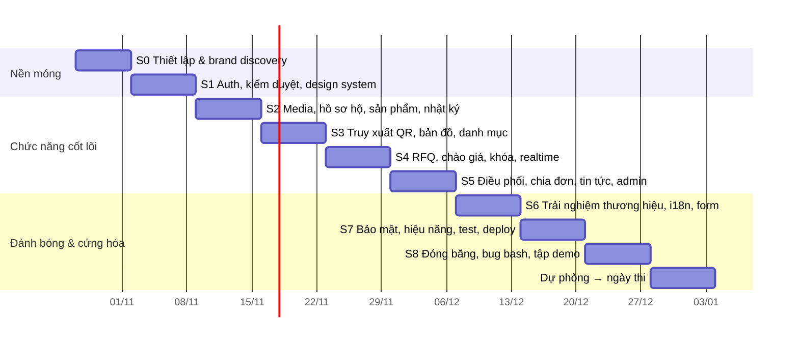

# vCraft — Kế hoạch thực hiện

> Phiên bản 1.0 · 27/10/2026 · Nhóm 3 người · Đi kèm [SRS.md](SRS.md), [ARCHITECTURE.md](ARCHITECTURE.md), [BRAND.md](BRAND.md)
> Giả định lịch vấn đáp **đầu tháng 1/2027**. Lịch khác thì co giãn Sprint 6–8, **không** cắt Sprint 7 (cứng hóa).

---

## Mục lục

1. [Chiến lược đạt điểm tối đa](#1-chiến-lược-đạt-điểm-tối-đa)
2. [Tech stack](#2-tech-stack)
3. [Phân vai nhóm](#3-phân-vai-nhóm)
4. [Lộ trình theo sprint](#4-lộ-trình-theo-sprint)
5. [Backlog chi tiết theo epic](#5-backlog-chi-tiết-theo-epic)
6. [Kịch bản demo vấn đáp](#6-kịch-bản-demo-vấn-đáp)
7. [Chuẩn bị câu hỏi vấn đáp](#7-chuẩn-bị-câu-hỏi-vấn-đáp)
8. [Definition of Done & quy trình làm việc](#8-definition-of-done--quy-trình-làm-việc)
9. [Rủi ro & phương án](#9-rủi-ro--phương-án)
10. [Bước tiếp theo ngay hôm nay](#10-bước-tiếp-theo-ngay-hôm-nay)

---

## 1. Chiến lược đạt điểm tối đa

### 1.1 Phân bổ công sức theo trọng số

| #   | Tiêu chí                | Hệ số    | Công sức | Cách "chốt" điểm tối đa                                                                                                                                                     |
| --- | ----------------------- | -------- | -------- | --------------------------------------------------------------------------------------------------------------------------------------------------------------------------- |
| 1   | Chức năng               | **0.35** | ~40%     | Làm **đủ 100% chức năng trong đề** (mức M) trước 06/12, sau đó mới thêm "wow" (mức S/C). Mỗi chức năng trong đề có ít nhất một điểm vượt kỳ vọng (bảng 1.2).                |
| 3   | Giao diện & bản sắc     | **0.2**  | ~25%     | Hệ thống thương hiệu hoàn chỉnh ([BRAND.md](BRAND.md)), 10 khoảnh khắc chuyển động đặc trưng, ảnh thật từ Bát Tràng, responsive kiểm từng màn ở 360/768/1440.               |
| 2   | Thiết kế logic, dễ dùng | 0.1      | ~8%      | Stepper trạng thái thống nhất, chỉ hiện hành động hợp lệ, wizard, trạng thái rỗng/lỗi có hướng dẫn, test với 5 người.                                                       |
| 4   | Hiệu năng / AJAX / JSON | 0.1      | ~8%      | Mọi tương tác là fetch → JSON → cập nhật DOM; SSE realtime; Lighthouse ≥ 90; chứng minh bằng tab Network.                                                                   |
| 5   | Phong cách lập trình    | 0.05     | ~5%      | Monorepo có ranh giới cưỡng chế, domain thuần, 12+ pattern có tên, JSDoc tham chiếu mã yêu cầu.                                                                             |
| 6   | Xử lý nhập liệu         | 0.05     | ~4%      | Schema Zod dùng chung, kiểm tra realtime, ≥ 8 kiểu tự điền/gợi ý/chuyển đổi (bảng 1.3).                                                                                     |
| 7   | An ninh                 | 0.05     | ~4%      | Supabase Auth (xác minh email, MFA bắt buộc cho Admin, CAPTCHA, refresh xoay vòng), API tự kiểm chứng JWT qua JWKS, đăng xuất mọi thiết bị, CASL, AES-GCM, CSP, rate limit. |
| 8   | URL                     | 0.05     | ~3%      | URL bản địa hóa vi/en, slug tiếng Việt, `/q/<code>` 308, slug cũ 301, rewrite ở Caddy.                                                                                      |
| 9   | CSDL OOP & độc lập      | 0.05     | ~3%      | MikroORM entity class + Unit of Work, **demo đổi sang MySQL trực tiếp**, CI ma trận 2 CSDL.                                                                                 |

### 1.2 Mỗi yêu cầu của đề có một điểm "vượt kỳ vọng"

| Yêu cầu trong đề    | Mức đề bài               | vCraft làm thêm                                                                                                 |
| ------------------- | ------------------------ | --------------------------------------------------------------------------------------------------------------- |
| Hồ sơ xưởng         | Lịch sử, ảnh, chứng nhận | Timeline gia đình kéo ngang, chứng nhận được BQL xác minh, độ hoàn thiện hồ sơ, AI gợi ý viết + dịch câu chuyện |
| Nhật ký sản xuất    | Mảng mốc + ảnh           | Mẫu công đoạn theo nghề, tự điền ngày từ EXIF, **chuỗi băm chống sửa** kiểm chứng ngay trên trình duyệt         |
| QR                  | Sinh QR → landing        | QR thương hiệu trong khung ấn, URL ngắn đa ngôn ngữ, thống kê lượt quét, in tờ tem PDF                          |
| Báo giá             | State machine            | Chào giá kín, sửa có phiên bản, so sánh realtime, ghép hộ chấm điểm, hết hạn tự động, idempotency               |
| Khóa bản ghi        | "Logic khóa phức tạp"    | Khóa lạc quan + bi quan + UNIQUE + outbox, **demo 2 tab chốt cùng lúc**                                         |
| Chia đơn            | Admin chia 3–4 hộ        | 3 chiến lược thuật toán so sánh song song, kéo-thả chỉnh tay, bất biến tổng, Gantt tiến độ, chia lại khi trễ    |
| Bản đồ              | Ghim + popup             | Style thương hiệu, "đang mở cửa" theo giờ thật, clustering, đồng bộ danh sách, gần tôi, chạy offline            |
| Upload & tối ưu ảnh | Resize ở backend         | Nén trước ở client, AVIF/WebP 4 kích thước, xóa GPS, thumbhash, xử lý nền + SSE báo xong                        |
| Kiểm duyệt hộ       | Duyệt tài khoản          | Hồ sơ song song giấy tờ ↔ bản đồ, kiểm tra trong ranh giới làng, giấy tờ mã hóa, hiệu ứng đóng ấn               |
| Tin tức             | CRUD                     | Lịch cúp điện có cấu trúc ⇒ banner cho hộ bị ảnh hưởng; biểu đồ giá vật liệu; hẹn giờ đăng                      |

### 1.3 Danh sách tính năng nhập liệu (tiêu chí 6)

1. Kiểm tra realtime bằng schema Zod dùng chung, thông báo tiếng Việt cụ thể.
2. Kiểm tra bất đồng bộ (email/slug/SĐT đã dùng) có debounce.
3. Địa chỉ dạng cascade **Tỉnh/Thành → Xã/Phường** (dữ liệu 2 cấp mới).
4. Chọn vị trí trên bản đồ ⇒ tự điền địa chỉ; "Dùng vị trí hiện tại".
5. Chọn danh mục ⇒ tự nạp mẫu công đoạn sản xuất.
6. Ảnh ⇒ tự điền ngày giờ mốc từ EXIF.
7. Ô tiền tự định dạng `1.250.000 ₫` + **đọc thành chữ** ("Một triệu hai trăm năm mươi nghìn đồng") + quy đổi USD tham khảo.
8. SĐT tự chuẩn hóa `0912…` ⇄ `+84 912…`; slug tự sinh từ tên tiếng Việt.
9. Gợi ý: tìm kiếm không dấu ⌘K, gợi ý giá chào/giá bán, gợi ý thời gian hoàn thành theo năng lực.
10. Ảnh: nén + HEIC→JPEG ở client, kiểm tra kích thước/định dạng trước khi gửi.
11. Wizard nhiều bước tự lưu nháp; cảnh báo khi rời trang chưa lưu.
12. Ngày tháng `dd/MM/yyyy`, chọn khoảng ngày, ràng buộc chéo (hạn giao > hạn chào giá).

---

## 2. Tech stack

Phiên bản đã đối chiếu npm ngày 27/10/2026. Sprint 0 khóa phiên bản chính xác trong lockfile.

### 2.1 Nền tảng & monorepo

| Thành phần      | Lựa chọn            | Phiên bản    | Ghi chú                            |
| --------------- | ------------------- | ------------ | ---------------------------------- |
| Runtime         | Node.js LTS         | 24 (≥)       | `.nvmrc`                           |
| Package manager | pnpm workspaces     | 12.x         | `corepack use pnpm@latest`         |
| Task runner     | Turborepo           | 2.11         | Cache build/test                   |
| Ngôn ngữ        | TypeScript (strict) | 6.0 | Bản 7 (native) chưa có JS API cho Next/Nest CLI/MikroORM CLI ⇒ nâng cấp khi hệ sinh thái hỗ trợ; `apps/api` build bằng SWC |
| Lint + format   | Biome               | 2.6          | Một công cụ thay ESLint + Prettier |
| Git hooks       | Lefthook            | 2.2          | pre-commit + Conventional Commits  |
| Ranh giới gói   | dependency-cruiser  | 18.7.0       | Chạy trong CI                      |

### 2.2 Frontend — `apps/web`

| Mục đích                | Lựa chọn                                                                                                     | Phiên bản    |
| ----------------------- | ------------------------------------------------------------------------------------------------------------ | ------------ |
| Framework               | **Next.js** (App Router, Turbopack, `proxy.ts`)                                                              | 16.4         |
| UI runtime              | React (+ React Compiler)                                                                                     | 19.3         |
| CSS                     | **Tailwind CSS** (token qua `@theme`)                                                                        | 4.3          |
| Primitive truy cập được | Radix UI qua shadcn/ui (tùy biến hoàn toàn theo brand)                                                       | —            |
| Dữ liệu server          | **TanStack Query**                                                                                           | 5.105        |
| Bảng / danh sách dài    | TanStack Table 9 · TanStack Virtual 3                                                                        | —            |
| URL state               | nuqs                                                                                                         | 2.10         |
| UI state                | Zustand                                                                                                      | 5            |
| Form                    | React Hook Form 7.91 + Zod 4.6                                                                               | —            |
| Xác thực (client)       | **@supabase/supabase-js** + **@supabase/ssr** (cookie phiên cho App Router) · Cloudflare Turnstile           | 2.118 · 0.12 |
| i18n                    | next-intl                                                                                                    | 4.14         |
| Hoạt ảnh component      | **Motion** (`motion/react`)                                                                                  | 14.6         |
| Kể chuyện theo cuộn     | **GSAP** (ScrollTrigger, SplitText, DrawSVG — miễn phí toàn bộ) + `@gsap/react`                              | 3.15         |
| Cuộn mượt               | Lenis                                                                                                        | 1.3          |
| 3D                      | three 0.186 · **@react-three/fiber** 9.8 · drei 10.7                                                         | —            |
| Bản đồ                  | **MapLibre GL JS** 6.16 + react-map-gl 8 (`/maplibre`) + OpenFreeMap / PMTiles                               | —            |
| Editor tin tức          | Tiptap                                                                                                       | 3.x          |
| Kéo-thả                 | dnd-kit                                                                                                      | 6.x          |
| QR                      | qr-code-styling (QR thương hiệu)                                                                             | 1.9          |
| Ảnh client              | exifr (EXIF) · browser-image-compression · heic2any                                                          | —            |
| Biểu đồ                 | Recharts                                                                                                     | 3.x          |
| Khác                    | cmdk (⌘K) · sonner (toast) · vaul (bottom sheet) · embla-carousel · lucide-react · date-fns 4 + @date-fns/tz | —            |

### 2.3 Backend — `apps/api`, `apps/worker`

| Mục đích             | Lựa chọn                                                                                                                                                                            | Phiên bản                                     |
| -------------------- | ----------------------------------------------------------------------------------------------------------------------------------------------------------------------------------- | --------------------------------------------- |
| Framework            | **NestJS** (adapter Fastify)                                                                                                                                                        | 12.x*(pin 11.x nếu thư viện phụ chưa hỗ trợ)* |
| ORM                  | **MikroORM** (`@mikro-orm/nestjs`, driver postgresql + mysql)                                                                                                                       | 7.2                                           |
| CSDL                 | PostgreSQL 17 (chính) · MySQL 8.4 (kiểm chứng độc lập)                                                                                                                              | —                                             |
| Validation & OpenAPI | Zod 4 + `ZodValidationPipe` tự viết + `z.toJSONSchema()` → Scalar API reference                                                                                                     | —                                             |
| Xác thực             | **Supabase Auth** (email, Google OAuth, MFA TOTP, invite) · **@supabase/server** `verifyAuth()` trong `SupabaseAuthGuard` tự viết (không dùng adapter NestJS — sẽ bị gỡ 01/12/2026) | 1.9                                           |
| Phân quyền           | CASL                                                                                                                                                                                | 7.0                                           |
| Bảo vệ               | @fastify/helmet · @nestjs/throttler (Redis store) · sanitize-html                                                                                                                   | —                                             |
| Hàng đợi             | **BullMQ** + Redis 7                                                                                                                                                                | 6.5                                           |
| Ảnh                  | **sharp** · thumbhash                                                                                                                                                               | 0.35                                          |
| QR / PDF             | qrcode · pdf-lib                                                                                                                                                                    | —                                             |
| Lưu trữ              | @aws-sdk/client-s3 (MinIO / Cloudflare R2)                                                                                                                                          | —                                             |
| Mail                 | Nodemailer (Mailpit khi dev)                                                                                                                                                        | —                                             |
| Log / health         | nestjs-pino · @nestjs/terminus                                                                                                                                                      | —                                             |
| ID                   | uuid v7 · nanoid (mã truy xuất, bảng chữ tùy chỉnh)                                                                                                                                 | —                                             |
| AI (Could)           | Claude API — Haiku 5.5 cho dịch/gợi ý câu chuyện                                                                                                                                    | —                                             |

### 2.4 Kiểm thử, hạ tầng, triển khai

| Mục đích         | Lựa chọn                                                                                                                                                                             |
| ---------------- | ------------------------------------------------------------------------------------------------------------------------------------------------------------------------------------ |
| Unit / component | Vitest 5 · Testing Library · fast-check                                                                                                                                              |
| Integration      | Testcontainers (PostgreSQL + MySQL) · Supertest                                                                                                                                      |
| E2E / a11y       | Playwright 1.64 · @axe-core/playwright                                                                                                                                               |
| Tải / tranh chấp | k6                                                                                                                                                                                   |
| Hiệu năng        | Lighthouse CI                                                                                                                                                                        |
| Dev infra        | Docker Compose: postgres, mysql (profile), redis, minio, mailpit, caddy                                                                                                              |
| Reverse proxy    | Caddy 2 (HTTPS tự động, rewrite, header bảo mật)                                                                                                                                     |
| CI/CD            | GitHub Actions                                                                                                                                                                       |
| Hosting demo     | 1 VPS (GitHub Student Pack có credit DigitalOcean) + tên miền (`.id.vn` miễn phí cho người 18–23 tuổi — kiểm tra điều kiện, hoặc `.me` qua Student Pack); dự phòng Cloudflare Tunnel |

---

## 3. Phân vai nhóm

| Thành viên                          | Vai trò chính                            | Sở hữu                                                                                                    | Hỗ trợ                                 |
| ----------------------------------- | ---------------------------------------- | --------------------------------------------------------------------------------------------------------- | -------------------------------------- |
| **A — Frontend & Brand lead**       | Design system, hoạt ảnh, trang công khai | `packages/ui`, `apps/web/experience`, trang chủ, hồ sơ hộ, chi tiết sản phẩm, landing truy xuất, BRAND.md | Figma, ảnh thực địa, kiểm thử khả dụng |
| **B — Backend & Domain lead**       | Nghiệp vụ lõi, bảo mật                   | `packages/domain`, `packages/contracts`, module auth/rfq/bids/orders, khóa & state machine, phân quyền    | Màn RFQ/điều phối (cùng A)             |
| **C — Platform & Integration lead** | Dữ liệu, media, bản đồ, hạ tầng          | `packages/database`, media pipeline, worker, traceability/QR, bản đồ, i18n, CI/CD, deploy                 | Studio nghệ nhân, Admin dashboard      |

Quy tắc chéo:
- **Ai cũng phải trả lời được mọi tiêu chí** khi vấn đáp ⇒ mỗi thứ Sáu 30 phút "dạy lại": một người trình bày phần mình cho hai người còn lại.
- Mỗi PR cần 1 người khác duyệt; người duyệt luân phiên để hiểu toàn bộ mã.
- Màn hình nào cũng có 1 "chủ" FE và 1 "chủ" API rõ ràng trong issue.

---

## 4. Lộ trình theo sprint

| Sprint               | Mục tiêu (sản phẩm demo được cuối sprint)                  | A — Frontend/Brand                                                                                        | B — Backend/Domain                                                                                                  | C — Platform                                                                                                                                                                                        |
| -------------------- | ---------------------------------------------------------- | --------------------------------------------------------------------------------------------------------- | ------------------------------------------------------------------------------------------------------------------- | --------------------------------------------------------------------------------------------------------------------------------------------------------------------------------------------------- |
| **S0** 27/10–01/11   | Repo chạy được, CI xanh, có hướng thương hiệu              | Moodboard, logo ấn bình, token màu/chữ, Figma 6 màn chính                                                    | Mô hình domain, schema Zod đầu tiên, bảng state machine + test                                                      | `create-next-app`, `nest new`, MikroORM + 2 driver, compose, CI; cấu hình Supabase Auth (Site URL, redirect URLs, SMTP riêng, JWT 15′, MFA, Turnstile); **thực địa Bát Tràng** (cả nhóm, cuối tuần) |
| **S1** 02/11–08/11   | Đăng ký/đăng nhập, hộ nộp hồ sơ, admin duyệt               | `packages/ui` (button, input, card, dialog, toast…), layout, header/footer, trang auth, wizard đăng ký hộ | `SupabaseAuthGuard` (JWKS), cấp hồ sơ lần đầu, CASL, throttler, kiểm duyệt hộ (+ invite/ban qua Supabase admin API) | Entities User/LoginEvent/Artisan/Workshop, migration, seeder cơ bản, mail (Mailpit), mã hóa trường CCCD                                                                                             |
| **S2** 09/11–15/11   | Hộ đăng sản phẩm có nhiều ảnh + nhật ký                    | Studio (mobile-first): hồ sơ hộ, form sản phẩm, uploader nhiều ảnh, thêm mốc nhật ký                      | Module products, production-logs, chuỗi băm (domain), mẫu công đoạn                                                 | **Media pipeline**: upload, magic bytes, worker sharp AVIF/WebP, thumbhash, SSE `media.ready`                                                                                                       |
| **S3** 16/11–22/11   | Khách quét QR xem hành trình; xem bản đồ; duyệt danh mục   | Trang danh mục (lọc + URL + cuộn vô hạn), chi tiết sản phẩm, hồ sơ hộ công khai, landing truy xuất        | Module catalog (Specification, cursor, tìm không dấu), gợi ý ⌘K                                                     | Traceability (mã, QR, `/q` redirect, lượt quét), **bản đồ** (style, ghim bbox, popup, đang mở, cluster), seed 200 sản phẩm                                                                          |
| **S4** 23/11–29/11   | Luồng báo giá đầy đủ tới chốt, 2 tab chốt cùng lúc an toàn | Màn tạo RFQ, lời mời + form chào giá (Studio), bảng so sánh realtime, stepper                             | **RFQ/Bids**: state machine, ghép hộ, chào giá kín, khóa lạc quan/bi quan, idempotency, outbox, job hết hạn         | SSE hub + Redis pub/sub, thông báo in-app + email, test concurrency (2 CSDL)                                                                                                                        |
| **S5** 30/11–06/12   | **Đủ 100% chức năng đề bài**                               | Màn điều phối (kéo-thả, 3 phương án), Gantt tiến độ, admin dashboard, editor tin tức                      | Orders/Allocations, 3 chiến lược chia (property test), chia lại, cập nhật tiến độ                                   | News (lịch cúp điện, giá vật liệu), audit log, biểu đồ dashboard                                                                                                                                    |
| **S6** 07/12–13/12   | Trang web "cực kỳ nổi bật"                                 | **Hero bình gốm 3D**, scroll story, View Transitions, đóng ấn, ghim thở, chế độ Lò đêm                    | Gợi ý giá, đánh giá hộ, trang Bảo mật tài khoản (lịch sử đăng nhập, đăng xuất mọi thiết bị), MFA bắt buộc cho Admin | i18n vi/en + URL bản địa hóa, OG image động, sitemap, slug 301, tự điền địa chỉ/EXIF, đọc số thành chữ                                                                                              |
| **S7** 14/12–20/12   | Sẵn sàng chấm                                              | Responsive pass 360/768/1440 từng màn, a11y (axe), reduced-motion, Lighthouse ≥ 90                        | Rà soát bảo mật (OWASP checklist), CSP nonce, test phân quyền 403 toàn bộ route                                     | Deploy VPS + HTTPS, backup, PMTiles offline, Lighthouse CI, E2E 3 vai trò                                                                                                                           |
| **S8** 21/12–27/12   | **Đóng băng tính năng 20/12**                              | Kiểm thử khả dụng 5 người, sửa UX                                                                         | Bug bash, tối ưu truy vấn                                                                                           | Dữ liệu demo cuối cùng, kịch bản reset dữ liệu 1 lệnh                                                                                                                                               |
| Dự phòng 28/12 → thi | Tập demo ≥ 3 lần có bấm giờ, luyện Q&A chéo                |                                                                                                           |                                                                                                                     |                                                                                                                                                                                                     |

**Mốc kiểm soát:** 08/11 (đăng nhập + duyệt chạy end-to-end) · 22/11 (QR quét được trên điện thoại thật) · **06/12 (đủ chức năng đề bài)** · 20/12 (feature freeze) · 27/12 (bản demo cuối).

---

## 5. Backlog chi tiết theo epic

Ký hiệu: **[A] [B] [C]** = người phụ trách; mã FR tham chiếu [SRS.md](SRS.md).

### E0 — Nền móng (S0)

- [ ] [C] Khởi tạo `apps/web` bằng `create-next-app` (TS, Tailwind 4, App Router, src/) vào khung thư mục sẵn có
- [ ] [C] Khởi tạo `apps/api`, `apps/worker` bằng Nest CLI; adapter Fastify; SWC
- [ ] [C] `packages/database`: `mikro-orm.config.ts` đọc `DB_DRIVER`; migration riêng 2 driver; `pnpm db:migrate`, `pnpm db:seed`
- [ ] [C] CI chạy đủ job; `pnpm deps:check` xanh
- [ ] [B] `packages/domain/rfq`: bảng chuyển trạng thái + `transition()` + `availableEvents()` + test mọi cặp trạng thái×sự kiện
- [ ] [B] `packages/contracts`: quy ước schema, mã lỗi, Problem Details
- [ ] [A] Moodboard, logo ấn bình (SVG), token màu/chữ/khoảng cách/bóng, Figma: Trang chủ, Hồ sơ hộ, Sản phẩm, Truy xuất, RFQ, Điều phối
- [ ] [ALL] Thực địa Bát Tràng: phỏng vấn 1–2 hộ (xin phép), chụp ảnh quy trình đủ 7 công đoạn, chân dung, xưởng; quay 10–20s video bàn xoay

### E1 — Xác thực & phiên (FR-AUTH) — Supabase Auth

- [ ] [C] Cấu hình project Supabase: Site URL + redirect URLs (localhost, domain demo), SMTP riêng, mẫu email tiếng Việt, JWT expiry 15′, bật MFA TOTP, leaked password protection, Turnstile, Google OAuth
- [ ] [B] `SupabaseAuthGuard` bọc `verifyAuth()` (`@supabase/server`): kiểm JWKS/iss/aud/exp, nạp `User` từ DB (cache Redis), tạo hồ sơ lần đầu, chặn `SUSPENDED`, decorator `@RequireAal2()` cho route Admin
- [ ] [B] CASL abilities + `PoliciesGuard` + decorator `@CheckPolicies`; test 403 cho mọi route
- [ ] [B] Supabase admin API ở backend: mời hộ, ban/unban khi khóa tài khoản; ghi `LoginEvent`
- [ ] [C] `api-client/http`: lấy token từ phiên Supabase, 401 ⇒ refresh + thử lại một lần, Idempotency-Key, ApiError
- [ ] [A] `@supabase/ssr` trong `proxy.ts` + providers; trang đăng nhập/đăng ký/quên mật khẩu (Turnstile); wizard đăng ký hộ 4 bước có lưu nháp
- [ ] [A][B] Trang Bảo mật tài khoản + màn nhập mã MFA cho Admin (S6)

### E2 — Kiểm duyệt hộ (FR-ADM-01…05)

- [ ] [B] API hàng đợi, duyệt/từ chối/yêu cầu bổ sung, audit
- [ ] [C] Polygon ranh giới làng (GeoJSON tĩnh) + kiểm tra điểm trong đa giác (domain)
- [ ] [A] Màn duyệt 3 cột + hiệu ứng **đóng ấn**

### E3 — Hồ sơ hộ & xưởng (FR-ART)

- [ ] [B] API hồ sơ, lịch sử gia đình, chứng nhận, năng lực, xưởng + giờ mở cửa
- [ ] [A] Studio: chỉnh hồ sơ (rich text), timeline gia đình, chứng nhận, thư viện ảnh kéo-thả
- [ ] [A] Trang triển lãm số công khai (bento, timeline ngang, masonry)

### E4 — Media (FR-MEDIA)

- [ ] [C] `POST /media` multipart, magic bytes, quota; bucket public/private; URL ký
- [ ] [C] Worker: pipeline Chain of Responsibility; AVIF/WebP ×4; thumbhash; màu chủ đạo; outbox `media.ready`
- [ ] [A] Uploader: nén client, HEIC→JPEG, EXIF, 4 luồng song song, progress, hủy/thử lại, thứ tự kéo-thả
- [ ] [A] Component `<CraftImage>`: `<picture>` + srcset + thumbhash + hiện dần

### E5 — Sản phẩm & nhật ký (FR-PRD)

- [ ] [B] CRUD sản phẩm, xuất bản (≥ 1 mốc), slug + `SlugRedirect`
- [ ] [B] Mốc nhật ký append-only, đính chính, chuỗi băm (domain + test)
- [ ] [A] Form sản phẩm, trình thêm mốc nhanh trên mobile (camera + EXIF)

### E6 — Truy xuất & QR (FR-TRC)

- [ ] [C] Sinh mã 8 ký tự, `GET /trace/:code`, `POST /trace/:code/scans`, thống kê lượt quét
- [ ] [C] `/q/[code]` 308 theo locale (proxy.ts)
- [ ] [A] Landing truy xuất: dòng thời gian lửa, kiểm chứng băm Web Crypto, ấn xác thực, bản đồ mini
- [ ] [A] QR thương hiệu (qr-code-styling) + tải SVG/PNG; [C] tờ tem PDF (pdf-lib)

### E7 — Danh mục & tìm kiếm (FR-CAT)

- [ ] [B] Catalog query (Specification), cursor pagination, `search_text` không dấu, gợi ý
- [ ] [A] Trang danh mục: bộ lọc ⇄ URL (nuqs), cuộn vô hạn, skeleton, ⌘K
- [ ] [A] Chi tiết sản phẩm + View Transition từ thẻ

### E8 — Bản đồ (FR-MAP)

- [ ] [C] `GET /map/workshops?bbox=…&openNow=…` (JSON), tính `isOpenNow/nextOpenAt` theo giờ VN
- [ ] [C] Style MapLibre theo brand; PMTiles khu vực Bát Tràng (dự phòng offline)
- [ ] [C] Ghim ấn + cluster + popup + bộ lọc + ghim thở + flyTo; danh sách đồng bộ; bottom sheet mobile; "gần tôi"
- [ ] [C] Chế độ danh sách cho không WebGL / screen reader

### E9 — Báo giá & chào giá (FR-RFQ)

- [ ] [B] API RFQ: nháp, submit (guard), ghép hộ (Strategy, BR-05), lời mời
- [ ] [B] API Bid: tạo/sửa (revision)/rút, chào giá kín (policy), hạn chót
- [ ] [B] `AcceptBidService`: giao dịch + khóa bi quan + `If-Match` + idempotency + outbox
- [ ] [B] Job `rfq.expire`, `rfq.coordination-check`
- [ ] [C] Test concurrency: 50 request chốt song song ⇒ 1 thành công (PostgreSQL + MySQL)
- [ ] [A] Form RFQ (ví dụ 5.000 cốc), Studio lời mời + đếm ngược + form chào giá (gợi ý giá), bảng so sánh realtime, stepper dùng `availableEvents()`

### E10 — Điều phối & chia đơn (FR-ORD)

- [ ] [B] Domain: 3 chiến lược chia + bất biến + property test (fast-check)
- [ ] [B] API nhận điều phối, đề xuất phương án, bid liên kết, xác nhận/từ chối phân bổ, bắt đầu SX, tiến độ, giao hàng, chia lại
- [ ] [A] Màn chia đơn: 3 phương án song song, kéo-thả/thanh trượt, khối đất rạn khi sai tổng
- [ ] [C] Gantt phân bổ + cảnh báo trễ; Studio "Đơn của tôi" cập nhật tiến độ

### E11 — Tin tức & thông báo (FR-NEWS, FR-NOTI)

- [ ] [C] API tin (chuyên mục, audience, hẹn giờ, sanitize), giá vật liệu, lịch cúp điện
- [ ] [A] Editor Tiptap; trang tin công khai; biểu đồ giá vật liệu; banner cúp điện trong Studio
- [ ] [C] Chuông thông báo SSE, đánh dấu đã đọc, email theo tùy chọn

### E12 — Admin dashboard (FR-ADM-06)

- [ ] [C] API thống kê; [A] KPI + biểu đồ + hoạt động gần đây; audit log viewer

### E13 — Trải nghiệm thương hiệu (S6) — xem [BRAND §6.3](BRAND.md#63-mười-khoảnh-khắc-đặc-trưng-signature-moments)

- [ ] [A] Hero bình gốm 3D (LatheGeometry nội suy 4 profile, shader men lam vẽ dần, ánh lửa nung) + poster fallback
- [ ] [A] Lenis + ScrollTrigger: "Một ngày ở Bát Tràng" cuộn ngang
- [ ] [A] SplitText "chữ nặn", mặt nạ "mực thấm ảnh", DrawSVG gạch chân
- [ ] [A] View Transitions (thẻ → chi tiết, chuyển sáng/tối "Lò đêm")
- [ ] [A] Con trỏ mực, nút từ tính, số đếm lên; kiểm reduced-motion toàn bộ

### E14 — Cứng hóa (S7)

- [ ] [B] Checklist OWASP (ARCHITECTURE §8.2) từng mục có bằng chứng
- [ ] [B] CSP nonce, header, cookie flags, kiểm tra mọi route có policy (test tự động duyệt toàn bộ route)
- [ ] [A] Lighthouse ≥ 90 / a11y ≥ 95 trên 3 trang chính; responsive pass
- [ ] [C] Deploy + HTTPS + domain; backup; script `pnpm demo:reset` nạp lại dữ liệu demo

### Seed data (C phụ trách, A duyệt nội dung)

1 làng Bát Tràng (polygon, giới thiệu) · 20+ hộ (ảnh thật nhóm chụp cho 5–6 hộ chính, còn lại ảnh có giấy phép) · 200+ sản phẩm × 4–7 mốc · 12 RFQ phủ **mọi trạng thái** · 1 đơn đã chia 4 hộ đang sản xuất · 15+ tin (có lịch cúp điện hôm nay, bảng giá vật liệu 6 tháng) · 3 tài khoản demo cố định cho 3 vai trò + 1 tài khoản hộ "đang chờ duyệt".

---

## 6. Kịch bản demo vấn đáp

**Chuẩn bị:** 3 hồ sơ trình duyệt đã đăng nhập sẵn (Buyer — Chrome, Hộ — điện thoại thật hoặc DevTools mobile, Admin — Edge) · tem QR in sẵn dán trên một chiếc cốc gốm thật mua ở Bát Tràng · `pnpm demo:reset` chạy trước giờ thi · bản local + tunnel dự phòng.

| Phút  | Màn                                                                                                                                                                                               | Người   | Thể hiện                                                              | Tiêu chí |
| ----- | ------------------------------------------------------------------------------------------------------------------------------------------------------------------------------------------------- | ------- | --------------------------------------------------------------------- | -------- |
| 0:00  | **Đưa cốc gốm cho giám khảo quét QR** bằng điện thoại của họ                                                                                                                                      | A       | Landing truy xuất, dòng thời gian lửa, "Nhật ký toàn vẹn ✓"           | 1, 3, 8  |
| 1:30  | Trang chủ trên màn lớn: hero bình gốm thành hình theo cuộn                                                                                                                                        | A       | Bản sắc, chuyển động; bật reduced-motion để chứng minh tôn trọng a11y | 3        |
| 2:30  | Danh mục: lọc, cuộn vô hạn, ⌘K "bat trang"; **mở DevTools → Network chỉ thấy Fetch JSON**; thu cửa sổ về 360px                                                                                    | A       | AJAX/JSON/DOM, responsive, URL đồng bộ bộ lọc                         | 3, 4, 8  |
| 3:30  | Bản đồ: lọc "đang mở cửa", click ghim → popup, flyTo                                                                                                                                              | C       | Bản đồ                                                                | 1        |
| 4:30  | Buyer tạo RFQ "5.000 cốc in logo ĐH Công nghệ": tự điền, đọc số thành chữ, ràng buộc ngày                                                                                                         | B       | Nhập liệu                                                             | 1, 6     |
| 5:30  | Hộ (trên điện thoại) nhận thông báo realtime, chào giá; Buyer thấy bid rơi vào bảng không tải lại                                                                                                 | B       | Realtime, chào giá kín                                                | 1, 4     |
| 6:30  | Admin điều phối: 3 phương án chia, kéo-thả, sai tổng ⇒ rạn đỏ; gửi bid liên kết                                                                                                                   | B       | Chia đơn                                                              | 1, 2     |
| 7:30  | **Hai tab Buyer bấm "Chốt" cùng lúc** ⇒ một thành công, một nhận "đã được chốt"                                                                                                                   | B       | Khóa bản ghi                                                          | 1, 9     |
| 8:30  | Hộ đăng mốc nhật ký mới bằng camera (EXIF tự điền), ảnh tối ưu xong hiện qua SSE                                                                                                                  | C       | Upload + tối ưu ảnh                                                   | 1, 4, 6  |
| 9:30  | Bảo mật: Admin đăng nhập phải nhập mã MFA; "Đăng xuất mọi thiết bị" ⇒ điện thoại bị đẩy ra; dán JWT vào jwt.io giải thích chữ ký + JWKS; gọi API sản phẩm hộ khác ⇒ 403; cột CCCD mã hóa trong DB | B       | An ninh                                                               | 7        |
| 10:30 | Mở VS Code: cây monorepo, `packages/domain` (State, Strategy), entity MikroORM, **đổi `DB_DRIVER=mysql` chạy lại**                                                                                | C       | Phong cách code, CSDL                                                 | 5, 9     |
| 11:30 | Đổi sang tiếng Anh: URL `/en/products/...`, `/q/...` redirect                                                                                                                                     | C       | URL                                                                   | 8        |
| 12:00 | Hỏi đáp                                                                                                                                                                                           | Cả nhóm |                                                                       |          |

Diễn tập: ≥ 3 lần có bấm giờ; mỗi người tập được **toàn bộ** kịch bản (phòng khi giám khảo chỉ định).

---

## 7. Chuẩn bị câu hỏi vấn đáp

| Câu hỏi có thể gặp                                       | Ý chính trả lời                                                                                                                                                                                                                        | Chỉ vào đâu                               |
| -------------------------------------------------------- | -------------------------------------------------------------------------------------------------------------------------------------------------------------------------------------------------------------------------------------- | ----------------------------------------- |
| "Tải bộ phận bằng AJAX ở đâu?"                           | Mọi dữ liệu tương tác qua `api-client` → fetch → JSON → TanStack Query → React cập nhật DOM; SSE đẩy thay đổi                                                                                                                          | Tab Network; `packages/api-client`        |
| "Khóa bản ghi thế nào? Sao cần cả lạc quan lẫn bi quan?" | Lạc quan (version) cho cập nhật thường — rẻ, phát hiện ghi đè; bi quan cho đoạn tranh chấp cao (chốt giá) để tuần tự hóa kiểm guard; UNIQUE chặn bid trùng; idempotency chặn double-click                                              | `accept-bid.service.ts`, test concurrency |
| "Độc lập CSDL thể hiện ở đâu?"                           | Entity class + ORM, không SQL tay, không kiểu riêng; UUID/tiền/tìm kiếm không dấu xử lý ở app; CI chạy 2 CSDL                                                                                                                          | `mikro-orm.config.ts`, CI matrix          |
| "Hướng đối tượng ở CSDL?"                                | Data Mapper: entity là class có hành vi; Unit of Work theo dõi thay đổi, flush 1 giao dịch; Identity Map                                                                                                                               | `packages/database/src/entities`          |
| "Design pattern nào?"                                    | State, Strategy, Repository/UoW, Specification, Observer+Outbox, Adapter, Factory, Value Object, Policy, Decorator, Facade, Chain of Responsibility                                                                                    | ARCHITECTURE §5                           |
| "Tách giao diện và nghiệp vụ?"                           | Domain thuần (không React/Nest); feature slices: hooks (view-model) ↔ components (presentational)                                                                                                                                      | `features/rfq`                            |
| "Sao dùng Supabase Auth, nhóm tự làm gì?"                | Ủy thác **danh tính** cho IdP chuyên dụng (như doanh nghiệp dùng Auth0/Cognito) để không tự lưu mật khẩu; nhóm tự làm **kiểm chứng JWT qua JWKS**, **phân quyền RBAC+ABAC**, khóa tài khoản, bắt buộc MFA cho Admin, lịch sử đăng nhập | ADR-11, `SupabaseAuthGuard`               |
| "JWT bị lộ thì sao?"                                     | Access 15′; refresh xoay vòng, dùng lại token cũ ⇒ Supabase thu hồi cả phiên; khóa tài khoản chặn ngay ở API vì trạng thái kiểm trong DB mỗi request                                                                                   | Sơ đồ ARCHITECTURE §7.5                   |
| "Backend biết token thật bằng cách nào?"                 | Supabase ký bằng khóa riêng; API tải khóa công khai từ JWKS (có cache) để kiểm chữ ký, rồi kiểm `iss`, `aud`, `exp`, `aal` — không cần gọi Supabase mỗi request                                                                        | `apps/api/src/common/guards`              |
| "Mã hóa gì?"                                             | TLS, mật khẩu băm bcrypt (Supabase), JWT ký bất đối xứng, AES-256-GCM cho CCCD, SHA-256 chuỗi nhật ký, URL ký cho giấy tờ                                                                                                              | `infrastructure/crypto`                   |
| "Ảnh tối ưu thế nào?"                                    | Nén client → kiểm magic bytes → worker sharp → AVIF/WebP 4 cỡ, xóa GPS, thumbhash → srcset + lazy                                                                                                                                      | Sơ đồ §7.1                                |
| "QR có giả được không?"                                  | QR chỉ là URL; giá trị nằm ở hồ sơ hộ đã duyệt + nhật ký chuỗi băm; hộ bị khóa ⇒ trang cảnh báo                                                                                                                                        | Landing truy xuất                         |
| "URL rewrite ở đâu?"                                     | `proxy.ts` (locale, `/q`, slug cũ 301), pathnames bản địa hóa, Caddy `/api` `/media`                                                                                                                                                   | `infra/caddy/Caddyfile`                   |
| "Sao chọn MikroORM thay Prisma?"                         | Prisma không có entity class, khóa bi quan phải viết SQL tay ⇒ vi phạm OOP & độc lập CSDL                                                                                                                                              | ADR-04                                    |

---

## 8. Definition of Done & quy trình làm việc

**Một tính năng là xong khi:**
1. Đáp ứng tiêu chí chấp nhận của mã FR tương ứng.
2. Schema trong `contracts`, kiểm tra cả FE và BE.
3. Có test: domain (unit), API (integration, có case 403), luồng chính (E2E nếu là hành trình demo).
4. Responsive 360 / 768 / 1440; có loading / empty / error; dùng token, không hard-code màu.
5. Tôn trọng reduced-motion; điều hướng bàn phím được; ảnh có alt.
6. Không chuỗi UI hard-code (đi qua i18n).
7. JSDoc cho hàm công khai và quy tắc nghiệp vụ (ghi mã BR/FR).
8. PR được duyệt, CI xanh, có ảnh chụp/GIF nếu đổi giao diện.

**Quy trình git** (chi tiết ở [AGENTS.md §4](../AGENTS.md#4-quy-tắc-git)):
- `main` chỉ để deploy: chỉ nhận merge từ `develop` khi phát hành, gắn tag `v0.<sprint>` cuối mỗi sprint.
- `develop` là nhánh tích hợp, luôn chạy được.
- Feature: tạo nhánh từ `develop` (`feat/<epic>-<mô-tả>`, `fix/…`, `docs/…`, `chore/…`), mở PR **vào `develop`**, squash merge, Conventional Commits (`feat(rfq): …`).
- Merge xong thì xóa nhánh feature ở cả remote lẫn local (bật "Automatically delete head branches" trên GitHub), rồi `git fetch --prune`.

**Nhịp làm việc:** họp 15′ thứ Hai/Tư/Sáu · demo nội bộ Chủ nhật cuối sprint · board GitHub Projects (cột: Backlog / Sprint / Đang làm / Review / Xong), mỗi issue gắn mã FR + tiêu chí chấm.

---

## 9. Rủi ro & phương án

| Rủi ro                                                                                 | Khả năng | Ảnh hưởng | Phương án                                                                                                    |
| -------------------------------------------------------------------------------------- | -------- | --------- | ------------------------------------------------------------------------------------------------------------ |
| Ôm quá nhiều "wow", thiếu chức năng cốt lõi                                            | Cao      | Rất cao   | Mốc cứng 06/12 đủ chức năng mức M; S6 mới làm hiệu ứng lớn; mọi thứ mức C có thể cắt                         |
| Hero 3D tốn thời gian / nặng                                                           | TB       | TB        | Giới hạn 4 ngày; dự phòng video loop bình xoay + GSAP, vẫn giữ ý tưởng 5 chặng                               |
| Mạng phòng thi chập chờn                                                               | TB       | Cao       | Chạy local + tunnel; bản đồ PMTiles offline; font tự host; ảnh seed có sẵn                                   |
| QR không quét được ở phòng thi                                                         | Thấp     | Cao       | In tem 3 cỡ; URL ngắn; thử trước trên iOS + Android; có bản ảnh chụp landing                                 |
| Thư viện chưa hỗ trợ NestJS 12                                                  | TB       | TB        | Đã kiểm 27/10: các thư viện chính hỗ trợ Nest 12; nếu phát sinh thì pin NestJS 11                                                             |
| Thành viên ốm / bận thi môn khác                                                       | TB       | Cao       | Ai cũng nắm toàn hệ thống (buổi dạy lại thứ Sáu); tài liệu ARCHITECTURE; dự phòng 1 tuần                     |
| Project Supabase Free tự tạm dừng sau 7 ngày không dùng / SMTP mặc định giới hạn email | TB       | Cao       | Truy cập định kỳ + kiểm tra 1 ngày trước thi; SMTP riêng (Resend/Brevo); tài khoản demo tạo sẵn, đã xác minh |
| Lệch giữa FE và BE                                                                     | TB       | TB        | Một nguồn schema (`contracts`), client có kiểu sinh từ OpenAPI                                               |
| Bản quyền ảnh                                                                          | TB       | TB        | Ảnh tự chụp ở thực địa; ảnh ngoài chỉ từ nguồn giấy phép rõ ràng, ghi công                                   |
| Dữ liệu demo bị "bẩn" do tập dượt                                                      | Cao      | TB        | `pnpm demo:reset` một lệnh                                                                                   |

---

## 10. Bước tiếp theo ngay hôm nay

1. Cả nhóm đọc [SRS.md](SRS.md) và góp ý trong 24h (đặc biệt §4 máy trạng thái).
2. Tạo GitHub Projects, nhập backlog §5 thành issue, gán người.
3. C: `corepack use pnpm@latest && pnpm install`, khởi tạo Next/Nest vào khung có sẵn, compose chạy được; commit lockfile rồi bật CI bằng repo variable `CI_ENABLED=true`.
4. A: moodboard + logo ấn bình bản nháp trước thứ Sáu 30/10.
5. B: PR đầu tiên `feat(domain): rfq state machine` kèm test.
6. C: cấu hình Supabase Auth theo E1, xác thực MCP `supabase` (`claude /mcp` trong terminal).
7. Chốt lịch thực địa Bát Tràng (thứ Bảy 31/10 hoặc Chủ nhật 01/11).
