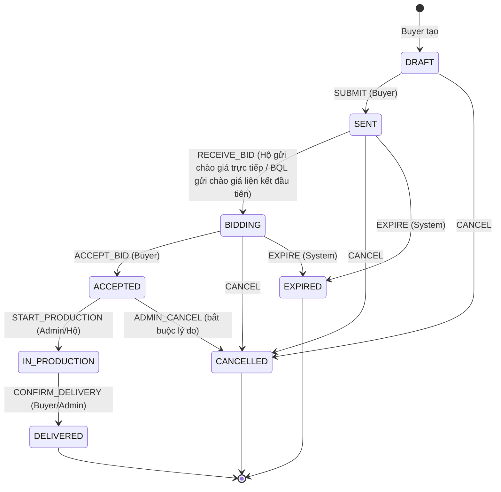
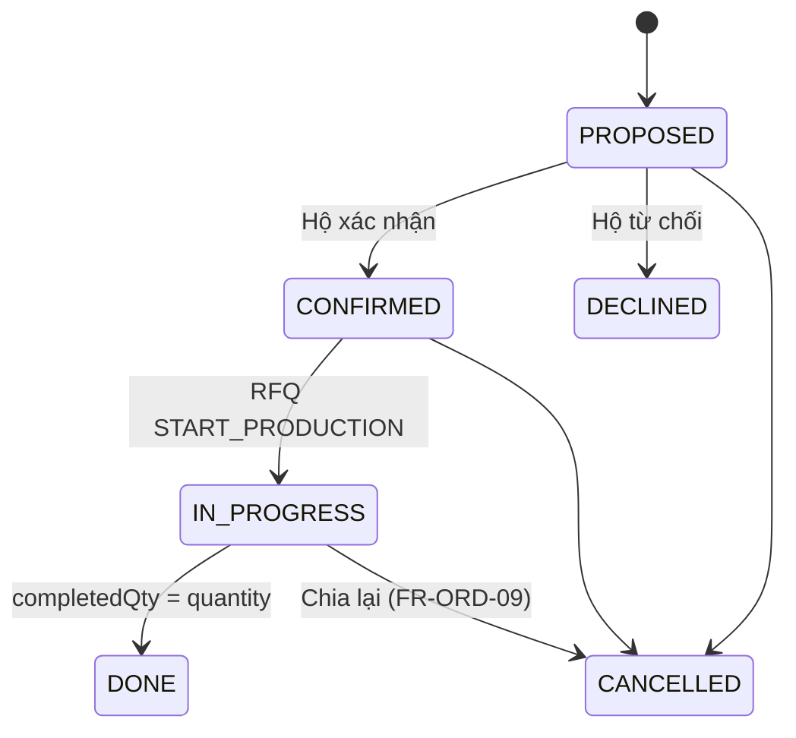

# vCraft — Đặc tả Yêu cầu Phần mềm (SRS)

> **Tinh hoa làng nghề, muôn phương lan tỏa**
> Phiên bản 1.2 · 09/11/2026 (bản 1.0: 27/10/2026) · INT3306 – Phát triển ứng dụng web (Fall 2026)
> Nguồn yêu cầu gốc: [requirements/vCraft.pdf](vCraft.pdf)
> Tài liệu liên quan: [ARCHITECTURE.md](../ARCHITECTURE.md) · [PLAN.md](../PLAN.md) · [BRAND.md](../design/BRAND.md) · [quotation-workflow.md](../api/quotation-workflow.md) · [ADR-0020](../adr/0020-catalog-page-based-pagination.md)

**Lịch sử sửa đổi.** Mã FR/NFR/BR giữ nguyên qua các phiên bản; dòng đã đổi nội dung ghi chú _"Cập nhật 2026-11"_.

| Phiên bản | Ngày | Nội dung |
| --- | --- | --- |
| 1.0 | 27/10/2026 | Bản đầu tiên. |
| 1.1 | 08/11/2026 | Đồng bộ với thiết kế đã triển khai (issue #242): đề xuất tham gia, chào giá trực tiếp và chào giá liên kết thay cho chào giá mở của mọi hộ (§1.2, §1.3, FR-RFQ-03…08, FR-ORD-01, FR-ORD-04, §4.1, §4.2, BR-L3, BR-L4, BR-05, AC-2); phân trang theo số trang theo ADR-0020 (FR-CAT-03, §8); quy tắc "Cần điều phối" theo job `rfq.coordination-check`. |
| 1.2 | 09/11/2026 | Đồng bộ phạm vi với ADR-0021 (issue #392): thanh toán trực tuyến (đặt cọc) có ở chế độ sandbox, chỉ phần chạy thật vẫn ngoài phạm vi (§1.2). |

---

## Mục lục

1. [Giới thiệu](#1-giới-thiệu)
2. [Mô tả tổng quan](#2-mô-tả-tổng-quan)
3. [Yêu cầu chức năng](#3-yêu-cầu-chức-năng)
4. [Đặc tả máy trạng thái & quy tắc khóa](#4-đặc-tả-máy-trạng-thái--quy-tắc-khóa)
5. [Yêu cầu giao diện ngoài](#5-yêu-cầu-giao-diện-ngoài)
6. [Yêu cầu phi chức năng](#6-yêu-cầu-phi-chức-năng)
7. [Yêu cầu dữ liệu](#7-yêu-cầu-dữ-liệu)
8. [Ma trận truy vết: Tiêu chí chấm ↔ Yêu cầu](#8-ma-trận-truy-vết-tiêu-chí-chấm--yêu-cầu)
9. [Phụ lục: Kịch bản chấp nhận chính](#9-phụ-lục-kịch-bản-chấp-nhận-chính)

---

## 1. Giới thiệu

### 1.1 Mục đích

Tài liệu đặc tả đầy đủ yêu cầu chức năng, phi chức năng và ràng buộc của **vCraft** — nền tảng web dành cho Ban quản lý (BQL) một làng nghề truyền thống. Đây là "hợp đồng" chung của nhóm 3 thành viên: mọi tính năng làm ra phải truy vết được về một mã yêu cầu (FR/NFR) ở đây, và mọi tiêu chí chấm điểm phải truy vết được về ít nhất một yêu cầu (§8).

### 1.2 Phạm vi sản phẩm

vCraft **không phải một sàn bán lẻ**. Sản phẩm gồm bốn trụ cột:

| Trụ cột                 | Giá trị mang lại                                                                                                    |
| ----------------------- | ------------------------------------------------------------------------------------------------------------------- |
| **Triển lãm số**        | Mỗi hộ/nghệ nhân có không gian riêng kể chuyện nghề, trưng bày sản phẩm độc bản.                                    |
| **Truy xuất nguồn gốc** | Mỗi sản phẩm có Nhật ký sản xuất (chuỗi mốc + ảnh chứng minh) và mã QR dẫn tới trang kể chuyện.                     |
| **Báo giá & Điều phối** | Khách sỉ gửi Yêu cầu báo giá → hộ được mời (do Khách chọn, hệ thống ghép hoặc BQL mời) chào giá trực tiếp, hoặc gửi đề xuất để BQL điều phối lập chào giá liên kết → Khách chốt → sản xuất → giao. _Cập nhật 2026-11._ |
| **Bản đồ làng nghề**    | Bản đồ tương tác hiển thị xưởng, trạng thái mở cửa đón khách tham quan/trải nghiệm.                                 |

Dữ liệu mẫu (seed) dùng **Làng gốm Bát Tràng** (Gia Lâm, Hà Nội); hệ thống cấu hình được cho làng nghề khác (vd. Lụa Vạn Phúc) qua bảng mẫu công đoạn sản xuất theo danh mục.

**Ngoài phạm vi (Won't have, phiên bản này):** thanh toán trực tuyến trên môi trường thật (đặt cọc trực tuyến chỉ chạy ở chế độ sandbox theo [ADR-0021](../adr/0021-online-payment-for-orders.md), chưa có hợp đồng merchant), tích hợp vận chuyển, ứng dụng di động native, hóa đơn điện tử.

### 1.3 Thuật ngữ

| Thuật ngữ                               | Định nghĩa                                                                                                      |
| --------------------------------------- | --------------------------------------------------------------------------------------------------------------- |
| **BQL / Admin**                         | Ban quản lý làng nghề (Chủ tịch xã / Hội làng nghề).                                                            |
| **Hộ / Nghệ nhân (Artisan)**            | Hộ gia đình sản xuất trong làng, đã được BQL kiểm duyệt. Một tài khoản đại diện một hộ.                         |
| **Xưởng (Workshop)**                    | Địa điểm sản xuất vật lý của hộ, có tọa độ và giờ mở cửa.                                                       |
| **Khách (Buyer)**                       | Khách mua lẻ, khách du lịch hoặc doanh nghiệp mua sỉ.                                                           |
| **Khách vãng lai (Guest)**              | Người dùng chưa đăng nhập.                                                                                      |
| **Nhật ký sản xuất (Production Log)**   | Chuỗi các **Mốc** (milestone) theo thời gian, mỗi mốc gắn công đoạn, ghi chú và ảnh chứng minh.                 |
| **Công đoạn (Stage)**                   | Bước chuẩn trong quy trình của một danh mục (Gốm: Nhào đất → Vuốt → Phơi → Vẽ → Tráng men → Nung → Thành phẩm). |
| **Mã truy xuất (Trace code)**           | Mã ngắn duy nhất của sản phẩm, được mã hóa trong QR.                                                            |
| **Yêu cầu báo giá (RFQ)**               | Quote Request — nhu cầu mua sỉ của Khách (số lượng, hạn, yêu cầu tùy biến).                                     |
| **Chào giá (Bid)** | Chào giá hoàn chỉnh cho **toàn bộ** số lượng của một RFQ (tổng tiền, ngày hoàn thành, ghi chú); thuộc loại _trực tiếp_ (`INDIVIDUAL`) hoặc _liên kết_ (`COOPERATIVE`). _Cập nhật 2026-11: không còn chào giá một phần._ |
| **Chào giá liên kết (Cooperative bid)** | Chào giá `COOPERATIVE` do BQL điều phối lập từ các đề xuất tham gia của nhiều hộ, kèm phương án chia. Khách thấy một chào giá trọn vẹn (phần, ngày và tổng tiền), không thấy đơn giá riêng của từng hộ. _Cập nhật 2026-11._ |
| **Chào giá trực tiếp (Direct quotation)** | Chào giá `INDIVIDUAL` của một Hộ được mời cho toàn bộ số lượng, chỉ trên RFQ **không** nhờ BQL điều phối; Khách thấy đơn giá của hộ đó. _Thêm 2026-11._ |
| **Đề xuất tham gia (Contribution offer)** | Đề xuất riêng của Hộ gửi BQL trên RFQ có điều phối: số lượng tối đa, đơn giá, ngày hoàn thành. Chưa phải chào giá; Khách không đọc được; không giữ chỗ năng lực giữa các RFQ. _Thêm 2026-11._ |
| **Đơn hàng (Order)**                    | Hợp đồng hình thành khi Khách chốt một chào giá.                                                                |
| **Phân bổ (Allocation)**                | Phần việc của một Hộ trong một Đơn hàng (số lượng, đơn giá, hạn).                                               |
| **Chia nhỏ (Split)**                    | Hành động BQL phân Đơn hàng thành nhiều Phân bổ.                                                                |

### 1.4 Quy ước

- Mã yêu cầu: `FR-<NHÓM>-<số>` (chức năng), `NFR-<NHÓM>-<số>` (phi chức năng), `BR-<số>` (quy tắc nghiệp vụ).
- Mức ưu tiên MoSCoW: **M** = Must (bắt buộc cho demo), **S** = Should (cần để đạt điểm tối đa), **C** = Could (điểm cộng "wow").
- Mọi thời gian lưu UTC, hiển thị theo `Asia/Ho_Chi_Minh`. Tiền tệ gốc VND (số nguyên).

---

## 2. Mô tả tổng quan

### 2.1 Bối cảnh

Làng nghề gặp ba vấn đề: (1) sản phẩm thật bị trà trộn hàng nhái, người mua không phân biệt được; (2) câu chuyện và giá trị tay nghề không được truyền tải; (3) đơn hàng sỉ lớn vượt năng lực một hộ, việc gom và chia đơn hiện làm thủ công qua điện thoại. vCraft giải quyết bằng định danh hộ đã kiểm duyệt, nhật ký sản xuất chống sửa đổi + QR, và luồng báo giá/điều phối có kiểm soát trạng thái.

### 2.2 Các lớp người dùng

| Vai trò     | Đặc điểm                                                        | Thiết bị chính                    | Mục tiêu                                                    |
| ----------- | --------------------------------------------------------------- | --------------------------------- | ----------------------------------------------------------- |
| Guest       | Du khách, người quét QR trên sản phẩm                           | Điện thoại (≥ 70%)                | Xem nhanh, tin tưởng nguồn gốc, tìm xưởng mở cửa            |
| Buyer       | Khách lẻ/sỉ, có thể là doanh nghiệp, có thể là người nước ngoài | Desktop + mobile                  | Tìm hộ phù hợp, gửi RFQ, so sánh chào giá, theo dõi tiến độ |
| Artisan     | Hộ sản xuất, kỹ năng số trung bình–thấp, thao tác tại xưởng     | **Điện thoại** (chụp ảnh tại chỗ) | Đăng sản phẩm/mốc nhanh, nhận RFQ, chào giá                 |
| Admin (BQL) | Cán bộ xã/hội nghề                                              | Desktop                           | Kiểm duyệt hộ, đăng tin, điều phối đơn lớn                  |
| System      | Tiến trình nền                                                  | —                                 | Tối ưu ảnh, hết hạn chào giá, gửi thông báo                 |

### 2.3 Môi trường vận hành

- Trình duyệt: 2 phiên bản mới nhất của Chrome, Edge, Firefox, Safari (macOS/iOS), Samsung Internet. WebGL2 là tùy chọn (có fallback).
- Màn hình từ 360px đến 2560px.
- Máy chủ: container Linux (Docker), CSDL quan hệ PostgreSQL hoặc MySQL.

### 2.4 Ràng buộc

- C1 — Nhóm 3 sinh viên, khoảng 9 tuần.
- C2 — Chấm bằng **demo trực tiếp + vấn đáp**; không có slide/tài liệu nộp ⇒ mọi tiêu chí phải **nhìn thấy được trên sản phẩm** hoặc chỉ ra được trong code trong ≤ 30 giây.
- C3 — Tự chọn công nghệ.
- C4 — Bản đồ dùng Google Maps API hoặc thư viện mã nguồn mở (Leaflet/MapLibre…).
- C5 — Mã QR phải quét được bằng điện thoại của giám khảo ⇒ cần URL công khai HTTPS lúc demo.

### 2.5 Giả định & phụ thuộc

- A1 — Một triển khai phục vụ một làng nghề (single-tenant), cấu hình được tên/màu nhấn/danh mục.
- A2 — Hộ có điện thoại chụp ảnh và kết nối 4G.
- A3 — Dữ liệu địa giới dùng mô hình **2 cấp (Tỉnh/Thành → Xã/Phường)** sau sắp xếp đơn vị hành chính có hiệu lực 01/07/2025.
- A4 — Ảnh seed lấy từ nguồn có giấy phép phù hợp, ghi công đầy đủ.
- A5 — Danh tính người dùng do **Supabase Auth** (project `aaltayglwiusqybuiycd`) cấp. CSDL nghiệp vụ chạy trên Postgres của cùng project ([ADR-15](../adr/0015-business-db-on-supabase.md)) nhưng chỉ tham chiếu `user.id` (UUID), không khóa ngoại sang `auth.users`, để vẫn chạy được trên MySQL.

---

## 3. Yêu cầu chức năng

### 3.1 Xác thực, phiên & tài khoản — `FR-AUTH`

Xác thực dùng **Supabase Auth** làm nhà cung cấp danh tính (IdP) bên ngoài. vCraft **không lưu mật khẩu**; backend chỉ kiểm chứng JWT do Supabase ký và tự quản lý **hồ sơ, vai trò, trạng thái** người dùng trong CSDL của mình (xem [ARCHITECTURE §7.5](../ARCHITECTURE.md#75-xác-thực-với-supabase-auth)).

| ID         | Yêu cầu                                                                                                                                                                                                                                         | Ưu tiên | Tiêu chí chấp nhận                                                                       |
| ---------- | ----------------------------------------------------------------------------------------------------------------------------------------------------------------------------------------------------------------------------------------------- | ------- | ---------------------------------------------------------------------------------------- |
| FR-AUTH-01 | Buyer tự đăng ký bằng email + mật khẩu qua Supabase Auth, **xác minh email** bằng liên kết (mẫu email tiếng Việt mang thương hiệu vCraft).                                                                                                      | M       | Chưa xác minh thì không đăng nhập được.                                                  |
| FR-AUTH-02 | Hộ đăng ký qua **wizard nhiều bước**: Tài khoản (Supabase sign-up) → Thông tin hộ → Vị trí xưởng (chọn trên bản đồ) → Giấy tờ xác minh. Hồ sơ hộ sau khi nộp: `PENDING_REVIEW`.                                                                 | M       | Hộ đang chờ duyệt chỉ xem được trạng thái hồ sơ, API từ chối mọi thao tác đăng sản phẩm. |
| FR-AUTH-03 | Admin **mời** hộ qua email (`auth.admin.inviteUserByEmail` gọi từ backend bằng secret key); hộ bấm link để đặt mật khẩu.                                                                                                                        | S       | Link mời dùng một lần.                                                                   |
| FR-AUTH-04 | Đăng nhập email + mật khẩu; tùy chọn **Google OAuth** cho Buyer. Phiên do Supabase quản lý: access token JWT ngắn hạn (cấu hình 15 phút) + refresh token **xoay vòng có phát hiện dùng lại** (tính năng sẵn có của Supabase).                   | M       | Hết hạn access token, client tự làm mới không gián đoạn.                                 |
| FR-AUTH-05 | Trang **Bảo mật tài khoản**: lịch sử đăng nhập (thời điểm, trình duyệt, vị trí thô — vCraft tự ghi), **đăng xuất khỏi các thiết bị khác** / **tất cả thiết bị** (`signOut({ scope: 'others' \| 'global' })`).                                   | S       | Sau khi đăng xuất toàn bộ, refresh token cũ không dùng được.                             |
| FR-AUTH-06 | Quên mật khẩu qua email (Supabase recovery); đổi mật khẩu ⇒ đăng xuất các thiết bị khác.                                                                                                                                                        | M       | —                                                                                        |
| FR-AUTH-07 | Chống dò mật khẩu: giới hạn tần suất của Supabase Auth + **CAPTCHA (Cloudflare Turnstile)** trên form đăng ký/đăng nhập/quên mật khẩu.                                                                                                          | S       | Thông báo lỗi không tiết lộ email có tồn tại hay không.                                  |
| FR-AUTH-08 | **MFA TOTP** (Supabase MFA): bắt buộc với Admin — API từ chối route Admin nếu JWT chưa đạt `aal2`.                                                                                                                                              | S       | Admin đăng nhập phải nhập mã 6 số.                                                       |
| FR-AUTH-09 | Phân quyền theo vai trò **và** quyền sở hữu (RBAC + ABAC). Vai trò và trạng thái lấy từ CSDL vCraft (nguồn sự thật), **không** tin vào dữ liệu client gửi lên. Ma trận ở [ARCHITECTURE §8.3](../ARCHITECTURE.md#83-ma-trận-phân-quyền-rbac--abac). | M       | Gọi API sửa sản phẩm của hộ khác ⇒ 403.                                                  |
| FR-AUTH-10 | Admin **tạm khóa** người dùng: cập nhật trạng thái trong CSDL vCraft (chặn ngay ở API) **và** cấm tài khoản trên Supabase (`ban_duration`) để không làm mới được phiên.                                                                         | S       | Người bị khóa nhận 403 ngay ở request kế tiếp.                                           |

### 3.2 Kiểm duyệt hộ — `FR-ADM`

| ID        | Yêu cầu                                                                                                                                                                | Ưu tiên | Tiêu chí chấp nhận                        |
| --------- | ---------------------------------------------------------------------------------------------------------------------------------------------------------------------- | ------- | ----------------------------------------- |
| FR-ADM-01 | Hàng đợi hồ sơ chờ duyệt, lọc theo trạng thái/ngày, đếm số chờ trên menu (badge).                                                                                      | M       | —                                         |
| FR-ADM-02 | Màn hình duyệt **song song**: thông tin khai báo ↔ giấy tờ (CCCD, xác nhận cư trú, ảnh xưởng) ↔ vị trí trên bản đồ có kiểm tra **nằm trong ranh giới làng** (polygon). | M       | Xưởng ngoài ranh giới hiện cảnh báo đỏ.   |
| FR-ADM-03 | Hành động: **Duyệt** (hiệu ứng đóng ấn triện, gửi email), **Từ chối** (bắt buộc lý do), **Yêu cầu bổ sung** (hộ sửa và nộp lại).                                       | M       | Mọi hành động ghi Audit log.              |
| FR-ADM-04 | Tạm khóa / mở khóa hộ (vd. phát hiện bán hàng nhái); sản phẩm của hộ bị khóa ẩn khỏi danh mục, trang QR hiện cảnh báo.                                                 | S       | —                                         |
| FR-ADM-05 | Nhật ký kiểm toán (Audit log): ai, làm gì, lúc nào, trên đối tượng nào, giá trị trước/sau.                                                                             | S       | Lọc theo người, loại hành động.           |
| FR-ADM-06 | Dashboard BQL: số hộ hoạt động, hồ sơ chờ duyệt, RFQ đang mở, đơn đang sản xuất, lượt quét QR 30 ngày, biểu đồ xu hướng.                                               | S       | Số liệu cập nhật không cần tải lại trang. |

### 3.3 Hồ sơ hộ & xưởng — `FR-ART`

| ID        | Yêu cầu                                                                                                                                                                                                     | Ưu tiên | Tiêu chí chấp nhận                                       |
| --------- | ----------------------------------------------------------------------------------------------------------------------------------------------------------------------------------------------------------- | ------- | -------------------------------------------------------- |
| FR-ART-01 | Hồ sơ hộ: tên hộ, slug, danh mục nghề, năm thành lập, số đời làm nghề, câu chuyện (rich text), ảnh bìa, ảnh chân dung, **chữ ký/ấn riêng** của nghệ nhân.                                                   | M       | Slug tự sinh từ tên tiếng Việt, kiểm tra trùng realtime. |
| FR-ART-02 | **Dòng thời gian lịch sử gia đình**: các sự kiện (năm, tiêu đề, mô tả, ảnh).                                                                                                                                | M       | Hiển thị dạng timeline cuộn có hiệu ứng.                 |
| FR-ART-03 | **Chứng nhận chất lượng**: tên (vd. "Nghệ nhân Nhân dân", "OCOP 4 sao"), đơn vị cấp, ngày cấp, ảnh; Admin đánh dấu "đã xác minh".                                                                           | M       | Chứng nhận chưa xác minh hiện nhãn khác.                 |
| FR-ART-04 | Thư viện ảnh xưởng (upload nhiều ảnh, kéo-thả sắp xếp, chú thích, alt text bắt buộc).                                                                                                                       | M       | —                                                        |
| FR-ART-05 | Thông tin xưởng: địa chỉ, tọa độ (chọn trên bản đồ / "dùng vị trí hiện tại"), **giờ mở cửa theo tuần**, cờ "đón khách tham quan", "có trải nghiệm" (mô tả, thời lượng, giá), cờ **tạm đóng cửa** kèm lý do. | M       | Trạng thái "Đang mở cửa" tính theo giờ Việt Nam.         |
| FR-ART-06 | **Năng lực sản xuất** theo danh mục (đơn vị/tháng) — dùng cho ghép RFQ và chia đơn.                                                                                                                         | M       | —                                                        |
| FR-ART-07 | Chỉ số **độ hoàn thiện hồ sơ** (%) kèm gợi ý mục còn thiếu.                                                                                                                                                 | C       | —                                                        |
| FR-ART-08 | **Gợi ý viết câu chuyện** bằng AI: hộ nhập ý chính, hệ thống gợi ý đoạn văn và bản dịch tiếng Anh, hộ duyệt trước khi lưu.                                                                                  | C       | Không tự động đăng khi chưa duyệt.                       |

### 3.4 Sản phẩm & Nhật ký sản xuất — `FR-PRD`

| ID        | Yêu cầu                                                                                                                                                                                                        | Ưu tiên | Tiêu chí chấp nhận                                                                                 |
| --------- | -------------------------------------------------------------------------------------------------------------------------------------------------------------------------------------------------------------- | ------- | -------------------------------------------------------------------------------------------------- |
| FR-PRD-01 | Hộ tạo/sửa/lưu trữ sản phẩm: tên, slug, danh mục, mô tả, chất liệu, kích thước, khối lượng, **giá bán (VND)**, cờ **độc bản**, tồn kho, tag. Trạng thái `DRAFT → PUBLISHED → ARCHIVED` (+ `SOLD` cho độc bản). | M       | —                                                                                                  |
| FR-PRD-02 | Upload **nhiều ảnh** (tối đa 12/sản phẩm, ≤ 15 MB/ảnh, JPEG/PNG/WebP/HEIC), thanh tiến độ từng ảnh, kéo-thả đổi thứ tự, chọn ảnh bìa.                                                                          | M       | Ảnh hiển thị placeholder mờ (thumbhash) ngay khi upload xong, thay bằng bản tối ưu khi xử lý xong. |
| FR-PRD-03 | **Nhật ký sản xuất**: chọn danh mục ⇒ tự nạp **mẫu công đoạn** (Gốm: Nhào đất → Vuốt → Phơi → Vẽ → Tráng men → Nung → Thành phẩm). Mỗi **mốc**: công đoạn, thời điểm, ghi chú, 1–6 ảnh chứng minh.             | M       | Một sản phẩm có ≥ 1 mốc mới được xuất bản.                                                         |
| FR-PRD-04 | Thêm mốc nhanh từ điện thoại: nút "Thêm mốc" mở camera (`capture`), **tự điền ngày giờ từ EXIF** của ảnh.                                                                                                      | S       | Ngày EXIF khác hiện tại > 30 ngày ⇒ hỏi xác nhận.                                                  |
| FR-PRD-05 | Nhật ký **chỉ được ghi thêm (append-only)** sau khi xuất bản; sửa sai bằng mốc "đính chính" tham chiếu mốc cũ. Mỗi mốc lưu `hash = SHA-256(nội dung ‖ checksum ảnh ‖ hash mốc trước)` (BR-01).                 | S       | Sửa trực tiếp DB ⇒ trang truy xuất báo "chuỗi nhật ký bị phá vỡ".                                  |
| FR-PRD-06 | Nhân bản sản phẩm (dùng cho dòng sản phẩm tương tự) — không nhân bản nhật ký.                                                                                                                                  | C       | —                                                                                                  |
| FR-PRD-07 | Gợi ý giá bán dựa trên trung vị giá sản phẩm cùng danh mục/kích thước.                                                                                                                                         | C       | —                                                                                                  |

### 3.5 Truy xuất nguồn gốc & QR — `FR-TRC`

| ID        | Yêu cầu                                                                                                                                                                                                                                                             | Ưu tiên | Tiêu chí chấp nhận                                                 |
| --------- | ------------------------------------------------------------------------------------------------------------------------------------------------------------------------------------------------------------------------------------------------------------------- | ------- | ------------------------------------------------------------------ |
| FR-TRC-01 | Hệ thống **tự sinh mã truy xuất** ngắn (8 ký tự, bảng chữ không gây nhầm, vd. `BT7K2QXM`) khi sản phẩm được tạo.                                                                                                                                                    | M       | Duy nhất toàn hệ thống.                                            |
| FR-TRC-02 | Sinh **mã QR** chứa URL ngắn `https://<domain>/q/<code>`; QR có thương hiệu (khung ấn triện, logo giữa, mức sửa lỗi H). Tải về SVG/PNG.                                                                                                                             | M       | Quét được bằng camera mặc định iOS/Android ở kích thước in 2×2 cm. |
| FR-TRC-03 | `/q/<code>` chuyển hướng (308) tới trang truy xuất theo ngôn ngữ trình duyệt: `/vi/truy-xuat/<code>` hoặc `/en/trace/<code>`.                                                                                                                                       | M       | —                                                                  |
| FR-TRC-04 | **Landing page truy xuất** kể chuyện theo cuộn: ảnh sản phẩm → nghệ nhân & xưởng → dòng thời gian các mốc (ngày, ảnh, ghi chú) từ ngày đầu tiên → bản đồ mini vị trí xưởng → chứng nhận → huy hiệu "Hộ đã được BQL xác minh" → CTA "Ghé xưởng" / "Yêu cầu báo giá". | M       | Tải lần đầu trên 4G: LCP ≤ 2.5s.                                   |
| FR-TRC-05 | Trình duyệt **tự kiểm chứng chuỗi băm** (Web Crypto) và hiển thị trạng thái "Nhật ký toàn vẹn" / "Có dấu hiệu chỉnh sửa".                                                                                                                                           | S       | —                                                                  |
| FR-TRC-06 | Ghi nhận lượt quét (thời gian, quốc gia, loại thiết bị — không lưu IP thô); Hộ xem thống kê lượt quét theo sản phẩm.                                                                                                                                                | S       | —                                                                  |
| FR-TRC-07 | In **tờ tem QR** A4 (nhiều tem/tờ) cho nhiều sản phẩm một lần (PDF).                                                                                                                                                                                                | C       | —                                                                  |
| FR-TRC-08 | Trang truy xuất của sản phẩm thuộc hộ bị khóa / mã không tồn tại hiển thị cảnh báo hàng không xác thực.                                                                                                                                                             | M       | —                                                                  |

### 3.6 Danh mục & khám phá — `FR-CAT`

| ID        | Yêu cầu                                                                                                                                                                            | Ưu tiên | Tiêu chí chấp nhận                         |
| --------- | ---------------------------------------------------------------------------------------------------------------------------------------------------------------------------------- | ------- | ------------------------------------------ |
| FR-CAT-01 | Xem sản phẩm **theo Phân loại** (cây danh mục) và **theo Hộ gia đình**.                                                                                                            | M       | —                                          |
| FR-CAT-02 | Bộ lọc: danh mục, hộ, khoảng giá, độc bản, còn hàng, có xưởng mở cửa; sắp xếp: mới nhất, giá, phổ biến. Bộ lọc **đồng bộ lên URL** và tải kết quả bằng fetch, không tải lại trang. | M       | Copy URL sang tab khác ⇒ cùng kết quả.     |
| FR-CAT-03 | **Phân trang theo số trang** (ADR-0020, thay cho cuộn vô hạn): 12 sản phẩm/trang, thanh số trang, trang nằm trên URL (`?page=N`), tải bằng fetch có skeleton, nút Back về trang trước, đổi bộ lọc quay về trang 1. API vẫn hỗ trợ phân trang con trỏ (24 mục/lần, không kèm `page`) cho client khác. _Cập nhật 2026-11._ | M | Sao chép URL có `?page=N` sang tab khác ⇒ cùng trang; đổi trang không tải lại trang; 500 sản phẩm vẫn mượt (≥ 55 fps). |
| FR-CAT-04 | Tìm kiếm **không dấu** ("bat trang" khớp "Bát Tràng"), gợi ý tức thời (sản phẩm, hộ, danh mục, tin tức) trong bảng lệnh `⌘K` / `Ctrl K`.                                           | M       | Gợi ý hiện sau ≤ 300 ms (debounce 150 ms). |
| FR-CAT-05 | Trang chi tiết sản phẩm: gallery có zoom, thông tin, tóm tắt nhật ký, QR, sản phẩm cùng hộ.                                                                                        | M       | —                                          |
| FR-CAT-06 | Trang hồ sơ hộ công khai (triển lãm số): hero, câu chuyện, timeline gia đình, chứng nhận, xưởng & giờ mở cửa, gallery, sản phẩm.                                                   | M       | —                                          |
| FR-CAT-07 | Danh sách yêu thích (lưu cục bộ khi chưa đăng nhập, đồng bộ khi đăng nhập).                                                                                                        | C       | —                                          |
| FR-CAT-08 | Song ngữ **vi/en**, hiển thị giá quy đổi tham khảo USD cho khách nước ngoài.                                                                                                       | S       | —                                          |

### 3.7 Bản đồ làng nghề — `FR-MAP`

| ID        | Yêu cầu                                                                                                                                                            | Ưu tiên | Tiêu chí chấp nhận |
| --------- | ------------------------------------------------------------------------------------------------------------------------------------------------------------------ | ------- | ------------------ |
| FR-MAP-01 | Bản đồ tương tác (MapLibre GL) hiển thị **ghim** tại (lat, lng) của mỗi xưởng đã duyệt.                                                                            | M       | —                  |
| FR-MAP-02 | Click ghim ⇒ **popup** tóm tắt: ảnh bìa, tên hộ, nghề, trạng thái "Đang mở cửa / Đóng cửa – mở lại lúc …", có trải nghiệm hay không, nút "Xem xưởng", "Chỉ đường". | M       | —                  |
| FR-MAP-03 | Bộ lọc: **đang mở cửa**, đón khách tham quan, có trải nghiệm, theo nghề. Ghim đang mở có hiệu ứng "nhịp thở".                                                      | M       | —                  |
| FR-MAP-04 | Gom cụm ghim (clustering) khi thu nhỏ; tải ghim theo khung nhìn (bbox) qua API JSON.                                                                               | S       | —                  |
| FR-MAP-05 | Danh sách xưởng bên cạnh bản đồ **đồng bộ hai chiều** (hover thẻ ⇒ nổi ghim; kéo bản đồ ⇒ cập nhật danh sách). Trên mobile: bottom sheet.                          | S       | —                  |
| FR-MAP-06 | Nút "Vị trí của tôi" và sắp xếp xưởng theo khoảng cách.                                                                                                            | S       | —                  |
| FR-MAP-07 | Chế độ thay thế không cần WebGL / cho trình đọc màn hình: danh sách xưởng có đầy đủ thông tin.                                                                     | S       | —                  |
| FR-MAP-08 | Gợi ý **lộ trình tham quan** đi bộ qua các xưởng đang mở.                                                                                                          | C       | —                  |

### 3.8 Yêu cầu báo giá & Chào giá — `FR-RFQ`

| ID        | Yêu cầu                                                                                                                                                                                                                                                  | Ưu tiên | Tiêu chí chấp nhận                                                  |
| --------- | -------------------------------------------------------------------------------------------------------------------------------------------------------------------------------------------------------------------------------------------------------- | ------- | ------------------------------------------------------------------- |
| FR-RFQ-01 | Buyer tạo RFQ: tiêu đề, danh mục, mô tả, **số lượng + đơn vị**, ngân sách dự kiến (khoảng, tùy chọn), **hạn giao hàng**, **hạn chót chào giá**, yêu cầu tùy biến (vd. in logo), tệp đính kèm (logo, bản vẽ), địa chỉ giao; tùy chọn "Nhờ BQL điều phối". | M       | Ví dụ chuẩn: _5.000 cốc in logo Trường ĐH Công nghệ trong 1 tháng_. |
| FR-RFQ-02 | RFQ lưu **nháp** tự động (`DRAFT`), gửi đi ⇒ `SENT`.                                                                                                                                                                                                     | M       | Đóng tab rồi mở lại vẫn còn nháp.                                   |
| FR-RFQ-03 | Khi gửi RFQ **không chọn hộ nào và không nhờ BQL điều phối**, hệ thống **ghép tối đa 10 hộ phù hợp** (BR-05), tạo lời mời và thông báo cho từng hộ; không có hộ phù hợp ⇒ `RFQ_NO_MATCHING_HOUSEHOLD`, RFQ vẫn là nháp (cần chọn danh mục). Nếu Khách đã chọn hộ thì mời đúng các hộ đó; nếu nhờ BQL điều phối thì BQL nhận RFQ và mời hộ (`POST /rfqs/:id/invitations`). _Cập nhật 2026-11._ | M | Buyer thấy "Đã gửi tới N hộ phù hợp". |
| FR-RFQ-04 | Hộ được mời xem lời mời (đồng hồ đếm ngược tới hạn chào giá), có thể **từ chối** hoặc phản hồi: (a) RFQ **không** nhờ BQL điều phối ⇒ gửi **chào giá trực tiếp** cho toàn bộ số lượng: đơn giá, ngày hoàn thành, ghi chú (≤ 500 ký tự); (b) RFQ **có** nhờ BQL điều phối ⇒ gửi **đề xuất tham gia** riêng cho BQL: số lượng tối đa (≤ tổng số lượng RFQ), đơn giá, ngày hoàn thành. Ngày hoàn thành phải sau hạn chào giá và không muộn hơn hạn giao hàng. Ảnh mẫu đính kèm chào giá chưa có trong phiên bản này. _Cập nhật 2026-11._ | M | Chào giá trực tiếp đầu tiên chuyển RFQ sang `BIDDING`; với RFQ điều phối, `BIDDING` bắt đầu khi BQL gửi chào giá liên kết đầu tiên (đề xuất tham gia không đổi trạng thái). |
| FR-RFQ-05 | Hộ **sửa** hoặc **rút** chào giá trực tiếp / đề xuất tham gia trước hạn (đề xuất lưu lịch sử phiên bản; đề xuất đã rút có thể kích hoạt lại). Sửa hoặc rút đề xuất ⇒ chào giá liên kết chưa được chốt dựa trên nó bị rút và Buyer, BQL nhận thông báo. _Cập nhật 2026-11._ | S | Sau hạn: nút sửa bị khóa ở cả UI và API. |
| FR-RFQ-06 | **Chào giá kín**: hộ chỉ đọc được đề xuất / chào giá của chính mình (không thấy hộ khác, kể cả danh sách hộ được mời); đề xuất tham gia chỉ hộ gửi và BQL điều phối RFQ đó đọc được, Buyer không đọc được. Buyer thấy mọi chào giá hoàn chỉnh; đơn giá của hộ chỉ lộ cho Buyer trên chào giá trực tiếp, còn chào giá liên kết chỉ hiện phần, ngày và tổng tiền. _Cập nhật 2026-11._ | M | Hộ không đọc được đề xuất / chào giá của hộ khác; Buyer gọi `GET /rfqs/:id/contributions` bị từ chối (403). |
| FR-RFQ-07 | Buyer xem các chào giá hoàn chỉnh đang hiệu lực của RFQ cạnh nhau: tổng tiền, tiền sản xuất + phụ phí, điều kiện giao hàng (đã gồm / giao riêng), phần của từng hộ (số lượng, ngày hoàn thành), ghi chú; chào giá trực tiếp có thêm đơn giá của hộ. Chào giá có **tổng tiền thấp nhất** được làm nổi bật khi có từ hai chào giá trở lên. Màn hình tự làm mới mỗi 10 giây khi đang hiển thị và khi tab hiện lại. Mọi chào giá đều phủ đủ số lượng nên không có chào giá một phần; sắp xếp chào giá theo tiêu chí hoặc điểm đánh giá hộ chưa có trong phiên bản này. _Cập nhật 2026-11._ | M | Chào giá mới xuất hiện sau tối đa ~10 giây, không cần F5. |
| FR-RFQ-08 | Buyer **chốt** một chào giá (mọi chào giá đều đủ số lượng) ⇒ `ACCEPTED`, tạo Đơn hàng cùng Phân bổ `PROPOSED` cho từng hộ có phần; các chào giá khác ⇒ `REJECTED`; thông báo `ALLOCATION_PROPOSED` cho các hộ có phần, `QUOTATION_ACCEPTED` cho BQL điều phối và `RFQ_NOT_SELECTED` cho các hộ được mời còn lại, không lộ nội dung chào giá khác. Có hộp thoại xác nhận. _Cập nhật 2026-11._ | M | Hai người chốt đồng thời ⇒ chỉ 1 thành công (§4.4). |
| FR-RFQ-09 | Buyer**hủy** RFQ trước khi chốt (bắt buộc lý do).                                                                                                                                                                                                        | M       | —                                                                   |
| FR-RFQ-10 | Hết hạn chào giá mà không có chào giá ⇒ `EXPIRED` (job nền). Có chào giá nhưng Buyer không chốt trong 7 ngày ⇒ `EXPIRED`.                                                                                                                                | S       | —                                                                   |
| FR-RFQ-11 | **Gợi ý giá** khi hộ chào giá: trung vị đơn giá các đơn đã chốt cùng danh mục, quy mô tương tự.                                                                                                                                                          | C       | —                                                                   |
| FR-RFQ-12 | Thanh tiến trình trạng thái (stepper) thống nhất trên mọi màn hình RFQ, chỉ hiện các hành động hợp lệ theo trạng thái + vai trò hiện tại (lấy từ cùng máy trạng thái với backend).                                                                       | M       | —                                                                   |
| FR-RFQ-13 | Nhân bản RFQ cũ thành nháp mới.                                                                                                                                                                                                                          | C       | —                                                                   |

### 3.9 Đơn hàng, Điều phối & Chia nhỏ — `FR-ORD`

| ID        | Yêu cầu                                                                                                                                                                                                                                                       | Ưu tiên | Tiêu chí chấp nhận                                 |
| --------- | ------------------------------------------------------------------------------------------------------------------------------------------------------------------------------------------------------------------------------------------------------------- | ------- | -------------------------------------------------- |
| FR-ORD-01 | RFQ **"Cần điều phối"**: (1) RFQ mà Buyer chọn "Nhờ BQL điều phối" (`coordinationOptIn`) luôn nằm trong hàng đợi Điều phối của Admin (RFQ đang mở còn hạn, và đơn `ACCEPTED`/`IN_PRODUCTION` của chúng); (2) job nền `rfq.coordination-check` (chạy mỗi 15 phút) đánh dấu RFQ **một lần** và gửi thông báo `COORDINATION_NEEDED` cho Admin điều phối (hoặc mọi Admin đang hoạt động nếu chưa ai nhận) khi RFQ còn mở và **hoặc** (a) đã nhờ BQL điều phối, chưa ai nhận, còn ≤ 48 giờ tới hạn chào giá, **hoặc** (b) còn ≤ 24 giờ tới hạn chào giá, chưa có chào giá nào đang hiệu lực và tổng số lượng tối đa của các đề xuất đang hiệu lực < số lượng yêu cầu. Quy tắc "đến 50% thời gian chào giá" của bản 1.0 được thay bằng hai ngưỡng này. _Cập nhật 2026-11._ | M | Hiển thị trong hàng đợi Điều phối của Admin; Admin nhận thông báo khi chạm ngưỡng (a) hoặc (b). |
| FR-ORD-02 | Admin **nhận điều phối** RFQ (khóa: một RFQ chỉ một Admin điều phối).                                                                                                                                                                                         | M       | —                                                  |
| FR-ORD-03 | Màn hình **Chia đơn**: chọn chiến lược đề xuất (BR-06) — _Theo năng lực_, _Giá thấp trước_, _Cân bằng_ — hệ thống sinh phương án; Admin chỉnh tay bằng thanh trượt/kéo-thả; luôn hiển thị **tổng = số lượng yêu cầu**, tổng chi phí, ngày hoàn thành dự kiến. | M       | Không lưu được khi Σ ≠ tổng hoặc vượt năng lực hộ. |
| FR-ORD-04 | Admin gửi phương án dưới dạng **Chào giá liên kết** (bid của BQL) cho Buyer; Buyer chốt như chào giá thường. Chào giá liên kết mới thay thế (rút, vẫn lưu lịch sử) chào giá liên kết đang hiệu lực, nên RFQ điều phối chỉ có một chào giá liên kết chốt được tại một thời điểm. _Cập nhật 2026-11._ | M | — |
| FR-ORD-05 | Khi chốt, Đơn hàng sinh các **Phân bổ** `PROPOSED`; mỗi hộ **xác nhận** hoặc **từ chối**; từ chối ⇒ Admin phân bổ lại phần đó.                                                                                                                                | M       | —                                                  |
| FR-ORD-06 | Khi tất cả phân bổ `CONFIRMED`, Admin/Hộ bấm "Bắt đầu sản xuất" ⇒ RFQ `IN_PRODUCTION`.                                                                                                                                                                        | M       | —                                                  |
| FR-ORD-07 | Hộ cập nhật **tiến độ** phân bổ (số lượng đã xong, ghi chú, ảnh); Đơn hàng hiển thị tiến độ tổng (%), **biểu đồ Gantt** các phân bổ, cảnh báo phân bổ có nguy cơ trễ.                                                                                         | M       | —                                                  |
| FR-ORD-08 | Khi mọi phân bổ `DONE`, Buyer (hoặc Admin điều phối thay mặt) **xác nhận đã nhận hàng** ⇒ `DELIVERED`; gửi `ORDER_RECEIVED` cho các hộ có phần và BQL điều phối, thêm Buyer khi Admin xác nhận thay; người thực hiện không tự nhận thông báo.                                                                                                                                                                  | M       | —                                                  |
| FR-ORD-09 | Admin **chia lại** đơn của một hộ đơn lẻ đang trễ: chuyển phần chưa làm sang hộ khác. Hộ chuyển đi nhận `ALLOCATION_REASSIGNED`; các hộ nhận thêm việc đang sản xuất nhận `ALLOCATION_INCREASED`, không yêu cầu xác nhận lại.                                                                                                                                                                         | S       | Lịch sử phân bổ được giữ.                          |
| FR-ORD-10 | Admin tạo RFQ **thay mặt khách ngoài hệ thống** (đơn nhận qua điện thoại), lưu tên, điện thoại và email tùy chọn của khách riêng với tài khoản Admin. Admin tạo là chủ bản ghi và người điều phối, thực hiện chốt, nhận hàng, đánh giá và hủy thay khách; không tự tạo tài khoản cho khách, không ghi nhận đồng ý thay khách. Thông tin khách chỉ trả cho Admin; thao tác tạo ghi nhật ký `rfq.create` với Admin thực hiện và mã RFQ, không sao chép thông tin liên hệ vào nhật ký.                                                                                                                                                           | C       | —                                                  |
| FR-ORD-11 | Chủ RFQ đánh giá từng hộ đã hoàn thành phần việc sau khi `DELIVERED`: 1–5 sao, nhận xét tùy chọn tối đa 1.000 ký tự; mỗi RFQ và hộ có một đánh giá, sửa trong 30 ngày từ lần đầu. Nhận xét chỉ chủ RFQ đọc được; công khai điểm trung bình và số đánh giá, điểm dùng cho ghép RFQ theo BR-05.                                                                                                                                                                                  | C       | —                                                  |

### 3.10 Tin tức cộng đồng — `FR-NEWS`

| ID         | Yêu cầu                                                                                                                                                                           | Ưu tiên | Tiêu chí chấp nhận                       |
| ---------- | --------------------------------------------------------------------------------------------------------------------------------------------------------------------------------- | ------- | ---------------------------------------- |
| FR-NEWS-01 | Admin CRUD tin: tiêu đề, slug, tóm tắt, ảnh bìa, nội dung rich text (editor khối), chuyên mục: **Giá nguyên vật liệu**, **Lịch cúp điện**, **Chính sách hỗ trợ**, Sự kiện, Chung. | M       | Nội dung HTML được làm sạch (chống XSS). |
| FR-NEWS-02 | Phạm vi hiển thị: **Công khai** hoặc **Chỉ hộ trong làng**; ghim tin; **hẹn giờ đăng**.                                                                                           | M       | Tin "chỉ hộ" trả 404 với khách.          |
| FR-NEWS-03 | Tin "Lịch cúp điện" có trường cấu trúc (khu vực, từ–đến) ⇒ hiện **banner cảnh báo** trong Studio các hộ bị ảnh hưởng trong ngày.                                                  | S       | —                                        |
| FR-NEWS-04 | Tin "Giá nguyên vật liệu" có bảng giá cấu trúc (vật liệu, đơn vị, giá) ⇒ **biểu đồ biến động giá** theo thời gian.                                                                | S       | —                                        |
| FR-NEWS-05 | Đăng tin quan trọng ⇒ thông báo in-app + email tới các hộ.                                                                                                                        | S       | —                                        |

### 3.11 Thông báo — `FR-NOTI`

| ID         | Yêu cầu                                                                                                                              | Ưu tiên | Tiêu chí chấp nhận                                                 |
| ---------- | ------------------------------------------------------------------------------------------------------------------------------------ | ------- | ------------------------------------------------------------------ |
| FR-NOTI-01 | Chuông thông báo in-app **realtime** (SSE): lời mời RFQ, chào giá mới, được chốt/bị từ chối, phân bổ mới, hồ sơ được duyệt, tin mới. | M       | Thông báo đến không cần tải lại; bấm vào ⇒ đi thẳng tới đối tượng. |
| FR-NOTI-02 | Email cho sự kiện quan trọng (duyệt hồ sơ, lời mời RFQ, chốt giá), có thể tắt theo loại.                                             | S       | —                                                                  |
| FR-NOTI-03 | Đánh dấu đã đọc / đọc tất cả.                                                                                                        | M       | —                                                                  |

### 3.12 Media — `FR-MEDIA`

| ID          | Yêu cầu                                                                                                                                                                                                                            | Ưu tiên | Tiêu chí chấp nhận                                                              |
| ----------- | ---------------------------------------------------------------------------------------------------------------------------------------------------------------------------------------------------------------------------------- | ------- | ------------------------------------------------------------------------------- |
| FR-MEDIA-01 | Upload nhiều ảnh song song (tối đa 4 luồng), hiển thị % từng ảnh, hủy/thử lại từng ảnh.                                                                                                                                            | M       | —                                                                               |
| FR-MEDIA-02 | Client **nén/thu nhỏ trước** khi upload (cạnh dài ≤ 2560px), chuyển HEIC → JPEG; đọc EXIF ngày chụp **trước khi** server xóa EXIF.                                                                                                 | S       | Ảnh 12 MB từ điện thoại upload còn ~1.5 MB.                                     |
| FR-MEDIA-03 | Backend kiểm tra **magic bytes**, giới hạn kích thước & số điểm ảnh, **xóa toàn bộ EXIF/GPS**, sinh biến thể **AVIF + WebP** ở 4 kích thước (320/640/1280/2048), **thumbhash** và màu chủ đạo; xử lý **bất đồng bộ** qua hàng đợi. | M       | API trả về ngay (202) với trạng thái `PROCESSING`; client nhận `READY` qua SSE. |
| FR-MEDIA-04 | Ảnh giấy tờ xác minh lưu **bucket riêng tư**, chỉ Admin xem qua URL ký có hạn 5 phút.                                                                                                                                              | M       | —                                                                               |
| FR-MEDIA-05 | Chống trùng lặp theo checksum SHA-256 (cùng chủ sở hữu).                                                                                                                                                                           | C       | —                                                                               |

### 3.13 Trợ lý Cáo (chatbot) — `FR-AST`

Trợ lý hỏi đáp có mascot cáo ở góc dưới bên phải trang công khai. Trợ lý **chỉ đọc** và chỉ dùng dữ liệu công khai. Thiết kế ở [ARCHITECTURE §7.6](../ARCHITECTURE.md#76-trợ-lý-cáo-rag--guardrail), quyết định lưu vector ở [ADR-13](../adr/0013-assistant-vector-store-supabase.md).

| ID        | Yêu cầu                                                                                                                                                                                                                                       | Ưu tiên | Tiêu chí chấp nhận                                                                                                   |
| --------- | --------------------------------------------------------------------------------------------------------------------------------------------------------------------------------------------------------------------------------------------- | ------- | -------------------------------------------------------------------------------------------------------------------- |
| FR-AST-01 | Nút mascot cáo nổi góc dưới phải trên mọi trang công khai; mở panel chat (desktop: popover; mobile: bottom sheet). Không che CTA, không tự bật popup.                                                                                         | S       | Ở 360px panel không tràn ngang, bàn phím ảo không che ô nhập.                                                       |
| FR-AST-02 | Trả lời câu hỏi về vCraft (đặt hàng, RFQ, truy xuất QR, đăng ký hộ), làng Bát Tràng, hộ và sản phẩm **công khai** dựa trên chỉ mục tri thức (RAG); mỗi câu trả lời có **trích dẫn** link nội bộ; tiếng Việt và tiếng Anh.                  | S       | "Làm sao đặt 5.000 cốc?" ⇒ hướng dẫn kèm link tới trang tạo RFQ.                                                    |
| FR-AST-03 | Trả lời câu **đời thường**: chào hỏi/cảm ơn (đường nhanh không gọi LLM), ngày giờ và âm lịch, thời tiết (mặc định Bát Tràng), xưởng đang mở cửa. Câu lạc đề vô hại thì trả lời ngắn rồi gợi ý quay về chủ đề.                                | S       | "chao cao" phản hồi < 100 ms; "thời tiết Bát Tràng hôm nay" có nhiệt độ; không câu chào/ngày giờ/thời tiết nào bị chặn. |
| FR-AST-04 | Phản hồi **stream** (SSE). Trong lúc chờ token đầu tiên, cáo ở trạng thái "đang nghĩ" với **bong bóng suy nghĩ** hiện các câu thú vị (i18n).                                                                                                 | S       | Có phản hồi thị giác < 100 ms sau khi gửi; first token p50 ≤ 1,5 s.                                                 |
| FR-AST-05 | Hiểu ngữ cảnh trang đang xem (`pagePath`); chip gợi ý câu hỏi đổi theo trang; giữ hội thoại khi chuyển trang trong phiên; có copy, 👍/👎, thử lại, cuộc trò chuyện mới.                                                                          | S       | Ở trang sản phẩm, "cái này làm ở đâu" trả lời đúng hộ của sản phẩm đó.                                               |
| FR-AST-06 | Mascot: chớp mắt ngẫu nhiên, đầu nhìn theo con trỏ, biểu cảm theo trạng thái (chào, nghĩ, nói, vui, từ chối, lỗi, ngủ). Tôn trọng `prefers-reduced-motion`.                                                                                  | S       | Bật reduced-motion ⇒ không còn chuyển động lặp.                                                                      |
| FR-AST-07 | **Guardrail**: chặn prompt injection, lạm dụng, dò dữ liệu riêng tư; không tiết lộ system prompt; không có tool ghi dữ liệu; rate limit và trần ngân sách token (BR-AST-01…04).                                                                  | S       | Bộ red-team: ≥ 95% câu tấn công bị chặn, 0 lần rò canary/PII, chặn nhầm ≤ 3% trên bộ câu hợp lệ.                     |
| FR-AST-08 | Admin xem thống kê trợ lý: số lượt, tỷ lệ chặn, câu chưa trả lời được, 👍/👎, thời gian phản hồi.                                                                                                                                                | C       | —                                                                                                                    |

---

## 4. Đặc tả máy trạng thái & quy tắc khóa

### 4.1 Máy trạng thái Yêu cầu báo giá (RFQ)

| #   | Từ                 | Sự kiện          | Đến           | Tác nhân                        | Điều kiện (guard)                                                                                | Tác dụng phụ                                                                  |
| --- | ------------------ | ---------------- | ------------- | ------------------------------- | ------------------------------------------------------------------------------------------------ | ----------------------------------------------------------------------------- |
| T1  | DRAFT              | SUBMIT           | SENT          | Buyer (chủ RFQ)                 | Dữ liệu hợp lệ; `biddingClosesAt ≥ now + 24h`; `requiredBy > biddingClosesAt`; email đã xác minh | Ghép hộ (BR-05), tạo lời mời, thông báo                                       |
| T2  | SENT               | RECEIVE_BID      | BIDDING       | Hộ được mời (RFQ không điều phối) / Admin điều phối | `now < biddingClosesAt`; hộ chưa có chào giá trực tiếp đang hiệu lực (BR-L3); đề xuất tham gia **không** kích hoạt T2 | Thông báo Buyer |
| T3  | BIDDING            | ACCEPT_BID       | ACCEPTED      | Buyer (chủ RFQ)                 | Bid `SUBMITTED`; `quantityOffered = quantity`; bid còn hiệu lực; `now < biddingClosesAt + 7 ngày` (hạn cứng, cùng biên với T8 kể cả khi job EXPIRE chạy trễ); **khóa bi quan** (§4.4) | Bid khác → `REJECTED`; tạo Order + Allocation(s) `PROPOSED`; thông báo hộ có phần và Admin điều phối |
| T4  | ACCEPTED           | START_PRODUCTION | IN_PRODUCTION | Admin điều phối / Hộ (đơn 1 hộ, chủ Allocation duy nhất) | Mọi Allocation `CONFIRMED`                                                                       | Allocation → `IN_PROGRESS`                                                    |
| T5  | IN_PRODUCTION      | CONFIRM_DELIVERY | DELIVERED     | Buyer / Admin                   | Mọi Allocation `DONE`                                                                            | Mở đánh giá (FR-ORD-11)                                                       |
| T6  | DRAFT/SENT/BIDDING | CANCEL           | CANCELLED     | Buyer                           | Có lý do (trừ DRAFT)                                                                             | Bid → `LAPSED`; thông báo hộ được mời                                         |
| T7  | ACCEPTED           | ADMIN_CANCEL     | CANCELLED     | Admin                           | Có lý do                                                                                         | Allocation → `CANCELLED`                                                      |
| T8  | SENT/BIDDING       | EXPIRE           | EXPIRED       | System (job)                    | SENT: `now ≥ biddingClosesAt`; BIDDING: `now ≥ biddingClosesAt + 7 ngày` và chưa chốt            | Bid → `LAPSED`                                                                |

Mọi sự kiện không có trong bảng ⇒ lỗi `409 INVALID_TRANSITION` (định dạng lỗi RFC 9457). Bảng này được cài **một lần** trong `packages/domain/src/rfq` và dùng chung cho backend (cưỡng chế) và frontend (hiển thị nút hợp lệ).

### 4.2 Trạng thái Chào giá (Bid)

`SUBMITTED` → (`revise`: vẫn `SUBMITTED`, `revision++`) → `ACCEPTED` | `REJECTED` | `WITHDRAWN` | `LAPSED`.
Thuộc tính `type ∈ {INDIVIDUAL, COOPERATIVE}`; bid `COOPERATIVE` kèm `allocationPlan[]`. Chào giá `INDIVIDUAL` chỉ do hộ gửi trên RFQ không điều phối; chào giá `COOPERATIVE` do Admin điều phối lập, và chào giá mới thay thế chào giá trước (→ `WITHDRAWN`). Đề xuất tham gia là thực thể riêng, không phải Bid, với trạng thái `ACTIVE` | `WITHDRAWN`. _Cập nhật 2026-11._

### 4.3 Trạng thái Phân bổ (Allocation)

### 4.4 Quy tắc khóa bản ghi & tính nhất quán

| ID    | Quy tắc                                                                                                                                        | Cơ chế                                                            |
| ----- | ---------------------------------------------------------------------------------------------------------------------------------------------- | ----------------------------------------------------------------- |
| BR-L1 | Mọi cập nhật RFQ/Bid/Allocation/Order kèm `version`; phiên bản cũ ⇒ `409 STALE_VERSION`, client tự tải lại và báo "Dữ liệu vừa được cập nhật". | **Khóa lạc quan** (cột `version`, ORM tự kiểm).                   |
| BR-L2 | `ACCEPT_BID`, `START_PRODUCTION`, chia đơn chạy trong **một giao dịch** và khóa dòng RFQ (`SELECT … FOR UPDATE`) trước khi kiểm guard.         | **Khóa bi quan** qua API của ORM (không viết SQL tay).            |
| BR-L3 | Mỗi hộ tối đa **một đề xuất tham gia** cho mỗi RFQ (sửa = tăng `version`, rút rồi kích hoạt lại) và tối đa **một chào giá trực tiếp đang hiệu lực** cho mỗi RFQ; gửi thêm khi đã có ⇒ `RFQ_BID_ALREADY_EXISTS`, nhưng sau khi rút thì gửi lại được. _Cập nhật 2026-11._ | Ràng buộc UNIQUE (`request`, `household`) cho đề xuất; kiểm tra trong giao dịch có khóa dòng RFQ cho chào giá trực tiếp. |
| BR-L4 | Đề xuất tham gia và chào giá không gửi / sửa / rút được khi `now ≥ biddingClosesAt` hoặc RFQ ∉ {SENT, BIDDING} (`RFQ_BIDDING_CLOSED`). _Cập nhật 2026-11._ | Guard domain + kiểm tra lại trong giao dịch. |
| BR-L5 | Các POST thay đổi trạng thái nhận header `Idempotency-Key`; gửi lặp (double click, mạng chập chờn) trả lại kết quả cũ.                         | Bảng `idempotency_keys` (TTL 24h).                                |
| BR-L6 | Σ `allocation.quantity` (trừ `DECLINED`/`CANCELLED`) = `order.quantity`; `allocation.quantity ≤ năng lực còn trống của hộ`.                    | Bất biến kiểm trong domain trước khi flush.                       |
| BR-L7 | Một RFQ chỉ có một Admin điều phối tại một thời điểm.                                                                                          | Cột `coordinator_id` + khóa lạc quan.                             |
| BR-L8 | Thay đổi trạng thái + ghi sự kiện thông báo nằm cùng giao dịch (**Transactional Outbox**); worker phát đi sau.                                 | Không mất / không gửi thông báo cho giao dịch đã rollback.        |

### 4.5 Các quy tắc nghiệp vụ khác

| ID    | Quy tắc                                                                                                                                                                                                                                                                   |
| ----- | ------------------------------------------------------------------------------------------------------------------------------------------------------------------------------------------------------------------------------------------------------------------------- |
| BR-01 | Chuỗi băm nhật ký: `hash_i = SHA-256(canonicalJSON{productId, seq, stageCode, occurredAt, note, mediaChecksums[], prevHash})`, `hash_0.prevHash = "GENESIS"`.                                                                                                             |
| BR-02 | Chỉ hộ `APPROVED` mới có sản phẩm hiển thị công khai và nhận lời mời RFQ.                                                                                                                                                                                                 |
| BR-03 | Trạng thái "Đang mở cửa" = cờ đón khách ∧ ¬tạm đóng ∧ thời điểm hiện tại (giờ VN) nằm trong khung giờ của ngày.                                                                                                                                                           |
| BR-04 | Mã truy xuất dùng bảng 31 ký tự `23456789ABCDEFGHJKLMNPQRSTUVWXYZ` (bỏ 0/O/1/I/L), 8 ký tự ⇒ ~8.5×10¹¹ tổ hợp.                                                                                                                                                            |
| BR-05 | **Ghép hộ** (chỉ khi RFQ không chọn hộ và không nhờ BQL điều phối): lọc (cùng danh mục ∧ APPROVED ∧ đại diện không bị khóa ∧ có khai báo năng lực > 0 cho danh mục **hoặc** có sản phẩm đã xuất bản trong danh mục; năng lực khai báo = 0 thì loại), xếp theo năng lực khai báo giảm dần, rồi số sản phẩm đã xuất bản, rồi điểm đánh giá trung bình giảm dần, rồi id; hộ chưa có đánh giá xếp sau các hộ đã được đánh giá khi các tiêu chí trước bằng nhau; mời tối đa 10 hộ. Mô hình dữ liệu chưa có tỉ lệ phản hồi, tỉ lệ đúng hạn nên công thức chấm điểm của bản 1.0 dùng ba tiêu chí trên. _Cập nhật 2026-11._ |
| BR-06 | **Chiến lược chia đơn**: _Theo năng lực_ — chia tỉ lệ năng lực, phần dư theo phương pháp số dư lớn nhất (Hamilton); _Giá thấp trước_ — tham lam theo đơn giá tăng dần tới khi đủ; _Cân bằng_ — chia đều có trần năng lực. Mọi chiến lược tôn trọng BR-L6 và lô tối thiểu. |
| BR-07 | Tiền lưu số nguyên VND; hiển thị `1.250.000 ₫`; quy đổi USD chỉ để tham khảo, tỉ giá cập nhật hằng ngày.                                                                                                                                                                  |
| BR-AST-01 | Chỉ mục tri thức chỉ chứa nội dung **công khai**: sản phẩm của hộ `APPROVED` (BR-02), hồ sơ hộ công khai, tin `PUBLIC`, FAQ. Không bao giờ chứa CCCD, giấy tờ, giá chào, tin "chỉ hộ", email/SĐT. Gỡ/ẩn/khóa ở CSDL chính ⇒ xóa khỏi chỉ mục. |
| BR-AST-02 | Trợ lý chỉ có tool **đọc** trong allowlist (`get_current_datetime`, `get_weather`, `search_catalog`, `get_open_workshops`), gọi API với quyền Guest. Mọi hành động chỉ là link để người dùng tự bấm.                                    |
| BR-AST-03 | Phân loại ý định quyết định chặn: chỉ `injection`, `abuse` hoặc dò dữ liệu riêng bị chặn; heuristic chỉ cộng điểm nghi ngờ, không tự chặn.                                                                                                |
| BR-AST-04 | Limits: a message is at most 4,000 characters and the history at most 20 turns. Per-IP and per-conversation rate limits (default 10 a minute and 100 a day) and the system-wide daily token ceiling (default 2,000,000 per village day) are on by default; `ASSISTANT_RATE_LIMIT_PER_MINUTE`, `ASSISTANT_RATE_LIMIT_PER_DAY` and `ASSISTANT_DAILY_TOKENS` override them and an explicit `0` turns one off. When the ceiling is reached the assistant pauses and the rest of the site keeps working. |

---

## 5. Yêu cầu giao diện ngoài

### 5.1 Giao diện người dùng — sơ đồ trang

| Khu vực                              | URL (vi)                                                                                 | URL (en)                  | Vai trò      |
| ------------------------------------ | ---------------------------------------------------------------------------------------- | ------------------------- | ------------ |
| Trang chủ (hero 3D, câu chuyện làng) | `/vi`                                                                                    | `/en`                     | Tất cả       |
| Sản phẩm (danh mục)                  | `/vi/san-pham?danh-muc=binh-gom&gia=…`                                                   | `/en/products?category=…` | Tất cả       |
| Chi tiết sản phẩm                    | `/vi/san-pham/binh-hut-loc-men-lam-bt7k2qxm`                                             | `/en/products/…`          | Tất cả       |
| Hộ nghệ nhân (danh sách / triển lãm) | `/vi/nghe-nhan`, `/vi/nghe-nhan/gom-minh-hai`                                            | `/en/artisans/…`          | Tất cả       |
| Bản đồ làng                          | `/vi/ban-do`                                                                             | `/en/map`                 | Tất cả       |
| Truy xuất QR                         | `/q/BT7K2QXM` → `/vi/truy-xuat/BT7K2QXM`                                                 | `/en/trace/…`             | Tất cả       |
| Tin tức                              | `/vi/tin-tuc`, `/vi/tin-tuc/<slug>`                                                      | `/en/news/…`              | Tất cả       |
| Đăng nhập / Đăng ký / Đăng ký hộ     | `/vi/dang-nhap`, `/vi/dang-ky`, `/vi/dang-ky-nghe-nhan`                                  | `/en/login`…              | Guest        |
| Yêu cầu báo giá của tôi              | `/vi/yeu-cau-bao-gia`, `/vi/yeu-cau-bao-gia/RFQ-2026-000123`                             | `/en/quotes/…`            | Buyer        |
| Studio nghệ nhân                     | `/vi/studio`, `/studio/san-pham`, `/studio/bao-gia`, `/studio/don-hang`, `/studio/ho-so` | `/en/studio/…`            | Artisan      |
| Bảng điều khiển BQL                  | `/vi/admin`, `/admin/duyet-ho`, `/admin/dieu-phoi`, `/admin/tin-tuc`, `/admin/nhat-ky`   | `/en/admin/…`             | Admin        |
| Tài khoản & phiên                    | `/vi/tai-khoan/phien-dang-nhap`                                                          | `/en/account/sessions`    | Đã đăng nhập |

Yêu cầu chung UI: trạng thái loading (skeleton), rỗng (minh họa + lời kêu gọi), lỗi (thử lại) cho mọi khối dữ liệu; điều hướng nhất quán; breadcrumb ở trang sâu; thông báo toast; xác nhận cho hành động không thể hoàn tác.

### 5.2 Giao diện phần mềm

- **REST JSON API** `/api/v1/*`, đặc tả OpenAPI 3.1 (trang tài liệu tương tác `/api/docs`), lỗi theo **RFC 9457 Problem Details**.
- **SSE** `/api/v1/events/stream` cho thông báo/realtime.
- **Supabase Auth** (GoTrue): đăng ký, đăng nhập, OAuth Google, MFA TOTP, khôi phục mật khẩu, mời người dùng; backend kiểm chứng JWT qua JWKS bằng `@supabase/server`.
- Bản đồ: MapLibre GL JS + vector tiles (OpenFreeMap; dự phòng tệp PMTiles tự host cho khu vực Bát Tràng).
- Object storage: **Supabase Storage** qua giao thức S3 (cùng project với Auth, [ADR-14](../adr/0014-object-storage-supabase.md)); ổ đĩa cục bộ khi test/offline. SMTP cho email.
- Dữ liệu đơn vị hành chính Việt Nam 2 cấp (tệp JSON tĩnh đóng gói cùng app).
- Tùy chọn: Claude API cho gợi ý/dịch câu chuyện (FR-ART-08).
- Trợ lý Cáo (FR-AST): OpenAI (`OPENAI_CHAT_MODEL`) để trả lời và phân loại; OpenAI `OPENAI_EMBEDDING_MODEL` (1024 chiều) để sinh embedding đa ngữ (ADR-19); **Supabase Postgres + pgvector** làm chỉ mục tri thức (tách khỏi CSDL nghiệp vụ, ADR-13); Open-Meteo (thời tiết, geocoding) không cần khóa API.
- SSE `POST /api/v1/assistant/messages` trả stream câu trả lời.

### 5.3 Giao diện phần cứng

Camera điện thoại (chụp ảnh mốc, quét QR bằng camera hệ thống), GPS (vị trí xưởng, "gần tôi").

### 5.4 Giao tiếp

HTTPS (TLS 1.2+), HTTP/2 hoặc HTTP/3 qua reverse proxy Caddy; nén zstd/gzip.

---

## 6. Yêu cầu phi chức năng

### 6.1 Hiệu năng — `NFR-PERF`

| ID          | Yêu cầu                                                                                                                                                    | Chỉ số                                                                            |
| ----------- | ---------------------------------------------------------------------------------------------------------------------------------------------------------- | --------------------------------------------------------------------------------- |
| NFR-PERF-01 | Core Web Vitals (mobile, 4G, p75)                                                                                                                          | LCP ≤ 2.5s · INP ≤ 200ms · CLS ≤ 0.1                                              |
| NFR-PERF-02 | Lighthouse (mobile) trang chủ, danh mục, truy xuất                                                                                                         | Performance ≥ 90 · Accessibility ≥ 95 · Best Practices ≥ 95 · SEO ≥ 95            |
| NFR-PERF-03 | Thời gian phản hồi API (p95, 100 người dùng đồng thời)                                                                                                     | Đọc ≤ 200ms · Ghi ≤ 400ms                                                         |
| NFR-PERF-04 | Sau lần tải đầu, mọi tương tác dữ liệu (lọc, phân trang, chào giá, đổi trạng thái) dùng **fetch + JSON** và cập nhật DOM cục bộ — **không tải lại trang**. | 0 lần full reload trong kịch bản demo                                             |
| NFR-PERF-05 | JS khởi tạo mỗi route (gzip)                                                                                                                               | ≤ 180 KB; cảnh 3D, bản đồ, editor tải lười                                        |
| NFR-PERF-06 | Ảnh danh sách                                                                                                                                              | Dùng biến thể ≤ 640px, `srcset`/`sizes`, lazy-load ngoài màn hình, có placeholder |
| NFR-PERF-07 | Hoạt ảnh                                                                                                                                                   | Chỉ animate `transform`/`opacity`/`filter`; ≥ 55 fps trên điện thoại tầm trung    |
| NFR-PERF-08 | Trợ lý Cáo: phản hồi thị giác sau khi gửi; câu chào; token đầu tiên; widget tải lười                                                                        | < 100 ms · < 100 ms · p50 ≤ 1,5 s / p95 ≤ 3 s · không tính vào ngân sách JS route  |

### 6.2 Bảo mật — `NFR-SEC`

| ID         | Yêu cầu                                                                                                                                                                                                                                                                                            |
| ---------- | -------------------------------------------------------------------------------------------------------------------------------------------------------------------------------------------------------------------------------------------------------------------------------------------------- |
| NFR-SEC-01 | vCraft không lưu mật khẩu (Supabase Auth băm bằng bcrypt). Chính sách mật khẩu ≥ 10 ký tự, có chữ hoa/thường/số, bật kiểm tra mật khẩu đã lộ (leaked password protection) trên Supabase.                                                                                                           |
| NFR-SEC-02 | Access token JWT ký **bất đối xứng** (signing keys của Supabase), backend kiểm chứng chữ ký qua **JWKS** (không chia sẻ bí mật), kiểm `iss`, `aud`, `exp`. Phiên lưu trong cookie do `@supabase/ssr` quản lý; refresh token xoay vòng + phát hiện dùng lại. Secret key Supabase chỉ nằm ở backend. |
| NFR-SEC-03 | Dữ liệu nhạy cảm (số CCCD, giấy tờ) mã hóa mức trường **AES-256-GCM**, hỗ trợ xoay khóa; giấy tờ ở bucket riêng tư, URL ký 5 phút.                                                                                                                                                                 |
| NFR-SEC-04 | Phòng chống OWASP Top 10: truy vấn tham số hóa qua ORM, làm sạch HTML, **CSP có nonce**, HSTS, chống CSRF (SameSite=Strict + header tùy biến bắt buộc), kiểm tra quyền sở hữu mọi tài nguyên (chống IDOR), giới hạn tần suất (rate limit) toàn cục và cho endpoint xác thực.                       |
| NFR-SEC-05 | Upload: kiểm tra magic bytes, cấm SVG, giới hạn 15 MB / 40 megapixel, **mã hóa lại** ảnh bằng sharp (loại payload ẩn).                                                                                                                                                                             |
| NFR-SEC-06 | Log không chứa mật khẩu/token/CCCD; IP lưu dạng băm có salt.                                                                                                                                                                                                                                       |
| NFR-SEC-07 | Tuân thủ quy định bảo vệ dữ liệu cá nhân của Việt Nam: có trang chính sách quyền riêng tư, xin đồng ý khi thu thập giấy tờ, cho phép người dùng tải/xóa dữ liệu của mình.                                                                                                                          |
| NFR-SEC-08 | Bí mật chỉ nằm trong biến môi trường; `pnpm audit` + Renovate trong CI.                                                                                                                                                                                                                            |
| NFR-SEC-09 | Trợ lý AI phòng thủ theo OWASP LLM Top 10: chuẩn hóa và giới hạn đầu vào, phân loại trước, tài liệu truy hồi và kết quả tool đánh dấu không tin cậy (chống indirect injection), canary token, che PII và allowlist link ở đầu ra, không render HTML/ảnh ngoài, log ẩn danh lưu 30 ngày. Bộ red-team chạy trong CI. |

### 6.3 Khả dụng & tiếp cận — `NFR-UX`

| ID        | Yêu cầu                                                                                                                             |
| --------- | ----------------------------------------------------------------------------------------------------------------------------------- |
| NFR-UX-01 | **Responsive** mobile-first; breakpoints 360 / 640 / 768 / 1024 / 1280 / 1536. Studio nghệ nhân dùng tốt hoàn toàn trên điện thoại. |
| NFR-UX-02 | **WCAG 2.2 AA**: tương phản ≥ 4.5:1, điều hướng bàn phím đầy đủ, focus ring rõ, ARIA đúng, alt text bắt buộc.                       |
| NFR-UX-03 | Tôn trọng `prefers-reduced-motion`: tắt cuộn mượt, parallax, 3D tự xoay; giữ chuyển cảnh mờ dần ≤ 150ms.                            |
| NFR-UX-04 | Tác vụ chính ≤ 3 bước: đăng mốc nhật ký, chào giá, chốt giá.                                                                        |
| NFR-UX-05 | Thông điệp lỗi tiếng Việt, cụ thể, chỉ cách sửa; giữ nguyên dữ liệu đã nhập khi lỗi.                                                |
| NFR-UX-06 | Kiểm thử khả dụng với ≥ 5 người dùng (gồm ≥ 1 người lớn tuổi ít dùng công nghệ), mục tiêu SUS ≥ 80.                                 |

### 6.4 Bảo trì & chất lượng mã — `NFR-MAIN`

| ID          | Yêu cầu                                                                                                            |
| ----------- | ------------------------------------------------------------------------------------------------------------------ |
| NFR-MAIN-01 | Monorepo, ranh giới gói được kiểm bằng công cụ (dependency-cruiser) trong CI.                                      |
| NFR-MAIN-02 | TypeScript strict toàn bộ; schema Zod là nguồn sự thật duy nhất cho kiểm tra dữ liệu FE + BE.                      |
| NFR-MAIN-03 | Phủ test: `packages/domain` ≥ 95% dòng; API ≥ 70%; E2E cho 3 hành trình vai trò.                                   |
| NFR-MAIN-04 | Conventional Commits, PR được review, CI xanh mới merge.                                                           |
| NFR-MAIN-05 | Chú thích JSDoc cho API công khai của các package và mọi quy tắc nghiệp vụ không hiển nhiên (tham chiếu mã BR/FR). |

### 6.5 Khả chuyển — `NFR-PORT`

| ID          | Yêu cầu                                                                                                                                                                                                                                                     |
| ----------- | ----------------------------------------------------------------------------------------------------------------------------------------------------------------------------------------------------------------------------------------------------------- |
| NFR-PORT-01 | **Độc lập CSDL**: chạy trên PostgreSQL và MySQL chỉ bằng đổi `DB_DRIVER`; không dùng tính năng riêng của một hệ (PostGIS, mảng, toán tử JSONB, full-text riêng). Khóa chính UUID v7 sinh ở ứng dụng; tìm kiếm không dấu dùng cột chuẩn hóa sinh ở ứng dụng. Chỉ mục vector của trợ lý nằm ngoài CSDL nghiệp vụ (Supabase pgvector, ADR-13) nên không ảnh hưởng yêu cầu này. |
| NFR-PORT-02 | Toàn bộ hệ thống khởi động bằng Docker Compose một lệnh.                                                                                                                                                                                                    |
| NFR-PORT-03 | Lưu trữ file qua cổng trừu tượng (S3-compatible / local disk).                                                                                                                                                                                              |

### 6.6 Tin cậy — `NFR-REL`

- NFR-REL-01 — Health check `/api/v1/health` (DB, Redis, storage).
- NFR-REL-02 — Job nền thử lại có backoff (3 lần), job lỗi vào hàng đợi lỗi để xem lại.
- NFR-REL-03 — Sao lưu CSDL hằng ngày (bản triển khai demo).

### 6.7 Quốc tế hóa & SEO — `NFR-I18N`

- NFR-I18N-01 — Tiếng Việt (mặc định) + tiếng Anh; URL bản địa hóa; chuyển ngôn ngữ giữ nguyên trang hiện tại.
- NFR-I18N-02 — Metadata, Open Graph image động cho sản phẩm/hộ/trang truy xuất (chia sẻ Facebook/Zalo hiển thị đẹp); `sitemap.xml`, `robots.txt`, `hreflang`, URL canonical, dữ liệu cấu trúc schema.org `Product` / `LocalBusiness`.

---

## 7. Yêu cầu dữ liệu

Thực thể chính (chi tiết thuộc tính, quan hệ, chỉ mục ở [ARCHITECTURE §6](../ARCHITECTURE.md#6-mô-hình-dữ-liệu)):

`User` (hồ sơ + vai trò, khóa chính = id người dùng Supabase), `LoginEvent`, `ArtisanProfile`, `VerificationDocument`, `FamilyHistoryEvent`, `Certification`, `Workshop`, `ProductionCapacity`, `Category`, `StageTemplate`, `Product`, `ProductMedia`, `ProductionLogEntry`, `TraceScan`, `MediaAsset`, `QuoteRequest`, `QuoteInvitation`, `Bid`, `BidRevision`, `Order`, `Allocation`, `AllocationProgress`, `News`, `MaterialPrice`, `PowerOutage`, `Notification`, `AuditLog`, `OutboxEvent`, `IdempotencyKey`, `AssistantMessageLog`. Ngoài CSDL nghiệp vụ: `knowledge_chunks` (Supabase pgvector, dữ liệu dẫn xuất dựng lại được).

Yêu cầu lưu trữ:
- DR-01 — Xóa mềm (`deletedAt`) cho Product, News, ArtisanProfile; xóa cứng dữ liệu cá nhân khi người dùng yêu cầu (trừ bản ghi giao dịch cần giữ, được ẩn danh hóa).
- DR-02 — `ProductionLogEntry`, `BidRevision`, `AuditLog` là **append-only**.
- DR-03 — Dữ liệu seed: 1 làng (Bát Tràng), ≥ 20 hộ, ≥ 200 sản phẩm, mỗi sản phẩm 4–7 mốc, ≥ 10 RFQ ở đủ mọi trạng thái, ≥ 15 tin tức.

---

## 8. Ma trận truy vết: Tiêu chí chấm ↔ Yêu cầu

| #   | Tiêu chí (hệ số)                           | Yêu cầu đáp ứng                                                              | Bằng chứng khi demo                                                                                                                                          |
| --- | ------------------------------------------ | ---------------------------------------------------------------------------- | ------------------------------------------------------------------------------------------------------------------------------------------------------------ |
| 1   | Chức năng & features (0.35)                | Toàn bộ FR-AUTH…FR-AST mức M + S; nhóm C làm điểm cộng                       | Kịch bản demo 3 vai trò ([PLAN §6](../PLAN.md#6-kịch-bản-demo-vấn-đáp))                                                                                         |
| 2   | Thiết kế: logic, dễ dùng (0.1)             | FR-RFQ-12, NFR-UX-04/05/06, §5.1                                             | Stepper trạng thái, hành động theo ngữ cảnh, wizard, kết quả SUS                                                                                             |
| 3   | Giao diện: responsive, đẹp, bản sắc (0.2)  | NFR-UX-01/02/03, [BRAND.md](../design/BRAND.md)                                        | Hero 3D bình gốm, hiệu ứng ấn triện, landing truy xuất; thu nhỏ trình duyệt về 360px                                                                         |
| 4   | Hiệu năng: fetch/AJAX, JSON, DOM (0.1)     | NFR-PERF-01…07, FR-CAT-02/03, FR-RFQ-07, FR-NOTI-01, FR-MAP-04               | DevTools Network: chỉ Fetch/XHR JSON khi lọc/đổi trang/chào giá; Lighthouse                                                                                       |
| 5   | Phong cách lập trình (0.05)                | NFR-MAIN-01…05, [ARCHITECTURE §4, §5](../ARCHITECTURE.md)                       | Cây monorepo, design patterns có tên, domain thuần, JSDoc                                                                                                    |
| 6   | Xử lý nhập liệu (0.05)                     | FR-AUTH-02, FR-ART-01/05, FR-PRD-03/04, FR-RFQ-01/11, FR-MEDIA-02, FR-CAT-04 | Kiểm tra realtime, tự điền EXIF/địa chỉ/mẫu công đoạn, gợi ý giá, đọc số thành chữ, định dạng tiền                                                           |
| 7   | An ninh (0.05)                             | FR-AUTH-01…10, NFR-SEC-01…09, FR-AST-07                                      | Đăng nhập Admin có MFA, đăng xuất mọi thiết bị, giải mã JWT trên jwt.io và giải thích kiểm chứng JWKS, thử truy cập trái phép ⇒ 403, CCCD đã mã hóa trong DB |
| 8   | Viết lại / định tuyến URL (0.05)           | §5.1, FR-TRC-03, NFR-I18N-01/02                                              | `/q/<code>` 308 → URL bản địa hóa; slug tiếng Việt; slug cũ 301 sang slug mới                                                                                |
| 9   | CSDL hướng đối tượng & độc lập CSDL (0.05) | NFR-PORT-01, §4.4, DR-01…03                                                  | Entity class + Unit of Work; đổi `DB_DRIVER=mysql` chạy lại demo; CI matrix 2 CSDL                                                                           |

---

## 9. Phụ lục: Kịch bản chấp nhận chính

**AC-1 — Truy xuất nguồn gốc (Guest, điện thoại)**
_Cho trước_ sản phẩm "Bình hút lộc men lam" đã xuất bản với 6 mốc,
_khi_ giám khảo quét QR trên tem bằng camera điện thoại,
_thì_ trong ≤ 3 giây hiện trang truy xuất tiếng Việt, cuộn qua đủ 6 mốc theo thứ tự thời gian kèm ảnh, có huy hiệu "Nhật ký toàn vẹn" và "Hộ đã được BQL xác minh".

**AC-2 — Chào giá & chốt đồng thời** _(Cập nhật 2026-11)_
_Cho trước_ RFQ "5.000 cốc in logo ĐH Công nghệ" **không nhờ BQL điều phối** ở trạng thái `BIDDING` với 3 chào giá trực tiếp của 3 hộ,
_khi_ hai phiên Buyer cùng bấm "Chốt" hai chào giá khác nhau trong cùng một giây,
_thì_ đúng một yêu cầu thành công (`ACCEPTED`), yêu cầu còn lại nhận `409` và giao diện hiển thị "Yêu cầu đã được chốt" mà không cần tải lại trang.

**AC-3 — Chia nhỏ đơn**
_Cho trước_ RFQ 5.000 cốc được đánh dấu "Cần điều phối", 4 hộ có năng lực 2.000 / 1.500 / 1.200 / 1.000,
_khi_ Admin chọn chiến lược "Theo năng lực",
_thì_ hệ thống đề xuất 1.754 / 1.316 / 1.053 / 877 (tổng 5.000), Admin chỉnh tay hộ thứ 4 lên 900 thì cảnh báo tổng ≠ 5.000 và chặn lưu đến khi cân bằng.

**AC-4 — Phân quyền**
_Cho trước_ hộ A đăng nhập,
_khi_ gọi `PATCH /api/v1/products/{id}` với sản phẩm của hộ B,
_thì_ nhận `403 FORBIDDEN` và sự kiện được ghi Audit log.

**AC-5 — Độc lập CSDL**
_Cho trước_ bộ integration test,
_khi_ chạy với `DB_DRIVER=postgresql` rồi `DB_DRIVER=mysql`,
_thì_ cả hai đều xanh, kể cả test tranh chấp chốt giá.
